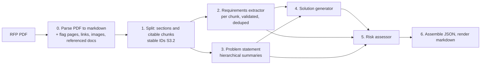

# RFP solution-summary generator

An agentic LangGraph pipeline that reads an RFP (request for proposal) PDF and produces a
structured solution summary: the requirements it imposes, the problem it is really
asking to solve, a proposed approach, and the risks. Every factual claim in the output
cites the chunk of the RFP it came from, so the summary can be checked against the
source. The repo includes an evaluation harness and per-run observability (tokens,
latency, cost).

**Status:** scaffold (S0), LLM layer with observability (S1), PDF parsing (S2),
section and chunk splitting (S3), parse-quality pass (S4), renderer (S9) and gold labels
(S11). The pipeline lands step by step; see `docs/ROADMAP.md`.

## Pipeline



Generator: DeepSeek by default. Eval judge: Claude. Provider and model are one setting
(`RFP_MODEL=<provider>:<model_id>`), so any LangChain-supported model can be swapped in.
JSON is the source of truth; markdown is rendered from it by code, never by an LLM.

## Quickstart

```bash
conda create -n rfp-solution-gen python=3.12 -y
conda activate rfp-solution-gen
pip install -r requirements.txt          # also installs the package in editable mode
cp .env.example .env                     # then fill in DEEPSEEK_API_KEY (and ANTHROPIC_API_KEY for evals)
pytest                                   # unit tests; nothing here calls a paid API
pytest --update-golden                   # rewrite golden files after an intended render change
```

Run the pipeline on the default brief (lands in step S10):

```bash
python -m rfp_agent run inputs/rfp_brief.pdf
```

Outputs go to `runs/<run_id>/`: `summary.json` (the source of truth), `summary.md`
(rendered from the JSON by code) and a run log with per-node tokens, latency and cost.
Citations in the markdown read `(Section title, p. 4 [S3.2])`; the bracketed chunk ID
is the key into the JSON. A sample rendering lives in `tests/fixtures/summary_sample.md`. Langfuse tracing turns on automatically when `LANGFUSE_*` keys are set
and is a no-op otherwise.

## Parsing

`rfp_agent.parsing.parse_pdf(path)` turns a PDF into a `ParsedDocument`: markdown per
page (tables kept as markdown tables, running headers and footers removed, quotes and
spaces normalised), the PDF outline, tables, images with captions, every http(s) link and
every Attachment/Appendix/Exhibit/Schedule/Addendum reference with its section and
whether its content is in the PDF, and page flags (low word count, large image, broken
table, fragmented lines) for the parse-quality pass. No LLM is involved. To inspect it:

```bash
python -m rfp_agent.parsing data/rfps/colfax.pdf --out colfax.json
```

### Parse-quality pass

The flags are suspicions. `rfp_agent.parsing.quality.run_quality_pass(parsed)` sends each
flagged page to the generator model once (prompt `prompts/parse_quality.md`), which says
whether the text is usable and whether content is missing (for example a table that is
only an image). Code then clears false alarms, keeps confirmed flags, and records an
escalation per page in the run log, noting whether a heuristic (`code`) or the judge
(`model`) found the problem. Confirmed-bad pages go to a VLM hook that, in core, only
records "would escalate to VLM". A judge failure keeps the page's flags. On the four RFPs
it clears 9 of 12 flagged pages and escalates Missouri p19 and p20 and Federal Way p5,
for about half a cent in total. To see the verdicts (paid, needs `DEEPSEEK_API_KEY`):

```bash
python -m rfp_agent.parsing data/rfps/federal_way.pdf --judge --out federal_way.json
```

## Splitting

`rfp_agent.splitting.split_document(parsed)` turns a `ParsedDocument` into a
`SplitDocument`: one section per heading of the RFP, each cut into citable chunks.
Headings come from the PDF outline when there is one (located in the page text, including
bold labels that open a paragraph such as `**(A) Services:** ...`), from markdown
headings otherwise, plus bold lines numbered like an existing heading ("SECTION 4" after
"SECTION 3"). Chunks hold at most 300 words, cut at paragraphs (sentences only inside an
over-long paragraph), never inside a table, and each chunk repeats the last sentence of
the previous one. IDs are stable: `S7` is the seventh section in document order and
`S7.2` its second chunk, so the same PDF always gives the same citations. Each section is
tagged `requirement_bearing` or `narrative` by obligation cues ("shall", "must",
"Describe ..."). No LLM is involved. To inspect it:

```bash
python -m rfp_agent.splitting data/rfps/federal_way.pdf --out federal_way_split.json
```

## Configuration

All settings live in `.env` (see `.env.example`); `RFP_*` variables override defaults.

| Variable | Default | Meaning |
|---|---|---|
| `RFP_MODEL` | `deepseek:deepseek-flash` | generator, `<provider>:<model_id>` |
| `RFP_JUDGE_MODEL` | `anthropic:claude-sonnet-5-5` | eval judge |
| `RFP_TEMPERATURE` | `0` | sent to every provider except Anthropic |
| `RFP_MAX_STRUCTURED_RETRIES` | `2` | retries after a schema validation failure |
| `RFP_MAX_OUTPUT_TOKENS` | provider default | output cap per call |
| `RFP_REQUEST_TIMEOUT_S` | `120` | per-request timeout |
| `RFP_LLM_TRANSPORT_RETRIES` | `2` | SDK retries on 429, 5xx and connection errors |
| `RFP_DEEPSEEK_THINKING` | `false` | DeepSeek thinking mode (structured output switches to JSON mode when on) |

## Observability

Every LLM call goes through `structured_call` in `src/rfp_agent/llm.py`, which records
one entry per call (node, model, input, output and cached tokens, cost from the pricing
table in `config.py`, latency, retries) into the run's log. The log also holds the model,
temperature and the SHA-256 of every prompt file used, and is written to
`runs/<run_id>/run_log.json` even when a run fails. Langfuse tracing is added as a
LangChain callback when `LANGFUSE_PUBLIC_KEY` and `LANGFUSE_SECRET_KEY` are set, and is
off otherwise.

Live smoke tests against the real APIs are skipped by default:

```bash
pytest -m llm      # needs DEEPSEEK_API_KEY and/or ANTHROPIC_API_KEY in .env
```

## Inputs

No RFP brief was provided with the assignment, so public US government RFPs stand in
(`data/rfps/`). The default input `inputs/rfp_brief.pdf` is Missouri DOT TR202504
("Using AI/ML to Write Legal Land Descriptions"). Three more RFPs form the eval set.
See `docs/ASSUMPTIONS.md`.

### Gold labels

`evals/gold/` holds reference labels for the four RFPs: core requirements and a
12-fact problem-statement checklist per RFP, drafted by Claude and corrected by hand
(19 to 26% of drafted requirements corrected). Format, workflow and the correction table
are in `evals/gold/README.md`.

```bash
python -m evals.gold.label check --all   # every gold quote is in the parsed text
python -m evals.gold.label diff --all    # draft vs final correction table
```

## Repository layout

```
src/rfp_agent/
  config.py        provider/model setting, paths, pricing table
  schemas.py       Pydantic v2 contract between every pipeline stage
  parsing/         PDF to markdown, page flags, referenced documents (S2), quality pass (S4)
  splitting/       sections and citable chunks with stable IDs (S3)
  agents/          requirements, problem, solution, risk (S5 to S8)
  render/          JSON assembly and markdown rendering (S9)
prompts/           one markdown prompt per agent
tests/             pytest; `@pytest.mark.llm` tests are skipped by default
evals/             gold labels, harness, results (S11 to S13)
runs/samples/      committed sample run outputs
docs/              ROADMAP, DECISIONS, ASSUMPTIONS, TIMELOG, PROMPTS
```

## Documentation

- `docs/ROADMAP.md`: the plan, step by step, with what was done in each.
- `docs/DECISIONS.md`: trade-offs and failure modes, with evidence.
- `docs/ASSUMPTIONS.md`: everything the assignment did not state.
- `docs/PROMPTS.md`: prompt design notes and changelog.
- `docs/TIMELOG.md`: hours per deliverable.
