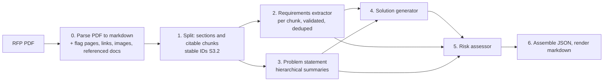

# RFP solution-summary generator

An agentic LangGraph pipeline that reads an RFP (request for proposal) PDF and produces a
structured solution summary: the requirements it imposes, the problem it is really
asking to solve, a proposed approach, and the risks. Every factual claim in the output
cites the chunk of the RFP it came from, so the summary can be checked against the
source. The repo includes an evaluation harness and per-run observability (tokens,
latency, cost).

**Status:** scaffold (S0), LLM layer with observability (S1), PDF parsing (S2),
section and chunk splitting (S3), parse-quality pass (S4), requirements extractor
(S5), problem statement (S6), solution generator (S7), risk assessor (S8),
renderer (S9), the end-to-end graph and CLI (S10), gold labels (S11), the evaluation
harness with baseline results (S12), the UI backend (S14) and the UI frontend (S15).
Sample outputs for the four RFPs are under `runs/samples/`, eval results under
`evals/results/baseline/`. Next: ablations and fixes driven by the evals (S13); see
`docs/ROADMAP.md`.

## Pipeline



Generator: DeepSeek by default. Eval judge: Claude. Provider and model are one setting
(`RFP_MODEL=<provider>:<model_id>`), so any LangChain-supported model can be swapped in.
JSON is the source of truth; markdown is rendered from it by code, never by an LLM.

## Quickstart

```bash
conda create -n rfp-solution-gen python=3.12 -y
conda activate rfp-solution-gen
pip install -r requirements.txt          # also installs the package in editable mode
cp .env.example .env                     # then fill in DEEPSEEK_API_KEY (and ANTHROPIC_API_KEY for evals)
pytest                                   # unit tests; nothing here calls a paid API
pytest --update-golden                   # rewrite golden files after an intended render change
```

Run the pipeline on the default brief:

```bash
python -m rfp_agent run inputs/rfp_brief.pdf
```

Outputs go to `runs/<run_id>/`: `summary.json` (the source of truth), `summary.md`
(rendered from the JSON by code), `run_log.json` (per-call tokens, latency and cost,
per-stage wall time) and every intermediate (`parsed.json`, `quality.json`,
`split.json`, `requirements.json` and its report, `problem.json`, `solution.json`,
`risks.json`), each written as its stage finishes so a failed run keeps what it had.
Citations in the markdown read `(Section title, p. 4 [S3.2])`; the bracketed chunk ID
is the key into the JSON. Committed samples for the four RFPs live under
`runs/samples/<rfp>/`. Langfuse tracing turns on automatically when `LANGFUSE_*` keys
are set and is a no-op otherwise.

## Running the pipeline

`python -m rfp_agent run <pdf>` runs the graph below: parse, judge the flagged pages,
split, then requirements extraction and the problem statement in parallel, then the
solution, the risks, and the assembled summary. The CLI prints one line per stage as it
starts and finishes (wall time, LLM calls, cost), then a per-stage table, a per-node
table and the run totals.

| Flag | Effect |
|---|---|
| `--full-text-problem` | ablation: problem statement from one full-text call (`RFP_FULL_TEXT_PROBLEM`) |
| `--single-call-extraction` | ablation: one extraction call over the whole document (`RFP_SINGLE_CALL_EXTRACTION`) |
| `--max-iterations N` | solution rounds for this run (`RFP_SOLUTION_MAX_ITERATIONS`) |
| `--model provider:id` | generator for this run (`RFP_MODEL`) |
| `--runs-dir DIR`, `--run-id ID` | where the run directory goes (default `runs/<timestamp-hex>/`) |
| `-v` | log every failed structured-output attempt and its feedback |

Exit codes: 0 on success, 1 when a stage fails (the run log and the intermediates
written so far are kept, and the failing stage is named), 2 when the provider key is
missing. The graph is importable too: `rfp_agent.graph.run_pipeline(pdf, on_event=...)`
calls back with a `StageEvent` (`started`, `finished`, `failed`, wall time, the stage's
calls and cost) from each node, which is what the UI backend streams. Per-agent debug
commands with JSON reuse of upstream outputs live in `python -m rfp_agent.agents`.

## UI

A browser UI over the pipeline. Upload an RFP and watch each stage run live, with
per-stage time, calls, tokens and cost. Then read the proposed solution, the
requirements (filterable by type and strictness), the risks (sorted by severity),
the problem statement, the parse and chunk views, and a metrics dashboard. Click
any chunk, requirement, component or risk ID to open its source: the cited chunk
with the verbatim quote highlighted, and the PDF at that page. The four samples
need no API key.

```
# once: build the frontend (Node 20+)
cd ui/frontend && npm ci && npm run build && cd ../..
python -m ui.backend --port 8000          # UI and API on http://127.0.0.1:8000

# or, while editing the frontend: two terminals
python -m ui.backend --port 8000
cd ui/frontend && npm run dev             # http://localhost:5173, proxies /api
```

Frontend checks: `npm run typecheck`, `npm test` (Vitest) and `npm run build` in
`ui/frontend`, also run in CI.

### UI backend

`python -m ui.backend --port 8000` serves a FastAPI app over the same pipeline. It
uploads a PDF, runs it on one worker thread (later uploads wait as `queued`), and
streams every stage event over SSE. It also serves each intermediate output, the
rendered markdown, downloads, the source PDF and a chunk lookup for source reveal. The
four committed samples are listed as runs (`missouri`, `nyesd`, `colfax`,
`federal_way`), so the UI works without an API key. The full API contract is in
`ui/backend/README.md`, and OpenAPI docs are at `/docs`.

```
python -m ui.backend --port 8000
curl -F file=@data/rfps/federal_way.pdf http://127.0.0.1:8000/api/runs   # -> {"run_id": ...}
curl -N http://127.0.0.1:8000/api/runs/<run_id>/events                    # live stage events
curl http://127.0.0.1:8000/api/runs/missouri/chunks/S1.1                  # a cited chunk
```

The upload form takes the CLI's options as fields: `model`, `full_text_problem`,
`single_call_extraction` and `max_iterations`. A missing provider key returns 503
before anything is written. When `ui/frontend/dist` exists, the same process serves the
built frontend. `--reload` is for development only, because a reload loses a run that
is in flight.

## Parsing

`rfp_agent.parsing.parse_pdf(path)` turns a PDF into a `ParsedDocument`: markdown per
page (tables kept as markdown tables, running headers and footers removed, quotes and
spaces normalised), the PDF outline, tables, images with captions, every http(s) link and
every Attachment/Appendix/Exhibit/Schedule/Addendum reference with its section and
whether its content is in the PDF, and page flags (low word count, large image, broken
table, fragmented lines) for the parse-quality pass. No LLM is involved. To inspect it:

```bash
python -m rfp_agent.parsing data/rfps/colfax.pdf --out colfax.json
```

### Parse-quality pass

The flags are suspicions. `rfp_agent.parsing.quality.run_quality_pass(parsed)` sends each
flagged page to the generator model once (prompt `prompts/parse_quality.md`), which says
whether the text is usable and whether content is missing (for example a table that is
only an image). Code then clears false alarms, keeps confirmed flags, and records an
escalation per page in the run log, noting whether a heuristic (`code`) or the judge
(`model`) found the problem. Confirmed-bad pages go to a VLM hook that, in core, only
records "would escalate to VLM". A judge failure keeps the page's flags. On the four RFPs
it clears 9 of 12 flagged pages and escalates Missouri p19 and p20 and Federal Way p5,
for about half a cent in total. To see the verdicts (paid, needs `DEEPSEEK_API_KEY`):

```bash
python -m rfp_agent.parsing data/rfps/federal_way.pdf --judge --out federal_way.json
```

## Splitting

`rfp_agent.splitting.split_document(parsed)` turns a `ParsedDocument` into a
`SplitDocument`: one section per heading of the RFP, each cut into citable chunks.
Headings come from the PDF outline when there is one (located in the page text, including
bold labels that open a paragraph such as `**(A) Services:** ...`), from markdown
headings otherwise, plus bold lines numbered like an existing heading ("SECTION 4" after
"SECTION 3"). Chunks hold at most 300 words, cut at paragraphs (sentences only inside an
over-long paragraph), never inside a table, and each chunk repeats the last sentence of
the previous one. IDs are stable: `S7` is the seventh section in document order and
`S7.2` its second chunk, so the same PDF always gives the same citations. Each section is
tagged `requirement_bearing` or `narrative` by obligation cues ("shall", "must",
"Describe ..."). No LLM is involved. To inspect it:

```bash
python -m rfp_agent.splitting data/rfps/federal_way.pdf --out federal_way_split.json
```

## Requirements extraction

`rfp_agent.agents.requirements.extract_requirements(split, title=...)` turns a
`SplitDocument` into a `RequirementsOutput` (requirements, ambiguities, gaps) plus a
`RequirementsReport`. One structured LLM call per chunk (`RFP_LLM_CONCURRENCY` in
parallel, default 4) returns core requirements with type, strictness and a verbatim
quote; code looks every quote up in the chunk, gives the model one turn to fix the ones
it cannot find, and keeps the rest flagged `quote_verified=false`. Code assigns the
`R001` IDs, cites the chunk, folds exact duplicates (the one-sentence chunk overlap
produces them), then one grouping call names near-duplicates and contradictions; code
checks the answer (every ID exists, none in two groups), feeds violations back once,
sanitises what remains and merges: the representative keeps its text and quote, chunk
IDs are unioned, the stricter strictness wins, absorbed IDs sit in `merged_from`.
Contradictions are flagged on both items (`conflicts_with`) and listed as ambiguities,
never merged. Gaps are documents the RFP points at but does not contain (Colfax
Attachments F and G). The scope is the gold scope: core requirements, no generic
contract boilerplate. `RFP_SINGLE_CALL_EXTRACTION=true` (or `--single-call`) runs one
call over the whole document instead, the eval baseline. To inspect it (paid, a few
cents per RFP):

```bash
python -m rfp_agent.agents requirements data/rfps/colfax.pdf --out colfax_requirements.json
## Problem statement

`rfp_agent.agents.problem.build_problem_statement(split, title=...)` writes the part of
the summary that says what the client is asking for and why: four lists of one-sentence
claims (client situation, goal, success criteria, constraints), each citing the chunk IDs
that support it and labelled `fact` or `inference`. Two paths:

- **Hierarchical** (default): one call per chunk (prompt `prompts/problem_chunk.md`,
  `RFP_LLM_CONCURRENCY` calls at a time) returns whether the chunk is relevant and a
  compact factual summary; code attaches the chunk ID. One synthesis call
  (`prompts/problem_synthesis.md`) then sees only the relevant summaries, labelled with
  their IDs. The synthesis output schema rejects an empty list or a citation that was not
  in the evidence, so the validation error goes back to the model and the call is
  retried; after the retry budget the node fails rather than keep an unverifiable claim.
- **Full text** (`RFP_FULL_TEXT_PROBLEM=true`, the S13 ablation): the same synthesis
  prompt over the full text of every chunk with the same labels.

On the four RFPs the hierarchical path costs $0.01 to $0.04 and 30 to 60 s on DeepSeek
Flash, the full-text call $0.004 to $0.008 and about 10 s; both mention every fact of the
gold checklists that the parsed text contains. To run one agent on its own (paid):

```bash
python -m rfp_agent.agents problem data/rfps/colfax.pdf --out colfax_problem.json
python -m rfp_agent.agents -v problem data/rfps/colfax.pdf --full-text   # -v logs retries
```

## Solution generator

`rfp_agent.agents.solution.build_solution(requirements, problem_statement, title=...)`
writes the proposed approach: a short summary, four to ten components that each cite
the requirement IDs they satisfy, and the assumptions the design takes where the RFP is
ambiguous or incomplete. The model sees the problem statement, the requirements (one
line each), the ambiguities and the gaps, never the RFP text (prompt
`prompts/solution.md`), so it can only cite requirement IDs from the list and chunk IDs
labelled in those inputs; the output schema rejects anything else inside the retry.

Coverage is computed by code, not reported by the model: the share of mandatory
requirements (type `submission` excluded) cited by at least one component. A small
LangGraph loop generates, checks coverage, and when mandatory requirements are left
uncovered feeds their IDs and text back for a revision in the same conversation, up to
`RFP_SOLUTION_MAX_ITERATIONS` rounds (default 3). The draft with the fewest uncovered
requirements is kept and the rest are listed in `coverage.uncovered_requirement_ids`
for the risk assessor. Component IDs `C01…` are assigned by code.

On the four RFPs: 9 to 10 components, full mandatory coverage after one or two rounds,
$0.007 to $0.013 and 20 to 35 s per RFP on DeepSeek Flash. To run it on its own
(paid; without the JSON options it runs the extractor and the problem statement first):

```bash
python -m rfp_agent.agents solution data/rfps/colfax.pdf \
    --requirements colfax_requirements.json --problem colfax_problem.json --out colfax_solution.json
python -m rfp_agent.agents -v solution data/rfps/colfax.pdf --max-iterations 1   # no revision round
```

## Risk assessor

`rfp_agent.agents.risk.build_risks(requirements, problem_statement, solution,
title=..., referenced_documents=parsed.referenced_documents, flags=parsed.flags)`
writes the risks: six to twelve entries, each with a severity and a likelihood (`low`,
`medium`, `high`), a justification, the requirement and chunk IDs it relates to, a
`source` (`rfp` for what the RFP itself carries, `solution` for what the proposed
approach creates) and a mitigation. The model sees the solution, the problem statement,
the requirements, the ambiguities and the gaps, never the RFP text (prompt
`prompts/risk.md`).

Before the call, code computes a findings block the model must work from: the mandatory
requirements the solution left uncovered, the requirement conflicts S5 flagged, the
referenced documents the parser marked absent, the parse flags that survived the
quality pass, and how many budget requirements exist. The output schema rejects, inside
the retry, fewer than 3 or more than 15 risks, any unknown ID, and a draft in which an
uncovered mandatory requirement is cited by no risk. Code then sorts by severity and
likelihood and numbers the risks `K01…`, so K01 is the top risk in both the JSON and the
rendered table.

Scales: severity is the impact if the risk happens (`high`: the project fails, misses a
contractual date or overruns budget by more than a quarter; `medium`: rework or cost
that contingency absorbs; `low`: normal delivery); likelihood is the chance given the
RFP and the solution as written (`high`: expected unless someone acts; `medium`: turns
on facts the RFP does not settle; `low`: an unusual event).

On the four RFPs: 12 to 13 risks, one call, no validator retry, $0.007 to $0.011 and
about 20 s per RFP on DeepSeek Flash. To run it on its own (paid; it runs the
parse-quality pass first and, without the JSON options, S5, S6 and S7 too):

```bash
python -m rfp_agent.agents risk data/rfps/colfax.pdf --requirements colfax_requirements.json \
    --problem colfax_problem.json --solution colfax_solution.json --out colfax_risks.json
```

## Configuration

All settings live in `.env` (see `.env.example`); `RFP_*` variables override defaults.

| Variable | Default | Meaning |
|---|---|---|
| `RFP_MODEL` | `deepseek:deepseek-flash` | generator, `<provider>:<model_id>` |
| `RFP_JUDGE_MODEL` | `anthropic:claude-sonnet-5-5` | eval judge |
| `RFP_TEMPERATURE` | `0` | sent to every provider except Anthropic |
| `RFP_MAX_STRUCTURED_RETRIES` | `2` | retries after a schema validation failure |
| `RFP_MAX_OUTPUT_TOKENS` | provider default | output cap per call |
| `RFP_REQUEST_TIMEOUT_S` | `120` | per-request timeout |
| `RFP_LLM_TRANSPORT_RETRIES` | `2` | SDK retries on 429, 5xx and connection errors |
| `RFP_DEEPSEEK_THINKING` | `false` | DeepSeek thinking mode (structured output switches to JSON mode when on) |
| `RFP_LLM_CONCURRENCY` | `4` | parallel calls in per-chunk stages (requirement extraction, problem-statement summaries) |
| `RFP_FULL_TEXT_PROBLEM` | `false` | problem statement from one full-text call instead of per-chunk summaries (ablation) |
| `RFP_SINGLE_CALL_EXTRACTION` | `false` | requirements from one call over the whole document instead of per chunk plus dedupe (ablation) |
| `RFP_SOLUTION_MAX_ITERATIONS` | `3` | solution rounds: one generation plus revisions while mandatory requirements are uncovered; `1` disables revision |

## Observability

Every LLM call goes through `structured_call` in `src/rfp_agent/llm.py`, which records
one entry per call (node, model, input, output and cached tokens, cost from the pricing
table in `config.py`, latency, retries) into the run's log. The log also holds the model,
temperature and the SHA-256 of every prompt file used, plus one `stages` entry per
graph node (status, wall time, error text on failure), and is written to
`runs/<run_id>/run_log.json` even when a run fails. A stage's LLM calls are the nodes
whose name starts with the stage's prefix (`requirements_`, `problem_`, `solution_`,
`risk_`, `parse_quality`). Langfuse tracing is added as a
LangChain callback when `LANGFUSE_PUBLIC_KEY` and `LANGFUSE_SECRET_KEY` are set, and is
off otherwise.

Live smoke tests against the real APIs are skipped by default:

```bash
pytest -m llm      # needs DEEPSEEK_API_KEY and/or ANTHROPIC_API_KEY in .env
```

## Inputs

No RFP brief was provided with the assignment, so public US government RFPs stand in
(`data/rfps/`). The default input `inputs/rfp_brief.pdf` is Missouri DOT TR202504
("Using AI/ML to Write Legal Land Descriptions"). Three more RFPs form the eval set.
See `docs/ASSUMPTIONS.md`.

### Gold labels

`evals/gold/` holds reference labels for the four RFPs: core requirements and a
12-fact problem-statement checklist per RFP, drafted by Claude and corrected by hand
(19 to 26% of drafted requirements corrected). Format, workflow and the correction table
are in `evals/gold/README.md`.

```bash
python -m evals.gold.label check --all   # every gold quote is in the parsed text
python -m evals.gold.label diff --all    # draft vs final correction table
```

## Evaluation

`evals/harness/` scores pipeline runs against the gold labels with code checks first and
a Claude judge second (`RFP_JUDGE_MODEL`, needs `ANTHROPIC_API_KEY`). Per run it
measures:

- **Requirements:** recall against gold (code match, then the judge for the rest),
  precision and scope of every extracted item by the judge, and type and strictness
  accuracy.
- **Grounding:** every cited claim, assumption and risk is checked against only the text
  it cites. Code checks IDs, numbers and names; the judge rates each item supported,
  partially or unsupported.
- **Problem statement:** checklist coverage of the 12 gold facts.
- **Solution:** cited and judged coverage of mandatory requirements, plus a rubric for
  specificity, feasibility and consistency.
- **Risks:** severity and likelihood re-rated blind, and coverage of the code findings.
- **Cost and latency:** per stage from the run log, with each retry's cause.

Across runs it reports consistency, a pairwise A/B judge for ablations, and judge
agreement with a hand-labelled sample.

```bash
python -m evals.harness run --label baseline --all --runs 2 --reuse-samples  # paid, ~$0.60
python -m evals.harness score --label baseline            # judge, ~$5 for 12 runs
python -m evals.harness score --label baseline --no-judge # code metrics only, free
python -m evals.harness report --label baseline           # summary.md and summary.json
python -m evals.harness compare RUN_A RUN_B --what problem --rfp missouri   # pairwise
```

Baseline (`evals/results/baseline/summary.md`): three runs per RFP, recall 80 to 100%,
with 61 to 94% matched by code alone. Federal Way's lower figure is its image-only page 5;
reachable recall is 93 to 96%. Precision is 95 to 99%, checklist coverage 67 to 92%,
and judged coverage of mandatory requirements 70 to 100% against 100% cited. The judge
agrees with 34 of 40 hand labels. How to read every column is in
`evals/results/README.md`.

## Repository layout

```
src/rfp_agent/
  config.py        provider/model setting, paths, pricing table
  schemas.py       Pydantic v2 contract between every pipeline stage
  graph.py         the LangGraph pipeline: stage wrappers, events, run_pipeline (S10)
  cli.py           `python -m rfp_agent run <pdf>` (S10)
  parsing/         PDF to markdown, page flags, referenced documents (S2), quality pass (S4)
  splitting/       sections and citable chunks with stable IDs (S3)
  agents/          requirements extractor with dedupe (S5), problem (S6), solution
                   with its coverage loop (S7), risk assessor (S8); `python -m rfp_agent.agents` debug CLI
  textmatch.py     quote matching tolerant of markdown and typography (S5, gold labels)
  render/          JSON assembly and markdown rendering (S9)
prompts/           one markdown prompt per agent
tests/             pytest; `@pytest.mark.llm` tests are skipped by default
evals/gold/        gold labels and the labelling script (S11)
evals/harness/     eval harness: `python -m evals.harness` (S12)
evals/results/     committed eval results, one directory per label (S12, S13)
runs/samples/      committed end-to-end outputs for the four RFPs (S10)
ui/backend/        FastAPI app: uploads, run queue, SSE events, run outputs (S14)
ui/frontend/       Vite + React + TypeScript + Tailwind UI (S15)
docs/              ROADMAP, DECISIONS, ASSUMPTIONS, TIMELOG, PROMPTS
```

## Documentation

- `docs/ROADMAP.md`: the plan, step by step, with what was done in each.
- `docs/DECISIONS.md`: trade-offs and failure modes, with evidence.
- `docs/ASSUMPTIONS.md`: everything the assignment did not state.
- `docs/PROMPTS.md`: prompt design notes and changelog.
- `docs/TIMELOG.md`: hours per deliverable.
