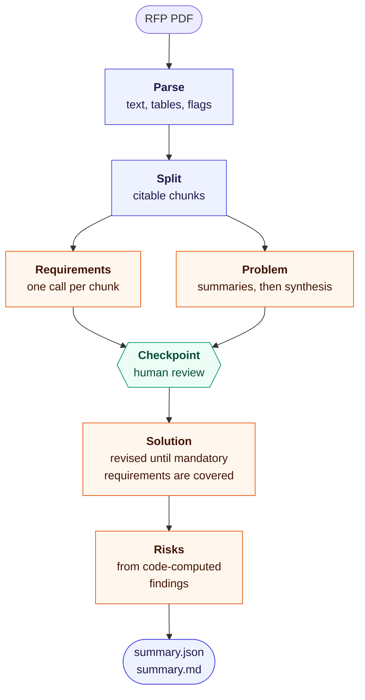
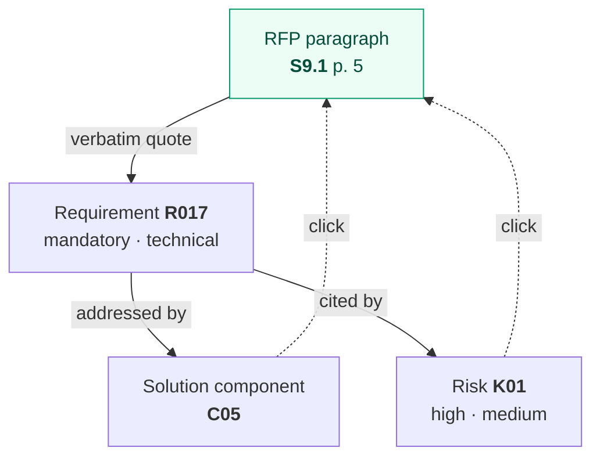
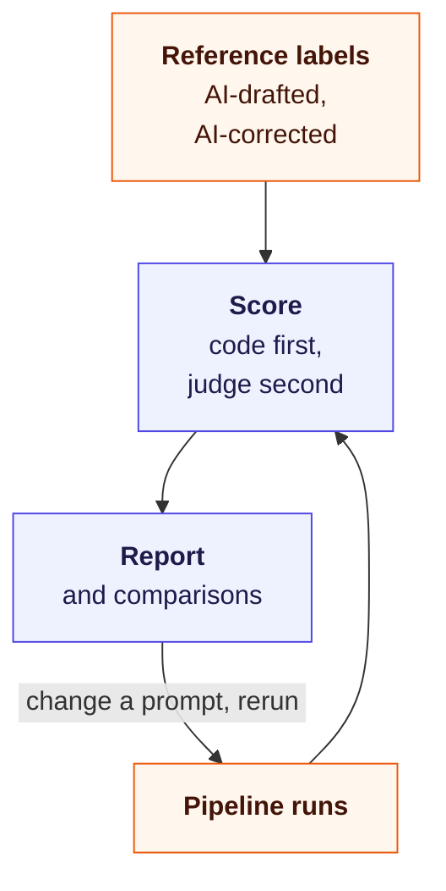
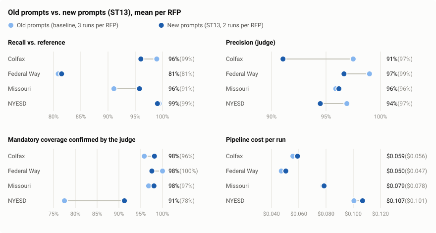
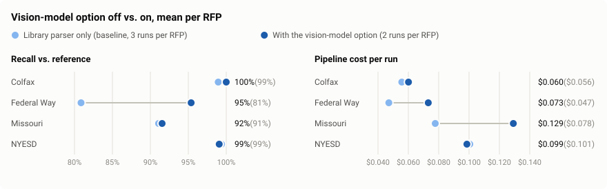

# RFP solution-summary generator

Drop in an RFP (request for proposal) PDF. A minute or two and a few cents later you get
the **requirements** it imposes, the **problem** behind it, a proposed **solution** and
the **risks**. Every claim links back to the paragraph of the RFP it came from, so a bid
team can check it with one click instead of rereading the whole document.

## How it works

Blue stages are plain code; orange stages call the model, and code checks every answer
(quotes must appear in the source, cited IDs must exist, coverage is counted) before
anything is kept. At the green checkpoint a pursuit lead confirms the requirement list
and adds a brief (win themes, capabilities, what the client said outside the RFP), which
the draft can cite like the RFP itself. After the draft, the lead asks for changes in
plain words, regenerates what went stale and signs off; every version is kept with its
diff. Details: [PIPELINE.md](docs/PIPELINE.md) and
[USAGE.md](docs/USAGE.md#refine-and-sign-off).

## Why you can trust a claim

IDs are assigned by code and stable for a given PDF. The UI turns every ID into a link
to the cited paragraph, with the quote highlighted and the PDF open at that page, and the
evaluation counts claims the cited text does not support.

## How it is evaluated

An evaluation harness runs the pipeline on four public RFPs, several times each, and
scores every output against reference answers. It exists so that a prompt or model
change is judged by numbers, not by reading a few outputs.

- **What is measured.** Whether it finds the requirements that matter (recall) and lists
  only real ones (precision), whether the problem statement contains the facts it must,
  whether each claim is supported by the text it cites, whether the solution covers every
  mandatory requirement, whether the risks are rated sensibly, and the cost and time of
  every stage.
- **How.** Code checks first: quotes are verbatim, so matching and ID checks are exact
  and free. A judge model handles only what code cannot, such as paraphrases or whether a
  description really meets a requirement.
- **Why that judge.** DeepSeek generates and Claude judges, so the judge never grades its
  own model family. A sample of the judge's verdicts is labelled independently to measure
  how often it agrees.
- **Where the ground truth comes from.** Claude drafted the reference labels, code
  dropped any label whose quote is not in the RFP, and the AI coding agent that built the
  project corrected every item against the full text; the author spot-checked. The
  judge-agreement sample was also labelled by the agent. **In a real project a human
  expert would make these labels**; here the 36-hour budget ruled that out, so the
  untouched drafts are committed next to the final labels and the correction is a
  recorded diff. The scores therefore measure agreement with a careful AI reading of each
  RFP, not with a procurement specialist.

The full method, its limits and every report: [EVALUATION.md](docs/EVALUATION.md).

## Results

Both charts are drawn by the harness from the committed reports; exact figures are in
[`evals/results/`](evals/results/README.md).

Every prompt was rewritten into one documented structure
([`prompts/README.md`](prompts/README.md)). The effect is neutral to slightly positive:
recall and judged coverage move by RFP, mostly within run-to-run spread, precision dips,
mostly because the rewritten judge is stricter, and cost rises a little with longer
instructions
([PROMPTS.md](docs/PROMPTS.md#st13-comparison)).

Federal Way's table of systems to replace is an image the library parser cannot read.
The vision-model option re-renders such pages, which closes most of that recall gap for
a few cents more; the other RFPs are unchanged.

## Run it

Run every command from the repository folder. They work the same in Windows `cmd`,
PowerShell and bash unless a line says otherwise.

**With Docker** (nothing else to install):

1. Copy `.env.example` to a new file named `.env` and fill in your DeepSeek key.
2. `docker build -t rfp-agent .`
3. Start it, with the line for your shell:
   - Windows `cmd`: `docker run --rm -p 8000:8000 --env-file .env -v "%cd%/runs:/app/runs" rfp-agent`
   - PowerShell: `docker run --rm -p 8000:8000 --env-file .env -v "${PWD}/runs:/app/runs" rfp-agent`
   - macOS or Linux: `docker run --rm -p 8000:8000 --env-file .env -v "$PWD/runs:/app/runs" rfp-agent`
4. Open <http://127.0.0.1:8000>

**Without Docker** (Python 3.12 via conda, and Node 20+):

1. `conda create -n rfp-solution-gen python=3.12 -y`
2. `conda activate rfp-solution-gen`
3. `pip install -r requirements.txt`
4. Copy `.env.example` to a new file named `.env` and fill in your DeepSeek key.
5. `cd ui/frontend`, then `npm ci`, then `npm run build`, then `cd ../..`
6. `python -m ui.backend`
7. Open <http://127.0.0.1:8000>

Four public RFPs are already loaded as samples and need no key, so the key step can wait
until you run your own PDF. The CLI, development mode, the API and the evals are in
[USAGE.md](docs/USAGE.md).

### Using the UI

1. **Drop an RFP PDF** on the start page, or open one of the four samples. The defaults
   are fine; tick `vlm` if the PDF has tables or forms that are images. **Remove** at the
   end of a row deletes one of your runs.
2. **Review at the checkpoint.** Reject or reclassify requirements, write the pursuit
   brief, then **Confirm and draft**. Tick "unattended" on upload to skip this.
3. **Watch it run.** The left rail shows each stage with its time, calls and cost.
4. **Read the result** in the tabs below, starting with Solution. Click any ID such as
   `R017`, `C05`, `K01` or `S9.1` to open the cited paragraph and the PDF at that page.
5. **Refine and sign off.** Each tab has "Suggest edits" and a version bar; the Review
   tab signs off and shows the whole history.
6. **Download** `summary.md` or `summary.json` from the header. Every run stays in the
   list.

| Tab | What you see |
|---|---|
| **Solution** | The proposed approach: components, the requirements each addresses, assumptions, and mandatory coverage. |
| **Requirements** | Every requirement with its type and strictness, plus ambiguities and documents the RFP refers to but does not include. |
| **Risks** | Risks ranked by severity and likelihood, each with a justification and a mitigation. |
| **Problem** | What the client is really asking for, each point marked fact or inference. |
| **Parse & chunks** | The RFP as the pipeline read it: pages, flagged pages, sections and citable chunks. |
| **Metrics** | Cost, tokens, retries and time per stage and per model call. |
| **Checkpoint, Review** | The human review: requirement decisions, the brief, revisions and sign-off. |

## Read more

| Doc | What it answers |
|---|---|
| [USAGE.md](docs/USAGE.md) | Every way to run it: CLI and flags, UI dev mode, API, Docker, evals, troubleshooting |
| [PIPELINE.md](docs/PIPELINE.md) | What each stage does, what code checks, settings, observability |
| [EVALUATION.md](docs/EVALUATION.md) | What is measured, how, the ground truth and its limits, every report |
| [DECISIONS.md](docs/DECISIONS.md) | Why it is built this way, with the evidence, and the failure modes hit |
| [PROMPTS.md](docs/PROMPTS.md) | Design notes and changelog for every prompt |
| [ASSUMPTIONS.md](docs/ASSUMPTIONS.md) | Everything the brief did not state |
| [REPOSITORY.md](docs/REPOSITORY.md) | Where each part of the code lives |
| [ROADMAP.md](docs/ROADMAP.md) | How it was built, step by step |
