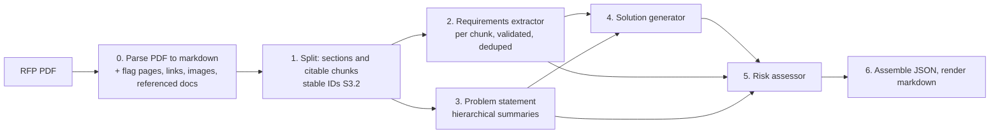

# RFP solution-summary generator

An agentic LangGraph pipeline that reads an RFP (request for proposal) PDF and produces a
structured solution summary: the requirements it imposes, the problem it is really
asking to solve, a proposed approach, and the risks. Every factual claim in the output
cites the chunk of the RFP it came from, so the summary can be checked against the
source. The repo includes an evaluation harness and per-run observability (tokens,
latency, cost).

**Status:** scaffold (S0) and PDF parsing (S2) are in. The pipeline lands step by
step; see `docs/ROADMAP.md`.

## Pipeline



Generator: DeepSeek by default. Eval judge: Claude. Provider and model are one setting
(`RFP_MODEL=<provider>:<model_id>`), so any LangChain-supported model can be swapped in.
JSON is the source of truth; markdown is rendered from it by code, never by an LLM.

## Quickstart

```bash
conda create -n rfp-solution-gen python=3.12 -y
conda activate rfp-solution-gen
pip install -r requirements.txt          # also installs the package in editable mode
cp .env.example .env                     # then fill in DEEPSEEK_API_KEY (and ANTHROPIC_API_KEY for evals)
pytest                                   # unit tests; nothing here calls a paid API
```

Run the pipeline on the default brief (lands in step S10):

```bash
python -m rfp_agent run inputs/rfp_brief.pdf
```

Outputs go to `runs/<run_id>/` as JSON, markdown and a run log with per-node tokens,
latency and cost. Langfuse tracing turns on automatically when `LANGFUSE_*` keys are set
and is a no-op otherwise.

## Parsing

`rfp_agent.parsing.parse_pdf(path)` turns a PDF into a `ParsedDocument`: markdown per
page (tables kept as markdown tables, running headers and footers removed, quotes and
spaces normalised), the PDF outline, tables, images with captions, every http(s) link and
every Attachment/Appendix/Exhibit/Schedule/Addendum reference with its section and
whether its content is in the PDF, and page flags (low word count, large image, broken
table, fragmented lines) for the parse-quality pass. No LLM is involved. To inspect it:

```bash
python -m rfp_agent.parsing data/rfps/colfax.pdf --out colfax.json
```

## Inputs

No RFP brief was provided with the assignment, so public US government RFPs stand in
(`data/rfps/`). The default input `inputs/rfp_brief.pdf` is Missouri DOT TR202504
("Using AI/ML to Write Legal Land Descriptions"). Three more RFPs form the eval set.
See `docs/ASSUMPTIONS.md`.

## Repository layout

```
src/rfp_agent/
  config.py        provider/model setting, paths, pricing table
  schemas.py       Pydantic v2 contract between every pipeline stage
  parsing/         PDF to markdown, page flags, referenced documents (S2), quality hook (S4)
  splitting/       sections and citable chunks with stable IDs (S3)
  agents/          requirements, problem, solution, risk (S5 to S8)
  render/          JSON assembly and markdown rendering (S9)
prompts/           one markdown prompt per agent
tests/             pytest; `@pytest.mark.llm` tests are skipped by default
evals/             gold labels, harness, results (S11 to S13)
runs/samples/      committed sample run outputs
docs/              ROADMAP, DECISIONS, ASSUMPTIONS, TIMELOG, PROMPTS
```

## Documentation

- `docs/ROADMAP.md`: the plan, step by step, with what was done in each.
- `docs/DECISIONS.md`: trade-offs and failure modes, with evidence.
- `docs/ASSUMPTIONS.md`: everything the assignment did not state.
- `docs/PROMPTS.md`: prompt design notes and changelog.
- `docs/TIMELOG.md`: hours per deliverable.
