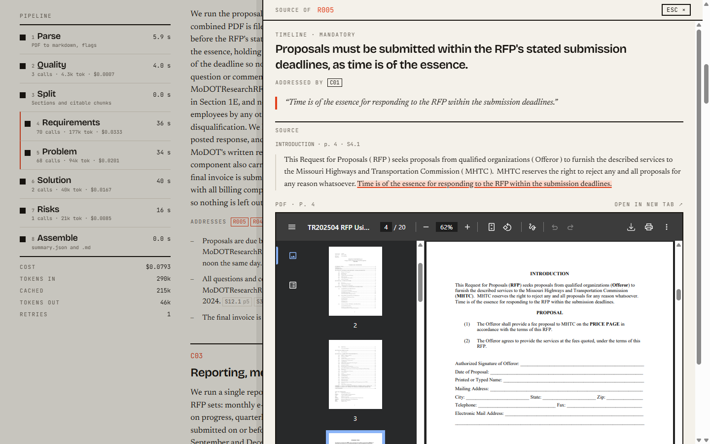
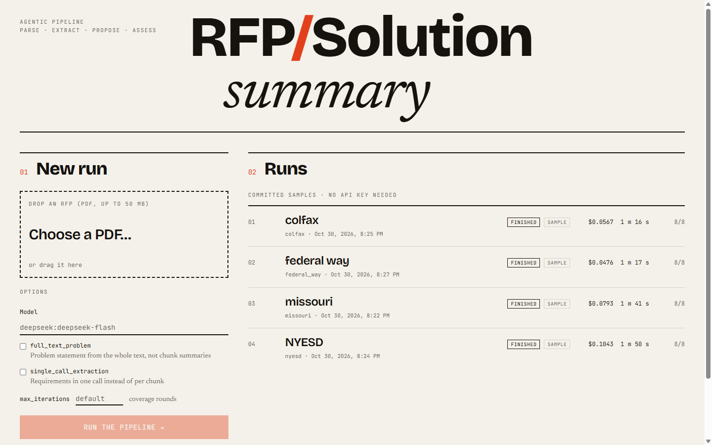
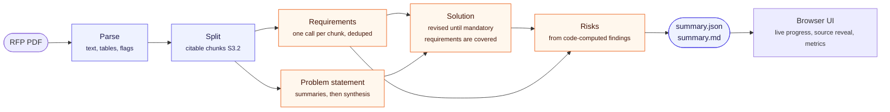
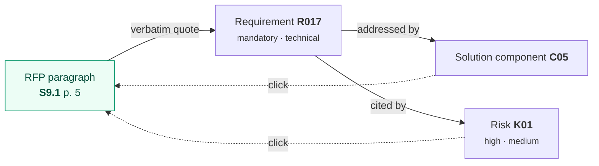
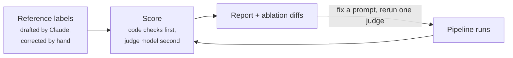

# RFP solution-summary generator

Drop in an RFP (request for proposal) PDF. About 90 seconds and 10 cents later you get
the **requirements** it imposes, the **problem** behind it, a proposed **solution** and
the **risks**. Every claim links back to the paragraph of the RFP it came from, so you
can check it with one click.



## Open the UI

Run every command from the repository folder. They work the same in Windows `cmd`,
PowerShell and bash unless a line says otherwise.

**With Docker** (nothing else to install):

1. Make a copy of the file `.env.example`, name it `.env`, and paste your DeepSeek
   key after `DEEPSEEK_API_KEY=`.
2. `docker build -t rfp-agent .`
3. Start it, with the line for your shell:
   - Windows `cmd`: `docker run --rm -p 8000:8000 --env-file .env -v "%cd%/runs:/app/runs" rfp-agent`
   - PowerShell: `docker run --rm -p 8000:8000 --env-file .env -v "${PWD}/runs:/app/runs" rfp-agent`
   - macOS or Linux: `docker run --rm -p 8000:8000 --env-file .env -v "$PWD/runs:/app/runs" rfp-agent`
4. Open <http://127.0.0.1:8000>

**Without Docker** (Python 3.12 via conda, and Node 20+):

1. `conda create -n rfp-solution-gen python=3.12 -y`
2. `conda activate rfp-solution-gen`
3. `pip install -r requirements.txt`
4. Make a copy of the file `.env.example`, name it `.env`, and paste your DeepSeek
   key after `DEEPSEEK_API_KEY=`.
5. `cd ui/frontend`, then `npm ci`, then `npm run build`, then `cd ../..`
6. `python -m ui.backend`
7. Open <http://127.0.0.1:8000>

Four public RFPs are already loaded as samples and need no key, so steps 1 and 4
(the key) can wait until you want to run your own PDF. More ways to run it (CLI, dev
mode, API, evals) are in [`docs/USAGE.md`](docs/USAGE.md).

## Using the UI



1. **Drop an RFP PDF** on the start page (or open one of the four samples below it).
   The options can stay at their defaults.
2. **Watch it run.** The left rail shows the eight stages ticking through, with time,
   calls and cost for each. A run takes one to two minutes.
3. **Read the result** in six tabs (table below). Start with Solution.
4. **Click any ID** such as `R017`, `C05`, `K01` or `S9.1`: a panel opens with the
   cited paragraph, the exact quote highlighted, and the PDF at that page.
5. **Download** `summary.md` or `summary.json` from the header, or come back later:
   every run stays in the list.

| Tab | What you see |
|---|---|
| **Solution** | The proposed approach: a summary, the components with the requirements each one addresses, the assumptions made, and how many mandatory requirements are covered. The problem statement sits underneath. |
| **Requirements** | Every requirement with its type and strictness, filterable by both, plus the ambiguities and the documents the RFP refers to but does not include. |
| **Risks** | Risks ranked by severity and likelihood, each with a justification and a mitigation, and the code-computed findings the assessor had to address. |
| **Problem** | What the client is really asking for: situation, goal, success criteria, constraints, each marked fact or inference. |
| **Parse & chunks** | The RFP as the pipeline read it: pages, flagged pages, sections and the citable chunks. |
| **Metrics** | Cost, tokens, retries and time per stage and per model call. |

How each tab's content is produced is in [`docs/PIPELINE.md`](docs/PIPELINE.md); the
CLI, the API and development mode are in [`docs/USAGE.md`](docs/USAGE.md).

## What happens to your PDF



Blue stages are plain code. Orange stages call the model, but code checks every
answer: quotes must appear in the source, cited IDs must exist, coverage is counted,
and a bad answer goes back to the model with the error before anything is kept.

**The checkpoint (human in the loop).** From the command line, a run stops after the
requirements and the problem statement, before anything is drafted. A pursuit lead
confirms the requirement list (reject one, change a strictness or a type) and writes a
pursuit brief: win themes, the bidder's capabilities and constraints, what the client
said outside the RFP. The brief becomes citable evidence (`H1`, `H2`...), so the
summary shows which claims rest on the RFP and which on the team, and the reviewer,
the decisions and the brief are rendered as the summary's review history. After the
draft, the lead reviews in prose: `revise` applies one instruction to the requirements,
the problem statement, the solution or the risks, checked by the same rules as the
stage that produced it (no unknown IDs, verbatim quotes, no mandatory requirement
dropped from the solution), and keeps every version with a diff and its cost. What
depends on a change is marked stale and regenerated only on request; `sign-off` is
refused until nothing is stale, then freezes the run. See
[docs/USAGE.md](docs/USAGE.md) for the commands and `--unattended` for the one-shot
run. The backend API takes the same checkpoint, revisions, regenerations and sign-off,
and an upload through the UI pauses at the checkpoint too: the run page opens on a
Checkpoint tab with the requirement table (reject, strictness, type per row), an
instruction box for model edits, the brief with a live preview of its H1, H2...
paragraphs, and "Confirm and draft" under the reviewer's name. The refine and sign-off
screens come in ST12e (until then, use the CLI or the API after the draft).

## Why you can trust a claim



IDs are assigned by code and stable for a given PDF. The UI turns every ID into a
link that opens the cited paragraph with the quote highlighted and the PDF at that
page. The evaluation counts claims the cited text does not support.

## How good is it

Measured on four public RFPs against hand-corrected reference labels, three runs
each, DeepSeek as the generator and Claude as the judge
([`evals/results/baseline/summary.md`](evals/results/baseline/summary.md)).

| RFP | Requirements found | Recall vs. reference | Precision | Cost per run | Time |
|---|---|---|---|---|---|
| Colfax | 120 | 99% | 97% | $0.06 | 85 s |
| Federal Way | 100 | 81% (96% of readable pages) | 99% | $0.05 | 84 s |
| Missouri | 122 | 91% | 96% | $0.08 | 121 s |
| NYESD | 226 | 99% | 97% | $0.10 | 117 s |

Mandatory requirements covered by the solution: 100% cited, 70 to 100% confirmed by
the judge. The judge agrees with 34 of 40 hand-checked verdicts.



## Repository map

```
src/rfp_agent/   the pipeline: parsing, splitting, agents, render, graph, CLI
prompts/         one markdown prompt per agent
ui/              FastAPI backend and React frontend
evals/           reference labels, scoring harness, committed results
runs/samples/    four complete sample runs (no key needed to browse)
docs/            everything below
Dockerfile       one image for the UI and the CLI
```

## Read more

| Doc | What it answers |
|---|---|
| [`docs/USAGE.md`](docs/USAGE.md) | Every way to run it: CLI and flags, UI dev mode, API, Docker, evals, troubleshooting |
| [`docs/PIPELINE.md`](docs/PIPELINE.md) | What each stage does, what code checks, settings, observability |
| [`docs/DECISIONS.md`](docs/DECISIONS.md) | Why it is built this way, with the evidence, and the failure modes hit |
| [`docs/PROMPTS.md`](docs/PROMPTS.md) | Design notes and changelog for every prompt |
| [`docs/ASSUMPTIONS.md`](docs/ASSUMPTIONS.md) | Everything the brief did not state |
| [`docs/ROADMAP.md`](docs/ROADMAP.md) | How it was built, step by step |
| [`evals/results/README.md`](evals/results/README.md) | How to read every eval column |
