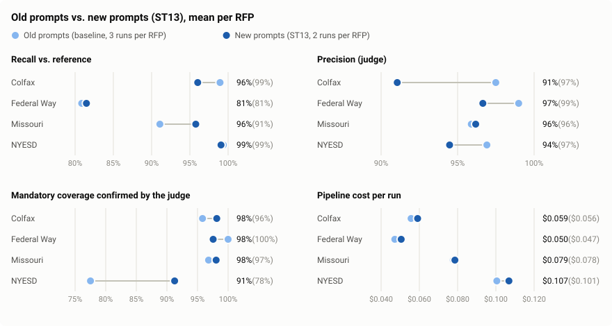
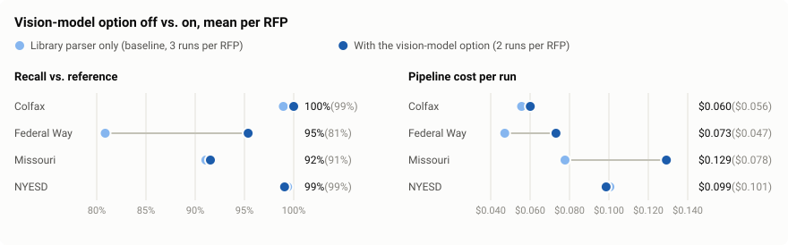

# EVALUATION.md — how the pipeline is measured

The evaluation harness (`evals/harness/`) runs the pipeline on a fixed set of four public
RFPs, scores every output against reference answers, and writes a report per run label
under `evals/results/`. It exists so that a prompt or model change can be judged by
numbers rather than by reading a few outputs, and so that the cost of the pipeline and of
the evaluation itself are both on record.

Commands are in [USAGE.md](USAGE.md#evaluation). How to read every column of a report is
in [`evals/results/README.md`](../evals/results/README.md). The label files and their
format are in [`evals/gold/README.md`](../evals/gold/README.md).

## What is evaluated

| Output | Question asked | Scored by |
|---|---|---|
| Requirements | Did it find the requirements that matter (recall), are the ones it lists real obligations (precision), are type and strictness right? | Code match against the reference, the judge for what code cannot pair; the judge rates every extracted item |
| Problem statement | Does it mention the 12 facts any correct statement must contain (issuer, need, budget, dates, hard constraints, missing documents)? | Judge, per fact |
| Grounding | Does the cited text actually say what each claim, assumption and risk says? | Code checks IDs, numbers and names; the judge sees only the claim and the text it cites |
| Solution | Does it cover every mandatory requirement, by citation and in substance? Is it specific, feasible and consistent? | Code counts citations; the judge confirms coverage and scores a 1–5 rubric |
| Risks | Are severity and likelihood sensible? Does each issue code detected (conflicts, missing documents, unreadable pages) get a risk? | The judge re-rates blind; code and judge check the findings are addressed |
| Cost and latency | What does a run cost, how long does it take, how often does a stage retry and why? | Code, from the run log |

Across runs of the same RFP it also reports consistency (mean, spread, overlap of what
was found), and for an ablation a pairwise A/B judge between two versions of an output.

## How it scores

**Code first, judge second.** Every check that can be exact is done in code: a quote is a
verbatim span of the parsed text, so matching an extracted requirement to a reference one
by quote is free and explainable, and it settles most items before any model is called.
The judge model handles only what code cannot: paraphrases, whether a description really
meets a requirement, whether a claim is supported. The code-only figure is kept as a
lower bound next to the judged one.

**Recall against the reference, precision judged per item.** The reference set is
deliberately core-only (requirements that change how a bidder designs, staffs, prices,
schedules or submits; boilerplate is left out). A correctly extracted boilerplate clause
is therefore not in the reference but is not an error either, so precision is not
"extracted minus matched": the judge rates every extracted item against the chunk it
cites.

**The judge is a different model family from the generator.** DeepSeek generates and
Claude judges, so the judge is not grading its own family's answers, the bias that
matters most for this kind of scoring. Every judge call is logged with its cost, like the
pipeline's own calls; judging costs several times more than generating.

**The judge is checked too.** A seeded sample of the judge's verdicts (enriched with its
negative verdicts, where mistakes are most likely) is labelled independently, and the
report states how often the judge agrees.

## Where the ground truth comes from

The reference answers ("gold labels") cover the four RFPs: a core requirement list and a
12-fact problem-statement checklist for each. They were made in three passes:

1. **Drafted by a model.** Claude Sonnet read each parsed RFP and drafted the labels. Code
   dropped any label whose quote is not found verbatim in the RFP text, so every label
   points at checkable text.
2. **Corrected by the coding agent.** The AI coding agent that built the project went
   through every drafted item against the full text and edited, removed or added items.
   19 to 26% of drafted requirements were changed per RFP, almost all removals of
   boilerplate the draft had included. Federal Way's image-only page 5 was labelled from
   the page image. The untouched drafts are committed next to the final files, so the
   correction pass is a measurable diff rather than a claim.
3. **Spot-checked by the author** in the pull request.

The judge-agreement sample was also labelled by the coding agent, not by a person.

**This is a known limitation.** The ground truth is AI-made, and in a real project it
would not be: a bid or procurement specialist would label the requirements and checklist
facts by hand (ideally two, with disagreements reconciled), and a person would label the
judge-agreement sample. Here, with a 36-hour budget, hand-labelling about 250 requirements
from scratch was out of reach, so the labels are AI-drafted and AI-corrected with the
correction recorded. What that means for the numbers:

- Scores measure agreement with a careful model reading of each RFP, not with an expert.
- A blind spot shared by the drafting model, the correcting agent and the pipeline would
  not show up as lost recall.
- The judge-agreement rate says the judge is consistent with another AI reading, not that
  it matches a human reviewer.

Replacing the labels with expert ones needs no code change: the label files have a fixed
format, and `python -m evals.gold.label check --all` verifies any new file's quotes.

## Results

Each report is written by `python -m evals.harness report`, and the charts are drawn from
the committed reports by `python -m evals.harness chart` (both free). Nothing below is
typed by hand; open the reports for the exact numbers.

| Label | What it measures |
|---|---|
| [`baseline`](../evals/results/baseline/summary.md) | The pipeline before the prompt rewrite, three runs per RFP |
| [`prompt_structure`](../evals/results/prompt_structure/summary.md) | The current prompts, two runs per RFP, with `diff_*.md` against the baseline |
| [`baseline_rejudged`](../evals/results/baseline_rejudged/summary.md) | The baseline outputs rescored with the current judge prompts only, to separate a judge change from a generator change |
| [`ablation_vlm`](../evals/results/ablation_vlm/summary.md) | The vision-model option on, for pages the library parser cannot read |
| Other `ablation_*` | Design alternatives that were measured and not adopted ([DECISIONS.md](DECISIONS.md)) |





To redraw a chart:

```bash
python -m evals.harness chart baseline prompt_structure \
  -o docs/images/prompt-structure-comparison.svg \
  --a-name "Old prompts (baseline, 3 runs per RFP)" \
  --b-name "Current prompts (2 runs per RFP)" \
  --title "Old prompts vs. current prompts, mean per RFP"
python -m evals.harness chart baseline ablation_vlm \
  -o docs/images/vlm-comparison.svg \
  --a-name "Library parser only (baseline, 3 runs per RFP)" \
  --b-name "With the vision-model option (2 runs per RFP)" \
  --title "Vision-model option off vs. on, mean per RFP"
```

Differences of under about 3 points are inside the run-to-run spread. The reading of the
prompt comparison is in [PROMPTS.md](PROMPTS.md#st13-comparison).
