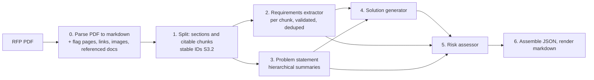

# PIPELINE.md — how each stage works

The technical companion to the README: what every stage does, what code checks and
what the model decides, the settings, and the observability record. Commands to run
things are in `USAGE.md`; the reasoning behind each choice is in `DECISIONS.md`.



Generator: DeepSeek by default. Eval judge: Claude. Provider and model are one setting
(`RFP_MODEL=<provider>:<model_id>`), so any LangChain-supported model can be swapped in.
JSON is the source of truth; markdown is rendered from it by code, never by an LLM.

**Traceability rule.** Factual assertions about the client or project cite the chunk
ID that supports them, or are labelled as inferences with the chunk IDs they come from,
or are dropped. Judgments (design choices, severities, mitigations) cite the
requirement or chunk IDs they respond to. Citations are IDs, not quotes, except
requirements, which keep a verbatim quote verified by string match. Code checks that
every cited ID exists; the schemas reject unknown IDs inside the retry loop.

## Parsing

`rfp_agent.parsing.parse_pdf(path)` turns a PDF into a `ParsedDocument`: markdown per
page (tables kept as markdown tables, running headers and footers removed, quotes and
spaces normalised), the PDF outline, tables, images with captions, every http(s) link and
every Attachment/Appendix/Exhibit/Schedule/Addendum reference with its section and
whether its content is in the PDF, and page flags (low word count, large image, broken
table, fragmented lines) for the parse-quality pass. No LLM is involved. To inspect it:

```bash
python -m rfp_agent.parsing data/rfps/colfax.pdf --out colfax.json
```

### Parse-quality pass

The flags are suspicions. `rfp_agent.parsing.quality.run_quality_pass(parsed)` sends each
flagged page to the generator model once (prompt `prompts/parse_quality.md`), which says
whether the text is usable and whether content is missing (for example a table that is
only an image). Code then clears false alarms, keeps confirmed flags, and records an
escalation per page in the run log, noting whether a heuristic (`code`) or the judge
(`model`) found the problem. Confirmed-bad pages go to a VLM hook that, in core, only
records "would escalate to VLM". A judge failure keeps the page's flags. On the four RFPs
it clears 9 of 12 flagged pages and escalates Missouri p19 and p20 and Federal Way p5,
for about half a cent in total. To see the verdicts (paid, needs `DEEPSEEK_API_KEY`):

```bash
python -m rfp_agent.parsing data/rfps/federal_way.pdf --judge --out federal_way.json
```

## Splitting

`rfp_agent.splitting.split_document(parsed)` turns a `ParsedDocument` into a
`SplitDocument`: one section per heading of the RFP, each cut into citable chunks.
Headings come from the PDF outline when there is one (located in the page text, including
bold labels that open a paragraph such as `**(A) Services:** ...`), from markdown
headings otherwise, plus bold lines numbered like an existing heading ("SECTION 4" after
"SECTION 3"). Chunks hold at most 300 words, cut at paragraphs (sentences only inside an
over-long paragraph), never inside a table, and each chunk repeats the last sentence of
the previous one. IDs are stable: `S7` is the seventh section in document order and
`S7.2` its second chunk, so the same PDF always gives the same citations. Each section is
tagged `requirement_bearing` or `narrative` by obligation cues ("shall", "must",
"Describe ..."). No LLM is involved. To inspect it:

```bash
python -m rfp_agent.splitting data/rfps/federal_way.pdf --out federal_way_split.json
```

## Requirements extraction

`rfp_agent.agents.requirements.extract_requirements(split, title=...)` turns a
`SplitDocument` into a `RequirementsOutput` (requirements, ambiguities, gaps) plus a
`RequirementsReport`. One structured LLM call per chunk (`RFP_LLM_CONCURRENCY` in
parallel, default 4) returns core requirements with type, strictness and a verbatim
quote; code looks every quote up in the chunk, gives the model one turn to fix the ones
it cannot find, and keeps the rest flagged `quote_verified=false`. Code assigns the
`R001` IDs, cites the chunk, folds exact duplicates (the one-sentence chunk overlap
produces them), then one grouping call names near-duplicates and contradictions; code
checks the answer (every ID exists, none in two groups), feeds violations back once,
sanitises what remains and merges: the representative keeps its text and quote, chunk
IDs are unioned, the stricter strictness wins, absorbed IDs sit in `merged_from`.
Contradictions are flagged on both items (`conflicts_with`) and listed as ambiguities,
never merged. Gaps are documents the RFP points at but does not contain (Colfax
Attachments F and G). The scope is the gold scope: core requirements, no generic
contract boilerplate. `RFP_SINGLE_CALL_EXTRACTION=true` (or `--single-call-extraction`)
runs one call over the whole document instead, the eval baseline. To inspect it (paid,
a few cents per RFP):

```bash
python -m rfp_agent.agents requirements data/rfps/colfax.pdf --out colfax_requirements.json
```

## Problem statement

`rfp_agent.agents.problem.build_problem_statement(split, title=...)` writes the part of
the summary that says what the client is asking for and why: four lists of one-sentence
claims (client situation, goal, success criteria, constraints), each citing the chunk IDs
that support it and labelled `fact` or `inference`. Two paths:

- **Hierarchical** (default): one call per chunk (prompt `prompts/problem_chunk.md`,
  `RFP_LLM_CONCURRENCY` calls at a time) returns whether the chunk is relevant and a
  compact factual summary; code attaches the chunk ID. One synthesis call
  (`prompts/problem_synthesis.md`) then sees only the relevant summaries, labelled with
  their IDs. The synthesis output schema rejects an empty list or a citation that was not
  in the evidence, so the validation error goes back to the model and the call is
  retried; after the retry budget the node fails rather than keep an unverifiable claim.
- **Full text** (`RFP_FULL_TEXT_PROBLEM=true`, an ablation): the same synthesis prompt
  over the full text of every chunk with the same labels.

On the four RFPs the hierarchical path costs $0.01 to $0.04 and 30 to 60 s on DeepSeek
Flash, the full-text call $0.004 to $0.008 and about 10 s; both mention every fact of the
gold checklists that the parsed text contains. To run one agent on its own (paid):

```bash
python -m rfp_agent.agents problem data/rfps/colfax.pdf --out colfax_problem.json
python -m rfp_agent.agents -v problem data/rfps/colfax.pdf --full-text   # -v logs retries
```

## Solution generator

`rfp_agent.agents.solution.build_solution(requirements, problem_statement, title=...)`
writes the proposed approach: a short summary, four to ten components that each cite
the requirement IDs they satisfy, and the assumptions the design takes where the RFP is
ambiguous or incomplete. The model sees the problem statement, the requirements (one
line each), the ambiguities and the gaps, never the RFP text (prompt
`prompts/solution.md`), so it can only cite requirement IDs from the list and chunk IDs
labelled in those inputs; the output schema rejects anything else inside the retry.

Coverage is computed by code, not reported by the model: the share of mandatory
requirements (type `submission` excluded) cited by at least one component. A small
LangGraph loop generates, checks coverage, and when mandatory requirements are left
uncovered feeds their IDs and text back for a revision in the same conversation, up to
`RFP_SOLUTION_MAX_ITERATIONS` rounds (default 3). The draft with the fewest uncovered
requirements is kept and the rest are listed in `coverage.uncovered_requirement_ids`
for the risk assessor. Component IDs `C01…` are assigned by code.

On the four RFPs: 8 to 11 components, full mandatory coverage after one or two rounds,
$0.007 to $0.013 and 20 to 35 s per RFP on DeepSeek Flash. To run it on its own
(paid; without the JSON options it runs the extractor and the problem statement first):

```bash
python -m rfp_agent.agents solution data/rfps/colfax.pdf \
    --requirements colfax_requirements.json --problem colfax_problem.json --out colfax_solution.json
python -m rfp_agent.agents -v solution data/rfps/colfax.pdf --max-iterations 1   # no revision round
```

## Risk assessor

`rfp_agent.agents.risk.build_risks(requirements, problem_statement, solution,
title=..., referenced_documents=parsed.referenced_documents, flags=parsed.flags)`
writes the risks: six to twelve entries, each with a severity and a likelihood (`low`,
`medium`, `high`), a justification, the requirement and chunk IDs it relates to, a
`source` (`rfp` for what the RFP itself carries, `solution` for what the proposed
approach creates) and a mitigation. The model sees the solution, the problem statement,
the requirements, the ambiguities and the gaps, never the RFP text (prompt
`prompts/risk.md`).

Before the call, code computes a findings block the model must work from: the mandatory
requirements the solution left uncovered, the requirement conflicts the extractor
flagged, the referenced documents the parser marked absent, the parse flags that
survived the quality pass, and how many budget requirements exist. The output schema
rejects, inside the retry, fewer than 3 or more than 15 risks, any unknown ID, and a
draft in which an uncovered mandatory requirement is cited by no risk. Code then sorts
by severity and likelihood and numbers the risks `K01…`, so K01 is the top risk in both
the JSON and the rendered table.

Scales: severity is the impact if the risk happens (`high`: the project fails, misses a
contractual date or overruns budget by more than a quarter; `medium`: rework or cost
that contingency absorbs; `low`: normal delivery); likelihood is the chance given the
RFP and the solution as written (`high`: expected unless someone acts; `medium`: turns
on facts the RFP does not settle; `low`: an unusual event).

On the four RFPs: 12 risks, one call, no validator retry, $0.007 to $0.011 and about
20 s per RFP on DeepSeek Flash. To run it on its own (paid; it runs the parse-quality
pass first and, without the JSON options, the three upstream agents too):

```bash
python -m rfp_agent.agents risk data/rfps/colfax.pdf --requirements colfax_requirements.json \
    --problem colfax_problem.json --solution colfax_solution.json --out colfax_risks.json
```

## Assembly and rendering

`rfp_agent.render` assembles the five stage outputs into one `SolutionSummary`
(`summary.json`), checking every cited ID against the split document and the
requirement list, and renders `summary.md` from it by code. Citations in the markdown
read `(Section title, p. 4 [S3.2])`; the bracketed chunk ID is the key into the JSON.

## Configuration

All settings live in `.env` (see `.env.example`); `RFP_*` variables override defaults.

| Variable | Default | Meaning |
|---|---|---|
| `RFP_MODEL` | `deepseek:deepseek-flash` | generator, `<provider>:<model_id>` |
| `RFP_JUDGE_MODEL` | `anthropic:claude-sonnet-5-5` | eval judge |
| `RFP_TEMPERATURE` | `0` | sent to every provider except Anthropic |
| `RFP_MAX_STRUCTURED_RETRIES` | `2` | retries after a schema validation failure |
| `RFP_MAX_OUTPUT_TOKENS` | provider default | output cap per call |
| `RFP_REQUEST_TIMEOUT_S` | `120` | per-request timeout |
| `RFP_LLM_TRANSPORT_RETRIES` | `2` | SDK retries on 429, 5xx and connection errors |
| `RFP_DEEPSEEK_THINKING` | `false` | DeepSeek thinking mode (structured output switches to JSON mode when on) |
| `RFP_LLM_CONCURRENCY` | `4` | parallel calls in per-chunk stages (requirement extraction, problem-statement summaries) |
| `RFP_FULL_TEXT_PROBLEM` | `false` | problem statement from one full-text call instead of per-chunk summaries (ablation) |
| `RFP_SINGLE_CALL_EXTRACTION` | `false` | requirements from one call over the whole document instead of per chunk plus dedupe (ablation) |
| `RFP_SOLUTION_MAX_ITERATIONS` | `3` | solution rounds: one generation plus revisions while mandatory requirements are uncovered; `1` disables revision |

Keys: `DEEPSEEK_API_KEY` for the generator (or the key of whichever provider
`RFP_MODEL` names), `ANTHROPIC_API_KEY` for the eval judge and the gold-label scripts.
`LANGFUSE_PUBLIC_KEY`, `LANGFUSE_SECRET_KEY` and `LANGFUSE_HOST` turn on tracing.

## Observability

Every LLM call goes through `structured_call` in `src/rfp_agent/llm.py`, which records
one entry per call (node, model, input, output and cached tokens, cost from the pricing
table in `config.py`, latency, retries and the cause of the last retry) into the run's
log. The log also holds the model, temperature and the SHA-256 of every prompt file
used, plus one `stages` entry per graph node (status, wall time, error text on
failure), and is written to `runs/<run_id>/run_log.json` even when a run fails. A
stage's LLM calls are the nodes whose name starts with the stage's prefix
(`requirements_`, `problem_`, `solution_`, `risk_`, `parse_quality`). Langfuse tracing
is added as a LangChain callback when `LANGFUSE_PUBLIC_KEY` and `LANGFUSE_SECRET_KEY`
are set, and is off otherwise. The UI's Metrics tab reads the same log.

## Inputs and gold labels

No RFP brief came with the assignment, so public US government RFPs stand in
(`data/rfps/`). The default input `inputs/rfp_brief.pdf` is Missouri DOT TR202504
("Using AI/ML to Write Legal Land Descriptions"). Three more RFPs (NYESD, Colfax,
Federal Way) form the eval set. See `ASSUMPTIONS.md`.

`evals/gold/` holds reference labels for the four RFPs: core requirements and a
12-fact problem-statement checklist per RFP, drafted by Claude and corrected by hand
(19 to 26% of drafted requirements corrected). Format, workflow and the correction table
are in `evals/gold/README.md`.
