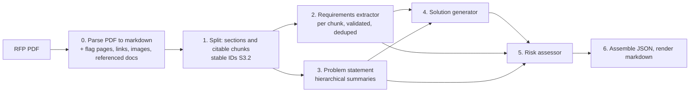
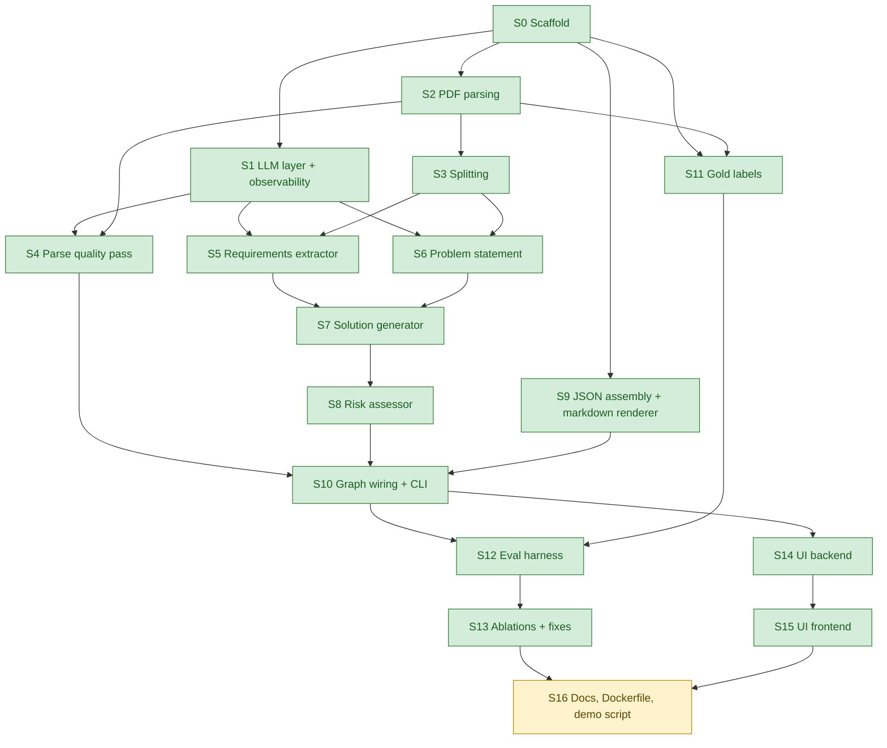

# ROADMAP.md

**This file is the only memory between sessions.** Read it first. Each step is one PR.
Follow the per-step loop in `CLAUDE.md`. Fill in "Detailed plan" when a step starts;
fill in "What was done", "Deviations from plan", "Open issues" when it ends.

Status values: `todo` · `in progress` · `done` · `dropped`.

---

## 0. Project summary (for sessions with cleared context)

36-hour take-home for an AI Engineer (LLM Apps and MLOps) role. Build an LLM/agent
app that ingests the RFP brief in `inputs/` and produces a structured solution summary
(requirements, approach, risks), as a real agentic workflow with an evaluation harness
and observability (tokens, latency, cost). Deliverables: working app plus README,
prompt assets with notes, eval harness with sample results, observability, DECISIONS.md,
3 to 5 minute demo. Also ASSUMPTIONS.md and a rough time log per part. Grading: agentic
depth 30%, eval and observability 20%, LLMOps fluency 15%, craft 15%, communication
10%, novelty 10%. The author defends every decision in a live 60-minute follow-up with a
small live change. **Doing less, cleanly, beats a sprawling half-build.**

Inputs: no brief was provided, so public RFPs stand in (see `docs/ASSUMPTIONS.md`).
Primary brief `data/rfps/missouri.pdf` (copied to `inputs/rfp_brief.pdf`); eval set
adds `NYESD.pdf`, `colfax.pdf`, `federal_way.pdf`. All four are text-native, 4k to 10k
words, fit one context window, have tables that pymupdf4llm renders correctly. Two have
PDF outlines, two do not. Missouri pages 19 to 20 are blank scanned forms; Federal Way
page 5 holds a requirements table as an image.

### Architecture (decided)



Framework LangGraph. Generator DeepSeek, judge Claude, provider and model one config
setting. Keys only in `.env`.

**Traceability rule (steps 2 to 5).** Factual assertions about the client or project
cite the chunk ID that supports them, or are labelled as inferences with the chunk IDs
they come from, or are dropped. Judgments (design choices, severities, mitigations)
need no support but cite the requirement or chunk IDs they respond to. Citations are
IDs, not quotes, except requirements, which keep a verbatim quote verified by string
match. Code checks that every cited ID exists.

**Agentic decision points (minimum).** Validate-and-retry with error feedback on every
structured output; quality-flag escalation in parsing (code flags, LLM confirms, VLM
hook); dedupe grouping with assertion. Critic, revision loop, ReAct are stretch and
only added if evals show a weakness they would fix.

### Repo layout (target)

```
CLAUDE.md  README.md  requirements.txt  .env.example  Dockerfile  pyproject.toml
inputs/rfp_brief.pdf          default input (copy of data/rfps/missouri.pdf)
data/rfps/*.pdf               the four public RFPs (committed)
src/rfp_agent/
  config.py  schemas.py  llm.py  observability.py  graph.py  cli.py
  parsing/   splitting/  agents/{requirements,problem,solution,risk}.py  render/
prompts/<agent>.md            one prompt file per agent
evals/  gold/  results/  harness code
ui/backend (FastAPI)  ui/frontend (Vite + React + Tailwind)
runs/                         local JSON run logs (gitignored except samples/)
tests/
docs/ROADMAP.md DECISIONS.md ASSUMPTIONS.md TIMELOG.md PROMPTS.md
```

---

## 1. Dependency graph



**Progress (2026-10-30):** done S0 to S15 (green). Ready now, all dependencies done
(amber): S16, the last core step. Update the two `class` lines in the diagram whenever
a step is marked `done`.

| Step                                 | Depends on | Can run in parallel with | Main files touched                                   |
| ------------------------------------ | ---------- | ------------------------ | ---------------------------------------------------- |
| S0 Scaffold                          | —          | — (must land first)      | everything top-level, `schemas.py`, `config.py`      |
| S1 LLM layer + observability         | S0         | S2, S9, S11              | `llm.py`, `observability.py`, `config.py` (pricing)  |
| S2 PDF parsing                       | S0         | S1, S9, S11              | `parsing/`                                           |
| S3 Splitting                         | S2         | S1, S4, S9, S11          | `splitting/`                                         |
| S4 Parse quality pass                | S1, S2     | S3, S5, S6, S9, S11      | `parsing/quality.py`, `prompts/parse_quality.md`     |
| S5 Requirements extractor            | S1, S3     | S4, S6, S9, S11          | `agents/requirements.py`, `prompts/requirements*.md` |
| S6 Problem statement                 | S1, S3     | S4, S5, S9, S11          | `agents/problem.py`, `prompts/problem*.md`           |
| S7 Solution generator                | S5, S6     | S4, S9, S11              | `agents/solution.py`, `prompts/solution.md`          |
| S8 Risk assessor                     | S7         | S4, S9, S11              | `agents/risk.py`, `prompts/risk.md`                  |
| S9 JSON assembly + markdown renderer | S0         | S1 to S8, S11            | `render/`                                            |
| S10 Graph wiring + CLI               | S4, S8, S9 | S11                      | `graph.py`, `cli.py`                                 |
| S11 Gold labels                      | S2         | S1, S3 to S10            | `evals/gold/`                                        |
| S12 Eval harness                     | S10, S11   | S14                      | `evals/`                                             |
| S13 Ablations + fixes                | S12        | S14, S15                 | prompts, agents, `evals/results/`                    |
| S14 UI backend                       | S10        | S12, S13                 | `ui/backend/`                                        |
| S15 UI frontend                      | S14        | S12, S13                 | `ui/frontend/`                                       |
| S16 Docs, Dockerfile, demo script    | S13, S15   | —                        | `README.md`, `Dockerfile`, `docs/`                   |

Parallel work rule: two agents may run concurrently only on steps listed as parallel
with each other, and must not edit each other's "main files". Shared files
(`schemas.py`, `config.py`, `requirements.txt`, `README.md`) are edited only with a
one-line note in the step's "What was done" so merges are easy to resolve.

---

## 2. Core steps

### S0. Scaffold
- **Status:** done
- **Goal:** the common foundation every other step builds on: repo layout, conda env and
  pinned `requirements.txt`, `config.py` (provider/model single setting, paths, pricing
  table stub), Pydantic v2 `schemas.py` for every pipeline artefact (ParsedDocument with
  pages, tables, images, referenced_documents, flags; Section; Chunk with stable ID,
  section path, page; Requirement with ID, text, type, strictness, quote, chunk IDs;
  Ambiguity; ProblemStatement with cited claims; Solution with requirement coverage;
  Risk with severity, likelihood, justification, IDs; RunLog with per-node tokens,
  latency, cost), `.env.example`, GitHub Actions CI (ruff + pytest), `prompts/`
  directory with a README, `inputs/rfp_brief.pdf` copied from `data/rfps/missouri.pdf`
  (the four RFPs are already committed under `data/rfps/`), README skeleton with the
  pipeline diagram, `tests/` with a schema round-trip test. The agent creates the
  `rfp-solution-gen` conda env itself. Create the `core` branch.
- **Depends on:** —
- **Parallel with:** — (lands first)
- **Detailed plan:** (approved 2026-10-30)
  - **Author decisions, asked in one batch:** generator default `deepseek:deepseek-flash`
    (DeepSeek V4.1 Flash; `deepseek-chat` is no longer on DeepSeek's pricing page);
    judge default `anthropic:claude-sonnet-5-5`; requirement `type` enum = functional,
    technical, security_compliance, legal_contractual, timeline, budget_pricing,
    submission, other; `strictness` = mandatory, desired, optional; risk `severity` and
    `likelihood` both low/medium/high.
  - **Branch:** `step-00-scaffold` off `core` as a worktree; one commit per unit below;
    PR into `core`.
  - **Packaging:** `pyproject.toml` (setuptools, `src/` layout, ruff and pytest config,
    `llm` marker skipped by default), `requirements.txt` with exact pins plus `-e .` so
    one `pip install -r requirements.txt` installs the package editable. Conda env
    `rfp-solution-gen` (Python 3.12) created by the agent.
  - **`config.py`:** pydantic-settings `Settings` (`RFP_` prefix, `.env`): `model`,
    `judge_model` as `provider:model_id` strings, `temperature`, `max_structured_retries`,
    the two S10 ablation flags (`full_text_problem`, `single_call_extraction`), API keys
    and Langfuse keys under their conventional unprefixed names; `split_model_spec()`;
    `langfuse_enabled`; path constants; `ModelPricing` + `PRICING` stub (DeepSeek peak
    rates, Claude opus/sonnet/haiku 5.5) + `pricing_for()`. Cost arithmetic is S1's.
  - **`schemas.py`:** Pydantic v2, `extra="forbid"`, StrEnums for every closed set, ID
    formats enforced by regex (`S3.2` chunk, `S3` section, `R001`, `A01`, `G01`, `C01`,
    `K01`). Models: parsing (`Page`, `Table`, `ImageBlock`, `ReferencedDocument`,
    `PageFlag`, `OutlineEntry`, `ParsedDocument`), splitting (`Chunk`, `Section`,
    `SplitDocument`), `Claim(text, kind=fact|inference, chunk_ids>=1)`, requirements
    (`Requirement` with quote, `chunk_ids`, `quote_verified`, `merged_from`,
    `conflicts_with`; `Ambiguity`; `Gap`; `RequirementsOutput`), problem (`ChunkSummary`,
    `ProblemStatement` as four lists of `Claim`), solution (`SolutionComponent` citing
    requirement IDs, `Coverage` computed by code, `Solution`), risk (`Risk`,
    `RiskAssessment`), final `SolutionSummary` with `ChunkRef` index for rendering,
    observability (`NodeMetrics`, `Escalation`, `RunLog.totals()`), and
    `validate_ids_exist()` for the agents.
  - **Skeleton:** `src/rfp_agent/{parsing,splitting,agents,render}/__init__.py`,
    `prompts/README.md` (one file per agent, `{{name}}` placeholders), `inputs/rfp_brief.pdf`
    copied from Missouri, `runs/samples/.gitkeep`, `.env.example`, GitHub Actions CI
    (ruff check, ruff format --check, pytest on Python 3.12), README skeleton with the
    pipeline diagram.
  - **Tests:** `tests/test_schemas.py` (round-trip of a full `SolutionSummary` and
    `RunLog`, ID regexes, forbid-extra, `validate_ids_exist`, totals) and
    `tests/test_config.py` (defaults, model spec parsing, env override, pricing lookup).
  - **Docs:** DECISIONS D13 to D15 (model ids and pricing source, schema conventions,
    install and config mechanics), TIMELOG row, ASSUMPTIONS line on peak pricing.
- **What was done:** (branch `step-00-scaffold`, PR into `core`)
  - Conda env `rfp-solution-gen` (Python 3.12) created; `requirements.txt` pins
    langgraph 1.2.18, langchain 1.4.7, langchain-core 1.7.3, langchain-deepseek 1.1.1,
    langchain-anthropic 1.7.7, langfuse 5.0.4, pymupdf4llm 1.28.2, pymupdf 1.28.2,
    pydantic 2.14.2, pydantic-settings 2.16.2, python-dotenv 1.2.4, typer 0.27.3,
    rich 15.0.0, pytest 9.2.0, ruff 0.17.3, and `-e .` (editable install of the package).
  - `pyproject.toml`: setuptools `src/` layout; ruff (line 100, py312, E/F/I/UP/B);
    pytest (`testpaths=tests`, `llm` marker, `addopts=-m 'not llm'`).
  - `src/rfp_agent/config.py`: `Settings` (pydantic-settings, `RFP_` prefix, reads
    `REPO_ROOT/.env`): `model`, `judge_model`, `temperature`, `max_structured_retries`,
    `full_text_problem`, `single_call_extraction`, provider keys and Langfuse keys under
    their unprefixed names; `generator`/`judge` properties; `langfuse_enabled`;
    `split_model_spec()`; path constants; `ModelPricing`, `PRICING`, `pricing_for()`;
    `get_settings()` (lru_cache).
  - `src/rfp_agent/schemas.py`: as planned. Extra helpers beyond the plan:
    `STRICTNESS_RANK` (for S5's keep-the-stricter merge), `SplitDocument.chunk_by_id()`,
    `RequirementsOutput.requirement_ids()/mandatory()`, `ProblemStatement.claims()`,
    `ParsedDocument.page_count`, `RunTotals` model returned by `RunLog.totals()`.
  - Empty packages `parsing/`, `splitting/`, `agents/`, `render/`; `prompts/README.md`;
    `inputs/rfp_brief.pdf`; `runs/samples/.gitkeep`; `.env.example`;
    `.github/workflows/ci.yml` (ruff check, ruff format --check, pytest on 3.12);
    README skeleton with the pipeline diagram and quickstart.
  - Tests: `tests/test_schemas.py` (10 tests incl. 9 parametrised bad-ID cases) and
    `tests/test_config.py`; 29 pass, ruff clean. Shared files touched: all of them
    (this is the scaffold).
- **Deviations from plan:**
  - `pymupdf4llm==2.0` and `pymupdf==2.0` on PyPI are empty placeholder releases
    (dist-info only, no modules). Pinned both to 1.28.2 and added `pymupdf` as a
    direct dependency since S2 will call it for links and images.
  - Status set to `done` in the same commit as the docs, before the PR is opened,
    to avoid a second docs-only commit on the branch.
- **Open issues:**
  - `langchain-openai` arrives transitively via `langchain-deepseek`; harmless, not pinned.
  - langchain/langgraph 1.x APIs: S1 must verify `init_chat_model("deepseek:...")`
    resolves to `langchain_deepseek` in these versions.
  - DeepSeek peak vs off-peak pricing: `PRICING` holds peak; S1 may add a time-aware
    rate if cost accuracy matters for the eval tables.

### S1. LLM layer and observability core
- **Status:** done
- **Goal:** `llm.py`: chat-model factory from config (DeepSeek default, Claude and any
  LangChain model swappable), a `structured_call()` helper that enforces a Pydantic
  schema with bounded retry feeding the validation error back, and records the retry
  count. `observability.py`: per-run JSON log under `runs/` with per-node input/output
  tokens, latency, cost from the pricing table (cache tokens if the provider reports
  them), model ID, temperature, prompt file hashes; Langfuse callback handler wired
  through LangChain and a no-op when keys are absent. Unit tests with a fake model.
- **Depends on:** S0
- **Parallel with:** S2, S9, S11
- **Detailed plan:** (approved 2026-10-30)
  - **Author decisions, asked in one batch:** `structured_call` uses provider-native
    `with_structured_output(include_raw=True)` inside a bounded retry loop (not code-side
    JSON parsing); one `NodeMetrics` per logical LLM call (retries included), tagged with
    the node, aggregated in code; `.env` created with empty placeholders, live smoke test
    `@pytest.mark.llm` self-skips without a key; cost is a simple upper bound (peak
    DeepSeek rates, cache reads at the cached rate, cache writes at the input rate,
    unknown model costs 0 with a warning).
  - **Verified library facts:** `init_chat_model("deepseek:...")` builds `ChatDeepSeek`
    with kwargs unfiltered; `ChatDeepSeek` raises at construction without a key and both
    providers read keys from `os.environ` only, so the factory passes `api_key` from
    `Settings`; `ChatAnthropic` raises for Sonnet 5.5 / Fable 5 if temperature is set, so
    temperature goes to non-Anthropic providers only; DeepSeek rewrites `json_schema` to
    `function_calling`, where no tool call gives `parsed=None, parsing_error=None`;
    Anthropic uses `method="json_schema"`; both report `usage_metadata` with
    `input_token_details.cache_read`; Langfuse without keys is a no-op but
    `get_trace_url()` raises, so it is guarded.
  - **Branch:** `step-01-llm-observability` off `core` as a worktree; one commit per unit.
  - **`config.py` (shared):** `max_output_tokens` (None = provider default),
    `request_timeout_s` (120), `llm_transport_retries` (2, SDK-level 429/5xx retries,
    distinct from `max_structured_retries`); `.env.example` updated.
  - **`llm.py`:** `get_chat_model(spec=None, settings=None, **overrides)`,
    `get_judge_model()`, `MissingApiKeyError`; `structured_method(model)` (json_schema
    for Anthropic, function_calling otherwise); `structured_call(model, schema, messages,
    node=..., recorder=None, max_retries=None, config=None) -> StructuredResult` that
    appends the bad AIMessage plus a HumanMessage with the validation error and retries,
    refuses to retry a truncated output (`finish_reason == "length"` /
    `stop_reason == "max_tokens"`), raises `StructuredOutputError` with all attempts on
    exhaustion, and records one `NodeMetrics`; `load_prompt(name) -> Prompt` with
    `{{var}}` rendering (missing or unused variables are errors) and SHA-256 recorded on
    the active run.
  - **`observability.py`:** `estimate_cost()`, `usage_from_message()`, `new_run_id()`,
    `RunRecorder` (holds the `RunLog`; `record`, `record_prompt`, `record_escalation`,
    `per_node()`, `finish()`, `write()` to `runs/<run_id>/run_log.json`, `activate()`
    context manager setting a contextvar so nodes need no plumbing),
    `current_recorder()`; `make_langfuse_handler()`, `langfuse_trace_url()`,
    `shutdown_langfuse()`, all no-ops without keys and without importing `langfuse`.
  - **Tests:** scripted fake chat model; structured-call retry paths (success, bad args,
    no tool call, exhaustion, truncation, recording); factory per provider; prompt
    loader; cost arithmetic, recorder round-trip, Langfuse on/off; live smoke test
    marked `llm`.
  - **Docs:** DECISIONS D17 to D19, TIMELOG, ASSUMPTIONS (cache-write pricing), README
    configuration and observability sections.
- **What was done:** (branch `step-01-llm-observability`, PR into `core`)
  - `src/rfp_agent/llm.py`: `get_chat_model(spec=None, settings=None, thinking=None,
    **overrides)` builds any LangChain provider through `init_chat_model`, wiring the key
    from `Settings` (raises `MissingApiKeyError` naming the env var), timeout, transport
    retries, optional `max_tokens`; temperature is sent to every provider except
    Anthropic; DeepSeek gets `extra_body={"thinking": {"type": ...}}` from
    `Settings.deepseek_thinking` or the `thinking` argument. `get_judge_model()`.
    `model_spec_of(model)` (`provider:model_id` for logs and pricing).
    `structured_method(model)`: `json_schema` for Anthropic, `json_mode` for DeepSeek with
    thinking on, `function_calling` otherwise. `structured_call(model, schema, messages,
    node=..., settings=None, recorder=None, max_retries=None, config=None)` returns
    `StructuredResult(value, metrics, attempts)`; on failure it appends the model's reply
    plus feedback (a `ToolMessage` per tool call, else a `HumanMessage`) carrying the
    validation error (capped at 2000 chars) and retries; a missing structured output gets
    a fixed "no structured output" message; a reply cut by the output cap raises
    `StructuredOutputError(truncated=True)` without retry; exhaustion raises
    `StructuredOutputError` with every attempt. In JSON mode the schema is inserted as a
    system message after the caller's system messages. One `NodeMetrics` (summed tokens
    over attempts, cost, wall latency, `retries`) is recorded per call, on success and on
    failure. `load_prompt(name) -> Prompt(name, path, text, sha256)` with
    `Prompt.render(**vars)` (`{{var}}`; missing and unused variables raise) and the hash
    recorded on the active run.
  - `src/rfp_agent/observability.py`: `estimate_cost()` (cached input at the cached rate,
    unknown model costs 0 and warns once), `usage_from_message()`, `new_run_id()`
    (`YYYYMMDD-HHMMSS-<6 hex>`), `RunRecorder` (`log: RunLog`, `run_dir`, `record`,
    `record_prompt`, `record_escalation`, `set_trace_url`, `totals`, `per_node`, `finish`,
    `write` to `runs/<run_id>/run_log.json`, `activate()` context manager that sets the
    current recorder and writes the log on exit even if the run raises,
    `from_settings()`), `current_recorder()`; `make_langfuse_handler()`,
    `langfuse_trace_url()`, `shutdown_langfuse()`: no-ops without keys and never import
    `langfuse` then; the trace-URL lookup never raises.
  - `config.py` (shared file): `max_output_tokens`, `request_timeout_s`,
    `llm_transport_retries`, `deepseek_thinking`; `.env.example` lists them. Local `.env`
    created from `.env.example` with empty keys for the author to fill in.
  - Tests: `tests/fakes.py` (`ScriptedChatModel`, `tool_call_msg`, `text_msg`),
    `test_llm_structured.py`, `test_llm_deepseek_modes.py`, `test_llm_factory.py`,
    `test_prompts.py`, `test_observability.py`, `test_config.py` extended: 67 unit tests
    pass, ruff clean. `test_llm_live.py` (`-m llm`): DeepSeek Flash with thinking off and
    on both pass live (about $0.0002 per call, 1 to 1.5 s); the Claude test skipped (no
    `ANTHROPIC_API_KEY` yet).
- **Deviations from plan:**
  - Added `Settings.deepseek_thinking` (default off) and a `json_mode` structured method.
    The first live call failed with DeepSeek's 400 "Thinking mode does not support this
    tool_choice": thinking is on by default for `deepseek-flash` and LangChain's
    tool-calling structured output forces the tool. Both fixes were probed live (see
    DECISIONS D17 and F1).
  - Retry feedback is a `ToolMessage` per tool call rather than always a `HumanMessage`:
    both APIs reject a conversation with an unanswered tool call.
  - `NodeMetrics` is also recorded when a call exhausts its retries, so failed calls
    still show their cost.
  - Each module was committed with its tests instead of a separate tests commit, so every
    commit is green.
- **Open issues:**
  - The conda env's editable install still points at the deleted `step-00-scaffold`
    worktree, so `import rfp_agent` from a fresh shell fails until
    `pip install -e .` is re-run from the main checkout. This step ran everything with
    `PYTHONPATH=src`. CI is unaffected.
  - Claude path not yet exercised live (`json_schema` method via `output_config`);
    run `pytest -m llm` once `ANTHROPIC_API_KEY` is in `.env` (S11/S12 need it anyway).
  - Thinking on vs off for DeepSeek is a quality question for S13: off is the cheap
    default; S7 and S8 can pass `thinking=True` per model if evals show a benefit.
  - S10 wraps the graph run in `RunRecorder.activate()` and passes
    `make_langfuse_handler()` in `config["callbacks"]`; LangGraph propagates it to calls
    inside nodes.

### S2. PDF parsing (library path)
- **Status:** done
- **Goal:** `parsing/`: pymupdf4llm to markdown per page with tables kept as markdown
  tables; use the PDF outline when present. Code heuristics flag suspicious pages (low
  word count, large image blocks, broken table rows, fragmented lines) into a
  `flags` list with the reason. Extract every hyperlink (annotation and plain-text URL)
  and every reference to an attachment, appendix, exhibit, schedule or addendum, with
  the section it appears in, into `referenced_documents`. Record image blocks per page
  (page, size, nearby caption). Unicode normalisation (curly quotes, split URLs inside
  table cells). Output a `ParsedDocument`. Tests on all four RFPs with assertions on
  page count, table count, known flags (Missouri p19 to 20, Federal Way p5) and known
  references (Colfax Attachments A to G). Leave a `escalate(page)` hook stub for S4.
- **Depends on:** S0
- **Parallel with:** S1, S9, S11
- **Detailed plan:** (approved 2026-10-30)
  - **Author decisions, asked in one batch:** a referenced document is `present` only when
    a matching heading exists and its section body has at least 40 words; the four-RFP
    tests always run (one session-scoped parse per file, about 45 s); repeated page
    headers and footers are stripped; `mailto:` links are not recorded.
  - **Findings that shape the design** (pymupdf4llm 1.28.2): `to_markdown(page_chunks=True)`
    returns per-page `text` plus layout `page_boxes` (classes text, section-header,
    list-item, table, picture, page-header, page-footer, each with bbox and char span);
    no separate tables or images keys. About 10 s per document. Merged-cell tables render
    as one column with `<br>`-joined cells (Missouri p12, Federal Way p14). Bold URLs split
    inside table cells (Missouri p6). Real link targets live only in link annotations.
  - **Branch:** `step-02-pdf-parsing` off `core`; PR into `core`.
  - **Files:** `parsing/pdf.py` (`parse_pdf`, orchestration), `parsing/normalize.py`
    (NFC, curly quotes and Unicode spaces to ASCII, ligatures, split-URL join, header and
    footer strip), `parsing/heuristics.py` (flag thresholds as constants, table blocks,
    broken-table rules), `parsing/references.py` (hyperlinks from annotations and plain
    text, Attachment/Appendix/Exhibit/Schedule/Addendum regex, section lookup, `present`),
    `parsing/quality.py` (`escalate()` stub for S4), `parsing/__main__.py` (debug dump).
  - **Heuristics:** low word count < 50; picture box >= 25% of page area; broken table =
    ragged pipe counts or a one-column block with `<br>`-merged cells; fragmented lines =
    at least 6 lines of <= 2 words making up >= 50% of prose lines.
  - **Title:** PDF metadata title if most of its words occur on page 1, else the first
    heading on page 1.
  - **Tests:** unit tests on literal strings for every rule; four-RFP tests for page,
    outline and table counts, known flags (Missouri p12, p19, p20; Federal Way p5, p14;
    NYESD none), image sizes and captions, references (Colfax A to G with E/F/G absent,
    NYESD Schedule A and Appendix A/B, Missouri Exhibits and the joined MoDOT URL), no
    curly quotes, header stripped, titles.
  - **Docs:** DECISIONS D20 to D22, ASSUMPTIONS lines, TIMELOG row, README parsing section.
- **What was done:** (branch `step-02-pdf-parsing`, PR into `core`)
  - `parsing/pdf.py`: `parse_pdf(path) -> ParsedDocument`. One
    `pymupdf4llm.to_markdown(doc, page_chunks=True, use_ocr=False)` call; per page:
    header/footer strip, normalisation, `Page` with `word_count`, `Table` per pipe block,
    `ImageBlock` per image from `get_image_info()` (clipped, >= 20 pt, caption = nearest
    text block within 40 pt above or below), flags, link annotations with anchor text
    (whole words under the link rectangle). Outline from `get_toc()`. Title = metadata
    title if 60% of its words are on page 1, else first heading on page 1.
  - `parsing/normalize.py`: NFC; curly quotes, Unicode spaces and hyphens to ASCII;
    ligatures expanded; soft hyphen and zero-width characters dropped; en/em dashes kept;
    bold URLs split across `<br>` in table cells rejoined; header/footer stripping (see
    D21).
  - `parsing/heuristics.py`: `count_words` (ignores tags, pipes, separator rows),
    `table_blocks`, `broken_table_reason` (ragged, or one-column with `<br>`-merged
    cells), `flag_page`; thresholds are module constants.
  - `parsing/references.py`: `document_lines` (every line tagged with its section:
    nearest heading, else outline entry), `document_references` (regex, first non-TOC
    occurrence), `mark_present` (heading plus >= 40 words), `hyperlinks` (annotation URIs,
    plus plain-text URLs no annotation covers; http(s) only).
  - `parsing/quality.py`: `escalate(page, flags) -> Escalation | None` stub for S4.
  - `parsing/__main__.py`: `python -m rfp_agent.parsing <pdf> [--out file.json]`.
  - Results on the four RFPs (about 5 to 9 s each):

    | RFP | pages | outline | tables | flagged pages | references (present) | links |
    |---|---|---|---|---|---|---|
    | Missouri | 20 | 64 | 8 | 12, 19, 20 | Exhibit A, B (both absent) | 9 |
    | NYESD | 27 | 0 | 2 | none | Schedule A, B; Appendix A, B (all absent) | 32 |
    | Colfax | 22 | 29 | 4 | 1, 2, 3, 20, 21, 22 | Attachments A-D present, E-G absent | 1 |
    | Federal Way | 16 | 0 | 10 | 2, 5, 14 | Exhibit A, B (both present) | 0 |

  - Tests: `tests/test_parsing_units.py` (rules on literal strings) and
    `tests/test_parsing_rfps.py` (one session-scoped parse per RFP); 83 tests pass in
    about 22 s, ruff clean. Shared files touched: none (`README.md` and docs only).
- **Deviations from plan:**
  - Hyperlinks are deduplicated across the document (one entry per URL, at its first
    page) rather than per page: downstream steps want one gap per document, not one per
    mention.
  - Plain-text URLs are suppressed when an annotation anywhere in the document covers
    them, compared on letters and digits only. NYESD's text layer mangles long URLs at
    line breaks (lost hyphens), which otherwise produced seven bogus duplicates (F2).
  - Header/footer stripping needed two extra cases beyond the plan: a repeated header
    merged into the same box as the next heading (prefix removed, heading kept), and a
    header split across two header boxes (Federal Way p7, p9, p11; F3).
  - `escalate()` takes a page and all its flags, not one flag: S4 judges each page once.
  - OCR is passed off explicitly (`use_ocr=False`); the layout path defaults it on (D20).
  - Image captions use the whole nearest text block (Missouri p19's caption block starts
    with a blank line and overlaps the image by one point).
- **Open issues:**
  - Colfax's title comes out as "CITY OF COLFAX" (its first heading); the RFP name is
    in the next two headings. Good enough for display; S9 may prefer the source path.
  - Low-word flags on cover and contents pages (Colfax p1, p3; Federal Way p2) and the
    broken-table flag on Colfax's one-column contents table are expected false
    positives for S4's judge to clear.
  - Section titles can be split across two headings (Missouri "SECTION (1):" then
    "GENERAL DESCRIPTION AND BACKGROUND"); S3 should merge a heading with no body into
    the next.
  - URLs without a scheme (`www.colfax-ca.gov` in text) are not recorded; Colfax's link
    annotation is `http://www.colfax-ca.go/`, a typo in the source, kept as-is.

### S3. Section and chunk splitting
- **Status:** done
- **Goal:** `splitting/`: split on the RFP's own headings (outline first, heading
  detection fallback for documents without an outline), keep the title attached; split
  each section into citable chunks by subsection where present, otherwise by a size cap
  of a few hundred tokens with small overlap. Deterministic stable IDs (`S3.2`), section
  path and page on every chunk. Tag sections narrative vs requirement-bearing by cheap
  heuristics (modal verbs, "shall", numbered lists). Tests: determinism across runs,
  every character of the document lands in exactly one section, chunk size bounds,
  fixtures for both an outlined and a non-outlined RFP.
- **Depends on:** S2
- **Parallel with:** S1, S4, S9, S11
- **Detailed plan:** (approved 2026-10-30)
  - **Author decisions, asked in one batch:** 300-word cap (`count_words`), split at
    paragraph boundaries, sentences only inside an over-cap paragraph, tables atomic,
    tail under 50 words merges back, **one-sentence overlap** between consecutive chunks
    of a section (prose only), so coverage is "every body line in at least one chunk";
    **every heading is a Section** (outline subsections included; flat list, `level` and
    `path` give the tree; containers with no own body have zero chunks); short bold-only
    lines are **promoted to headings** when their label matches a numbering scheme an
    existing heading uses; **golden split JSON** for Missouri and NYESD under
    `tests/fixtures/` with `--update-golden`.
  - **Taken without asking:** unlocated outline entries are dropped; text before the first
    heading becomes a synthetic level-1 `Front matter` section; `#` lines over 20 words or
    ending in a period are body text; section IDs number sections in document order
    (`S5` is not the RFP's "Section 5").
  - **Findings that shape the design:** Missouri's outline has 64 entries but only about
    35 render as `#` lines; the rest are bold run-in labels (`**(A) Services:** The
    Offeror shall ...`), so outline titles are located in page text by key prefix; split
    titles (`## SECTION (1):` + `## GENERAL DESCRIPTION ...`, `## Task 1` +
    `## Project Management`); outline entry "Expenses" is a table cell. Federal Way
    "SECTION 4" and NYESD criterion "A." are bold lines, not headings.
  - **Branch:** `step-03-splitting` off `core` as a worktree; PR into `core`. No schema
    change, no new dependency.
  - **Files:** `splitting/headings.py` (markdown headings with demotion and split-title
    merge, outline location in text, bold-line promotion, `detect_headings`),
    `splitting/chunker.py` (blocks, greedy cap fill, sentence split, tail merge, overlap),
    `splitting/kind.py` (modal-verb cue density plus enumerations), `splitting/split.py`
    (`split_document(parsed) -> SplitDocument`), `splitting/__main__.py` (debug dump).
  - **Tests:** unit tests on literal strings for every rule; four-RFP tests for
    determinism, line coverage, size bounds, ID sequence, page ranges, round-trip, known
    sections (Missouri Section (5) with (A) to (Y), no "Expenses"; Colfax Tabs; NYESD X.
    and promoted "A."; Federal Way SECTION 4), kinds; two goldens.
  - **Docs:** DECISIONS D25 to D27, TIMELOG row, ASSUMPTIONS line (words stand in for
    tokens), README splitting section.
- **What was done:** (branch `step-03-splitting`, PR into `core`)
  - `splitting/headings.py`: `Heading(page, line, title, raw_level, consumed, source)`
    where `consumed` lists the title lines removed from the body (empty for a run-in bold
    label, which stays in the body). `markdown_headings` (demotes `#` lines over 20 words,
    ending in a period, not starting with a letter, digit, `(` or `"`, or colon-ended
    with no numbering; merges split titles), `locate_outline` (title key search on the
    entry's page then the next, after the previous match, skipping table rows and
    contents pages; matches a `#` heading, a leading bold run with an optional label
    outside the bold, a whole line, or two bold lines), `promote_bold_lines` (no-outline
    documents only; schemes section, keyword Task/Tab/Exhibit/..., paren, decimal, roman,
    lower roman, letter), `detect_headings`, `heading_paths` (stack on raw levels; a
    contents heading never parents), `title_key`, `scheme_of`.
  - `splitting/chunker.py`: `blocks` (paragraphs on blank lines and page breaks, table
    runs atomic), `chunk_blocks` -> `ChunkText(text, own, page_start, page_end)`
    (greedy 300-word packing, sentence cuts inside an over-cap paragraph, < 50-word tail
    merged back, last sentence of the previous chunk prepended unless it ends in a table
    or is over 60 words), `overlap_of`, `own_text` (strips the overlap, for tests and
    any consumer that needs non-overlapping text), `sentences`.
  - `splitting/kind.py`: `section_kind(text)` requirement-bearing on any obligation cue
    or imperative instruction line, else narrative (D27).
  - `splitting/split.py`: `split_document(parsed) -> SplitDocument`; `Front matter`
    section for text before the first heading; contents-page sections are narrative;
    section `page_end` covers its descendants; `level == len(path)`.
  - `splitting/__main__.py`: `python -m rfp_agent.splitting <pdf> [--out file.json]`
    prints the section tree (id, pages, kind, chunks, words).
  - Results on the four RFPs:

    | RFP | sections | outline located | chunks | mean / max words | requirement-bearing |
    |---|---|---|---|---|---|
    | Missouri | 75 | 63 / 64 | 67 | 82 / 330 | 45 |
    | NYESD | 61 | no outline | 70 | 142 / 322 | 42 |
    | Colfax | 40 | 29 / 29 | 40 | 108 / 293 | 21 |
    | Federal Way | 15 | no outline | 21 | 178 / 362 | 7 |

    (max includes the repeated overlap sentence.)
  - Tests: `tests/test_splitting_units.py` (28 tests on literal strings) and
    `tests/test_splitting_rfps.py` (22 tests: determinism and round-trip, every word of
    every page in exactly one chunk or heading line once the overlap is removed, ID and
    page invariants, size bound, known sections per RFP, kinds, goldens
    `tests/fixtures/split_missouri.json` and `split_NYESD.json`). 210 tests pass, ruff
    clean. Shared files touched: none (README and docs only; README status line also
    lists S11, which had not been added).
- **Deviations from plan:**
  - Section kind uses "any obligation cue" instead of a cue-density threshold: the
    threshold (1.5 per 100 words) left 8 of Missouri's 25 agreement clauses narrative
    because long clauses say "shall" once (D27). Imperative instruction lines
    ("- Describe ...") count as cues so NYESD's selection criteria are caught.
  - Bold-line promotion allows up to 40 words, not 12: NYESD fuses heading "viii." and a
    sub-heading into one 33-word bold line. Promotion still needs a whole-bold line and
    a numbering scheme already in use.
  - Added a lowercase-roman scheme (NYESD "i." to "xiv.") and a numbering label outside
    the bold (`- (Y) **Information Technology:**`, Missouri p17), both found on the RFPs.
  - Colon-ended headings with no numbering ("Name of Respondent:", "Reference 1 :",
    "Submission Deadline:") are treated as form labels; without this, Colfax Attachment
    D's whole body sat under "Name of Respondent:".
  - The coverage test compares word multisets (document words = heading-line words +
    non-overlapping chunk words) rather than lines, because over-cap paragraphs are cut
    mid-line at sentences.
  - Sentence cuts do not split at colons (the plan listed `:`); colons inside RFP prose
    mostly introduce lists.
- **Open issues:**
  - Some front-page lines become one-line sections (Colfax "Shanna Stahl, Administrative
    Services Officer ..."; NYESD "Issued: August 8, 2025"). Harmless for citations;
    S6 may see them as tiny chunks.
  - In documents without an outline, the document title heading (`#`) is the parent of
    every section (NYESD, Federal Way), so paths start with the RFP title.
  - Missouri "(B) Background" is tagged requirement-bearing ("required" appears in the
    background prose); the kind is a hint only.
  - Section numbering `S<n>` changes if parsing changes (a new heading shifts every later
    ID). Gold labels (S11) store quotes, not chunk IDs, so they are unaffected; the
    goldens here will flag any shift.
  - Found while merging S4 (not an S3 change): on a Windows checkout with
    `core.autocrlf=true`, `prompts/parse_quality.md` gets CRLF line endings and
    `load_prompt` reads raw bytes, so `test_quality.py::
    test_page_without_images_and_empty_text_render_placeholders` fails locally (CI on
    Linux passes) and prompt hashes differ by OS. Fix in a later step: a `.gitattributes`
    with `eol=lf` for `prompts/` and fixtures, or newline normalisation in `load_prompt`.

### S4. Parse quality pass (LLM judge of flagged pages, VLM hook)
- **Status:** done
- **Goal:** for pages flagged by S2 heuristics, one LLM call judges whether the page's
  extracted text is usable; pages confirmed bad are passed to a VLM hook that in core
  only records "would escalate" (transcription is stretch). Log for every escalation
  whether code or the model triggered it. Prompt `prompts/parse_quality.md`. Tests with
  a fake model.
- **Depends on:** S1, S2
- **Parallel with:** S3, S5, S6, S9, S11
- **Detailed plan:** (approved 2026-10-30)
  - **Author decisions, asked in one batch:** the judge returns two booleans,
    `text_usable` and `content_missing`, plus a page kind, the heuristic flags it
    confirms and a one-sentence reason; a page is bad when its text is unusable or
    content is missing. The pass replaces `ParsedDocument.flags` with the judged flags
    and attributes each escalation by match: `code` when the judge confirms a heuristic
    flag, `model` when it finds a problem no heuristic named. The generator model judges;
    a judge failure keeps the page's flags and the run continues. The prompt is one
    template rendered into one human message (the S11 convention).
  - **Branch:** `step-04-parse-quality` off `core` as a worktree; one commit per unit.
  - **`schemas.py` (shared, Parsing section):** `PageKind` enum; `PageJudgement` (LLM
    output contract, `bad` property); `ParseQualityReport` (judgements by page,
    escalations, judged pages). `Escalation` is unchanged.
  - **`parsing/quality.py`:** `judge_page()` renders `prompts/parse_quality.md` with the
    title, page number and count, flags, images and page markdown, and calls
    `structured_call(node="parse_quality")`, one call per flagged page. `escalate(page,
    flags, judgement, hook)` replaces the S2 stub and applies the attribution rule. The
    VLM hook is a callable `(page, judgement) -> action text`; the default
    `record_only_hook` returns "would escalate to VLM: <reason>" (ST2 swaps in
    transcription). `run_quality_pass(parsed, ...) -> (ParsedDocument, ParseQualityReport)`
    judges each flagged page, records every escalation on the run recorder, and returns a
    copy of the document holding only confirmed and model-raised flags.
  - **Debug CLI:** `python -m rfp_agent.parsing <pdf> --judge` runs the pass and prints
    each judgement.
  - **Tests:** fake-model unit tests for every branch (no flags, cleared, confirmed,
    model-raised, several flags on one page, judge failure, prompt content, recorder,
    custom hook, schema round-trip); a live `llm` test on Federal Way (p5 escalated, p2
    cleared); one live run on all four RFPs for the results table.
  - **Docs:** DECISIONS D24 plus failure modes hit, PROMPTS design note and changelog,
    ASSUMPTIONS (judge sees text only), TIMELOG, README parsing section.
- **What was done:** (branch `step-04-parse-quality`, PR into `core`)
  - `schemas.py` (shared file, Parsing section): `PageKind` enum (cover, contents, form,
    table, narrative, blank, other); `PageJudgement` (`text_usable`, `content_missing`,
    `page_kind`, `confirmed_flags: list[FlagReason]`, `reason`; property `bad`);
    `ParseQualityReport` (`judged_pages`, `judgements: dict[int, PageJudgement]`,
    `escalations`). Existing models unchanged.
  - `prompts/parse_quality.md`: one template, sent as one `HumanMessage`; lists each flag's
    typical false alarm and asks for the two booleans separately.
  - `parsing/quality.py` (replaces the S2 stub): `format_flags`, `format_images`,
    `render_prompt`; `judge_page(...) -> PageJudgement` (one `structured_call`, node
    `parse_quality`); `escalate(page, flags, judgement, hook=) -> (Escalation, kept_flags)`
    implementing the attribution rule, with `confirmed_flags` intersected with the page's
    real flags; `EscalationHook` type and `record_only_hook`; `run_quality_pass(parsed,
    model=None, settings=None, recorder=None, config=None, hook=) -> (ParsedDocument,
    ParseQualityReport)`: groups flags by page, one call per flagged page, records each
    escalation on the recorder, catches `StructuredOutputError` per page (flags kept,
    escalation `code`/bad with "judge failed after N attempts"), returns a deep copy with
    only surviving flags. No flags means no model is built and no call is made.
  - `parsing/__main__.py`: `--judge` runs the pass under a non-writing recorder and prints
    one row per judged page plus tokens, cost, latency and retries; the flags table and
    JSON afterwards show only surviving flags.
  - Tests: `tests/test_quality.py` (18 fake-model tests: no flags, cleared, confirmed,
    model-raised, shared call for several flags, invented flag name, confirmed flags on a
    fine page ignored, judge failure, prompt content and placeholders, recorder and
    written run log, custom hook, direct `escalate`, `bad` property, report JSON round
    trip, forbid-extra and unknown flag); `tests/test_quality_live.py` (`-m llm`, Federal
    Way, passes live). S2's obsolete `test_escalate_stub_returns_none` removed. 177 unit
    tests pass, ruff clean.
  - Live results, DeepSeek Flash, thinking off, 0 retries:

    | RFP | judged | cleared | escalated (trigger) | calls cost | latency |
    |---|---|---|---|---|---|
    | Missouri | 12, 19, 20 | 12 (merged cost table readable) | 19, 20 affidavit images (code) | $0.0013 | 4.1 s |
    | NYESD | none | — | — | $0 | 0 s |
    | Colfax | 1, 2, 3, 20, 21, 22 | all six (cover, contents, blank dividers) | none | $0.0026 | 8.4 s |
    | Federal Way | 2, 5, 14 | 2 (contents), 14 (pricing form readable) | 5 ERP table image (code) | $0.0007 | 4.5 s |

  - Docs: DECISIONS D24, PROMPTS design note and changelog line, ASSUMPTIONS (judge sees
    text only; unflagged pages are not judged), TIMELOG, README parse-quality subsection
    and layout line. Shared files touched: `schemas.py`, `README.md`.
- **Deviations from plan:**
  - The plan's "image page-area fraction" in the prompt was dropped: `ImageBlock` has no
    page size, and the `large_image_block` flag detail already carries the fraction.
  - S2's unit test for the stub was deleted, since the stub's contract (return None) no
    longer exists.
  - Status set to `done` in the docs commit, before the PR, as in S0.
- **Open issues:**
  - The `model` trigger (judge finds a problem no heuristic named) never fired on the four
    RFPs; it is covered by unit tests only.
  - Missouri p19 and p20 are escalated correctly by the rule, but they are blank affidavit
    forms, so ST2's VLM would add little there; Federal Way p5 is the page that matters.
  - S10 runs `run_quality_pass` as the node after parsing and passes the returned
    document on; S14 can serve `ParseQualityReport` as the parse-quality view.
  - Outside pytest, scripts in a worktree need `PYTHONPATH=src` because the editable
    install points at the main checkout (same as S1's note).

### S5. Requirements extractor
- **Status:** done
- **Goal:** `agents/requirements.py`: per-chunk structured extraction (ID, text, type,
  strictness as a separate field, verbatim quote, chunk ID) plus an ambiguities list.
  Around the LLM, code does: schema validation with bounded retry, quote verification
  by string match against the cited chunk (reject or mark unverified), merge, exact
  dedupe, then one LLM grouping pass for fuzzy dedupe; code merges groups, keeps all
  quotes and chunk IDs, keeps the stricter strictness, asserts every original ID lands in
  exactly one group, and flags conflicts rather than merging them. Gaps list optional
  and separate. Prompts `prompts/requirements_extract.md`, `prompts/requirements_dedupe.md`
  with design notes in `docs/PROMPTS.md`. Tests with a fake model for the code paths.
- **Depends on:** S1, S3
- **Parallel with:** S4, S6, S9, S11
- **Detailed plan:** (approved 2026-10-30)
  - **Author decisions, asked in one batch:** **core-only scope**, the same
    include/exclude rule as `prompts/gold_requirements.md` (D23), so recall against gold
    is like for like and S7 is not flooded with boilerplate; a fuzzy-merged requirement
    keeps the **representative's quote only** (chunk IDs unioned, absorbed IDs in
    `merged_from`; no schema change); the **single-call ablation path**
    (`Settings.single_call_extraction`) is implemented now; a **live run on all four
    RFPs** fills the results table (DeepSeek Flash, under $0.30).
  - **Taken without asking:** ambiguities and gaps come from the per-chunk call (code
    assigns IDs; gaps deduped by normalised document name); an unverified quote gets one
    code-level retry with feedback naming the quote, then the item is kept with
    `quote_verified=False` (the requirement is real even if the quote is sloppy); chunk
    calls run in a thread pool (`Settings.llm_concurrency`, default 4) with the
    recorder passed explicitly (contextvars do not cross threads); `.gitattributes`
    pins `prompts/**`, `tests/fixtures/**` and `evals/gold/*.json` to LF (S3's open issue).
  - **Branch:** `step-05-requirements` off `core` as a worktree; PR into `core`.
  - **Files:** `textmatch.py` (`normalise`, `find_quote` moved from `evals/gold/`, which
    becomes a re-export shim); `schemas.py` (Requirements section: LLM output contracts
    `ExtractedRequirement`, `ExtractedAmbiguity`, `ExtractedGap`, `ChunkExtraction`,
    `Cited*` + `DocumentExtraction` for single-call, `DedupeGroup`,
    `RequirementConflict`, `DedupeOutput`; existing models unchanged); `config.py`
    (`llm_concurrency`); `agents/requirements.py`; `prompts/requirements_extract.md`,
    `prompts/requirements_dedupe.md`; debug CLI `python -m rfp_agent.agents requirements`.
  - **Pipeline:** per chunk, one `structured_call(node="requirements_extract")` →
    `verify_quotes` with `find_quote` → feedback retry if any quote is unverified (retry
    accepted only if it verifies at least as many items) → a failed chunk yields nothing
    and is counted. Code assigns `R001…` in document order, maps ambiguity indexes to
    IDs, then **exact dedupe** on normalised text or quote (the overlap sentence makes
    this common). One `structured_call(node="requirements_dedupe")` returns groups
    (representative + members) and conflict pairs; code checks every ID exists, no ID in
    two groups, representative not a member, no conflict pair inside a group; violations
    get one feedback retry, then **fallback**: unknown IDs ignored, first membership
    wins, ungrouped IDs are singletons, so "every original ID lands in exactly one group"
    holds by construction and the report records the fallback. Merge keeps the
    representative's id, text, quote, type; unions chunk IDs; max strictness; conflicts
    set `conflicts_with` symmetrically and add an `Ambiguity`. Single-call mode: one
    call over all chunks labelled by ID, quotes verified against the cited chunk,
    unknown chunk IDs rejected with feedback then dropped, grouping call skipped.
  - **Tests:** fake-model unit tests per stage (prompt rendering, quote retry paths,
    chunk failure, assemble, exact dedupe, group checks and fallback, conflict split,
    the exactly-one-group invariant, end-to-end with recorder, single-call path,
    concurrency order); a live `llm` test on Missouri.
  - **Docs:** DECISIONS D29 to D31 plus any failure modes hit, PROMPTS notes and
    changelog, ASSUMPTIONS, TIMELOG, README requirements section, `.env.example`.
- **What was done:** (branch `step-05-requirements`, PR into `core`)
  - `src/rfp_agent/textmatch.py`: `normalise`, `find_quote` moved from `evals/gold/`
    (now a re-export shim) so the package never imports `evals`.
  - `schemas.py` (shared file, Requirements section): LLM output contracts
    `ExtractedRequirement`, `ExtractedAmbiguity` (`requirement_indexes` into the same
    reply), `ExtractedGap`, `ChunkExtraction`; `CitedRequirement`/`CitedAmbiguity`/
    `CitedGap` + `DocumentExtraction` for single-call mode; `DedupeGroup`
    (`representative_id`, `member_ids`), `RequirementConflict`, `DedupeOutput`.
    `Requirement`, `Ambiguity`, `Gap`, `RequirementsOutput` unchanged.
  - `config.py` (shared): the extractor reads S6's `llm_concurrency` (default 4); its
    description now names both stages. No new setting.
  - `agents/requirements.py`: `extract_requirements(split, title=, model=, settings=,
    recorder=, config=, single_call=) -> (RequirementsOutput, RequirementsReport)`.
    Per chunk: `render_chunk_prompt` → `verified_call` (a `structured_call` followed by
    a code check and one feedback turn; the retry is kept only if it has no more
    problems than the first reply) with `verify_quotes` (`find_quote` against the chunk)
    → failed chunks skipped and listed in `report.calls_failed`. `extract_chunks` runs a
    `ThreadPoolExecutor` with the recorder passed explicitly, document order kept.
    `assemble_chunks` numbers `R001…`/`A01…`/`G01…`, cites the chunk, maps ambiguity
    indexes to IDs (out-of-range dropped with a warning). `exact_dedupe` folds equal
    normalised text or quote (`merge_into`: chunk IDs unioned, stricter strictness,
    `merged_from` lineage, a verified quote replaces an unverified one). `dedupe_llm`:
    one grouping call through `verified_call` with `check_groups` (unknown IDs,
    representative as member, ID in two groups, conflict pair inside a group) as the
    check, then `sanitise_groups` so any answer satisfies the contract (first membership
    wins, unknown IDs dropped, conflicting members removed from the group, empty groups
    dropped); `apply_groups` merges; `apply_conflicts` sets `conflicts_with` both ways and
    adds an `Ambiguity` per conflict; `dedupe_gaps` folds gaps naming the same document
    (prefix at a word boundary, so "Attachment F" and "ATTACHMENT F: SOFTWARE ..." are
    one). Single-call mode: `render_document_prompt` over every chunk, `verify_document`
    (cited chunk exists and quote found in it), items citing an unknown chunk dropped
    after the feedback turn, grouping call skipped. Node names `requirements_extract`,
    `requirements_extract_single`, `requirements_dedupe`.
  - `agents/__main__.py` (S6's agents CLI, shared): a `requirements` command,
    `python -m rfp_agent.agents requirements <pdf> [--single-call] [--out f.json]`, prints
    the report summary, per-node metrics, the requirements table, ambiguities and gaps.
  - Prompts `requirements_extract.md` (one file for both modes: `{{unit}}`,
    `{{mode_rules}}`, `{{title}}`, `{{input}}`; instructions first so the provider
    prefix cache hits, about 74% of input tokens were cache reads) and
    `requirements_dedupe.md` (`{{requirements}}`). Tuned once after the first Missouri
    run (F8, F9).
  - `.gitattributes`: added here for `prompts/**`, `tests/fixtures/**`, `evals/gold/*.json`;
    S6 landed a broader version first, which the merge kept.
  - Tests: `tests/test_requirements.py` (23 fake-model tests: prompt rendering, numbering
    and citation, quote feedback accepted / worse retry discarded / still unverified kept,
    markup-tolerant matching, failed chunk skipped, exact dedupe across the overlap,
    verified-quote adoption, group merge, violations → retry → fallback, conflict pair
    split and flagged, conflict IDs follow merges, grouping failure, a 60-round random
    grouping test of "every original ID lands in exactly one place", gap folding,
    recorder nodes and prompt hashes, 8 chunks on 4 threads in document order, single-call
    verification/drop/skip-grouping, settings default). `tests/fakes.py` gains a
    `responder` callable and a lock. `tests/test_requirements_live.py` (`-m llm`,
    Missouri, passes). 250 unit tests pass, ruff clean.
  - Live results, DeepSeek Flash, thinking off, concurrency 4. "Crude recall" is quote
    containment against gold either way after normalisation (a sanity number, not the
    S12 metric: several "misses" are the same requirement with a different span, e.g.
    every cover-page deadline was extracted). NYESD is the only run on the final prompt
    (the gap-naming line was added after the first three; see F9).

    | RFP | chunks | calls | pre-dedupe | exact | fuzzy | final | conflicts | ambiguities | gaps | gold | crude recall | cost | latency (summed) |
    |---|---|---|---|---|---|---|---|---|---|---|---|---|---|
    | Missouri | 67 | 69 | 156 | 2 | 23 | 131 | 4 | 53 | 12 | 71 | 86% | $0.040 | 182 s |
    | NYESD | 70 | 72 | 263 | 4 | 43 | 216 | 1 | 70 | 38 | 54 | 80% | $0.056 | 207 s |
    | Colfax | 40 | 41 | 148 | 4 | 19 | 125 | 1 | 42 | 19 | 63 | 83% | $0.027 | 121 s |
    | Federal Way | 21 | 23 | 120 | 4 | 26 | 90 | 0 | 29 | 7 | 46 | 72% | $0.020 | 78 s |

    Zero failed chunks and zero unverified quotes on all four; one quote feedback turn
    on Missouri; the grouping call needed its feedback turn on three of four RFPs and
    was contract-clean after it (the first Missouri run fell back once: R030 in three
    groups twice). Wall time is about a quarter of the summed latency. Known catches:
    Colfax Attachments F and G as gaps and the 30-day vs 15-day notification conflict
    (S11's open issue) as a flagged conflict; Missouri's fixed milestone dates vs
    relative deadlines as four conflicts; Federal Way's separate Requirements document
    as a gap.
  - Docs: DECISIONS D29 to D31, F8, F9; PROMPTS notes and changelog; ASSUMPTIONS;
    TIMELOG; README requirements section; `prompts/README.md` rows already existed.
    Shared files touched: `schemas.py`, `config.py`, `.env.example`, `README.md`,
    `tests/fakes.py`, `evals/gold/textmatch.py`.
- **Deviations from plan:**
  - The debug CLI is a command on S6's `python -m rfp_agent.agents` app rather than a
    module of its own: a first version under a `__main__` guard inside the agent failed
    (with `from __future__ import annotations`, typer cannot resolve `Annotated` defined
    inside a function), and S6 had meanwhile added the shared app.
  - `extract_concurrency` was dropped on merge in favour of S6's `llm_concurrency`: one
    knob for every per-chunk stage.
  - One prompt file serves both modes (`{{unit}}`, `{{mode_rules}}`) instead of a second
    document-mode file.
  - Prompt tuned once after the first live run instead of shipping the first draft: the
    model reported other sections of the same RFP as ambiguities and gaps (F8) and
    listed NYESD forms twice, by name and by URL (F9). Requirements 144 → 131,
    ambiguities 105 → 53, gaps 39 → 12 on Missouri.
  - `exact_dedupe` lets a verified quote replace an unverified one on merge (not in the
    plan; costs nothing and improves the evidence).
- **Open issues:**
  - Volume: 90 to 216 requirements per RFP against 46 to 71 gold. Most of the surplus is
    `submission` (proposal-content lists split finely) and `legal_contractual`
    (boilerplate the prompt excludes but the model keeps when a clause reads as
    project-specific). S12 judges precision per item; S13 decides whether to tighten.
  - Ambiguities are still many (29 to 70): the "would change the bid" bar is applied
    loosely. S7 and S8 should treat them as a list to scan, not as facts; S13 can cut.
  - Run-to-run variance at temperature 0: NYESD gave 196 then 216 requirements on two
    runs of near-identical prompts. S12 should report variance over several runs (D7
    already plans this for the problem statement).
  - Conflicts over-flag alternatives (Missouri Oracle vs SQL Server, Missouri standard
    vs WCAG 2.1 AA) despite the prompt line; the four date conflicts are real.
  - The grouping call rarely passes its contract on the first try (3 of 4 RFPs needed the
    feedback turn); `sanitise_groups` makes it safe, but it is a second call per
    document. A smaller model-facing contract (groups only, conflicts in a separate call)
    is an option if S13 sees quality loss.
  - Single-call mode is unit-tested only; S13 runs it live for the D5 ablation.
  - `RequirementsReport` is a dataclass, not in the run log; S10 can log it as JSON next
    to the run log if the UI wants it.
  - The worktree needs a copy of `.env` for live runs (`cp ../../../.env .env`), since
    `Settings` reads `REPO_ROOT/.env` and `REPO_ROOT` is the worktree.

### S6. Problem statement (hierarchical)
- **Status:** done
- **Goal:** `agents/problem.py`: stage one summarises each chunk ("what is being built,
  for whom, why, under what constraints") tagged with its chunk ID, near-empty for
  irrelevant chunks; stage two synthesises client situation, goal, success criteria,
  main constraints, every factual claim citing chunk IDs, inferences labelled. Also a
  full-text baseline path behind a config flag for the S12 comparison. Code validates
  that cited IDs exist. Prompts `prompts/problem_chunk.md`, `prompts/problem_synthesis.md`.
- **Depends on:** S1, S3
- **Parallel with:** S4, S5, S9, S11
- **Detailed plan:** (approved 2026-10-30)
  - **Author decisions, asked in one batch:** stage one is **one call per chunk, run
    concurrently** in a thread pool (new setting `RFP_LLM_CONCURRENCY`, default 4); code
    sets the chunk ID on each summary, so the model never writes a citation in stage one.
    In synthesis a claim citing a chunk ID that was not among the summaries shown is
    caught by a **validator on the output schema**, so `structured_call` feeds the bad IDs
    back and retries (the S11 F4 pattern); when the budget is exhausted the node raises
    and the run log shows why, no silent drops. The same validator rejects an **empty
    claim list** (an RFP always has a situation, goal, success criteria and constraints);
    the prompt asks for 3 to 8 claims per list but the upper bound is not enforced.
    A **`.gitattributes`** forces LF on `prompts/` and `tests/fixtures/` (S3's open
    issue: CRLF checkouts on Windows broke one S4 test and made prompt hashes differ by OS).
  - **Taken without asking:** every chunk is summarised, no code-side skipping (tiny
    front-matter chunks such as "Issued: August 8, 2025" carry facts); synthesis sees only
    summaries marked relevant, in document order, each with its chunk ID, section path and
    pages; the **full-text baseline** (`Settings.full_text_problem`) sends every chunk's
    own text (overlap stripped with `own_text`) with the same IDs through the same
    synthesis prompt, so the evidence is the only variable in the S13 comparison;
    `problem_synthesis.md` therefore takes `{{evidence}}` plus a one-line
    `{{evidence_kind}}`; a chunk whose stage-one call fails after its retries is kept as
    `relevant=False` with the error recorded on the summary (one flaky call must not kill a
    70-call stage), while a synthesis failure raises; the recorder and the prompt are
    resolved in the main thread before dispatch because contextvars do not cross
    `ThreadPoolExecutor`; node names `problem_chunk`, `problem_synthesis`,
    `problem_full_text` so per-node cost is visible.
  - **Branch:** `step-06-problem` off `core` as a worktree; one commit per unit; PR into
    `core`.
  - **`schemas.py` (shared, Problem statement section):** `ChunkSummaryDraft(summary,
    relevant)` as the stage-one LLM contract; `ChunkSummary` gains `error: str | None`.
    `ProblemStatement` itself stays permissive (S9 assembles empty ones); the validators
    live on a per-call subclass built with `pydantic.create_model` from the allowed IDs.
  - **`config.py` (shared):** `llm_concurrency` (`RFP_LLM_CONCURRENCY`, default 4);
    `.env.example` and the README table gain the row.
  - **`agents/problem.py`:** `render_chunk_prompt`, `summarise_chunk` (one call, node
    `problem_chunk`), `summarise_chunks` (thread pool, document order preserved),
    `format_evidence` (relevant summaries) and `format_full_text` (own text of every
    chunk), `problem_schema(allowed_ids)`, `synthesise` (one call, returns a plain
    `ProblemStatement`), `build_problem_statement(split, *, title, model, settings,
    recorder, config, full_text=None) -> ProblemResult(statement, chunk_summaries, mode)`;
    debug CLI `python -m rfp_agent.agents.problem <pdf> [--full-text] [--out]`.
  - **Prompts:** `prompts/problem_chunk.md` (what is being built, for whom, why, under
    what constraints; keep every number, date, amount, name and referenced document;
    `relevant=false` for contents, signature blocks and boilerplate that would apply to
    any contract) and `prompts/problem_synthesis.md` (four lists, one sentence per claim
    with the concrete value, `fact` vs `inference`, cite only IDs present in the evidence).
  - **Tests (`tests/test_problem.py`, fake model):** chunk prompt content and
    placeholders; chunk ID set by code; irrelevant chunk; failed chunk kept with error;
    concurrency preserves order; evidence lists only relevant summaries in order with
    section path; unknown ID rejected then accepted on retry; exhaustion raises; empty list
    rejected; full-text evidence has every ID and no overlap sentence; settings flag picks
    the mode; nodes recorded on the recorder. `tests/test_problem_live.py` (`-m llm`) on
    Missouri. The CRLF fix makes the failing S4 test pass on Windows.
  - **Live run:** both modes on the four RFPs once each; table of relevant chunks, claims
    per list, inferences, retries, cost and latency; spot check of each statement against
    the gold checklist by eye (S12 does it properly).
  - **Docs:** DECISIONS D28 (stage-one IDs set by code, citations checked by a schema
    validator inside the retry loop, concurrency) plus any failure mode hit; PROMPTS design
    notes and changelog; ASSUMPTIONS; TIMELOG; README problem-statement section, config
    row, layout line.
- **What was done:** (branch `step-06-problem`, PR into `core`)
  - `agents/problem.py`: `summarise_chunk` (one `structured_call` per chunk, node
    `problem_chunk`, schema `ChunkSummaryDraft`; code attaches the chunk ID; a relevant
    verdict with an empty summary is recorded as not relevant; a call that fails after its
    retries returns `relevant=False` with the error on the summary), `summarise_chunks`
    (thread pool of `Settings.llm_concurrency`, document order kept, prompt and recorder
    resolved on the calling thread), `format_evidence` / `evidence_ids` (relevant summaries
    labelled `[S3.2] section > path (pages n)`), `format_full_text` (own text of every
    chunk, overlap stripped with `own_text`, same labels), `problem_schema(allowed_ids)`
    (a `ProblemStatement` subclass per call via `pydantic.create_model`, named
    `ProblemStatement` so the tool name is unchanged, whose validator rejects an empty
    claim list and any chunk ID outside the evidence with a message naming the list and the
    IDs), `synthesise` (one call, node `problem_synthesis` or `problem_full_text`,
    returns the plain contract class), `build_problem_statement(split, *, title, model,
    settings, recorder, config, full_text=None) -> ProblemResult(mode, statement,
    chunk_summaries)`; `NoEvidenceError` when no chunk is relevant.
  - `agents/__main__.py`: `python -m rfp_agent.agents [-v] problem <pdf> [--full-text]
    [--out f.json]` runs parse, split and the agent under a non-writing recorder and prints
    per-node calls, tokens, cost, latency and retries, then the claims. S5, S7 and S8 add
    their commands here.
  - Prompts `prompts/problem_chunk.md` (title, chunk ID, section path, pages, text; the
    relevance list mirrors the gold checklist categories) and `prompts/problem_synthesis.md`
    (`{{title}}`, `{{evidence_kind}}`, `{{evidence}}`; four lists, one sentence per claim
    with the concrete value, `fact` vs `inference`, cite only labelled IDs, write about "the
    RFP" never "the evidence").
  - `schemas.py` (shared, Problem statement section): `ChunkSummaryDraft(relevant,
    summary)`; `ChunkSummary.error`. `ProblemStatement` unchanged. `config.py` (shared):
    `llm_concurrency` (`RFP_LLM_CONCURRENCY`, default 4). `.env.example`: that row plus
    `RFP_FULL_TEXT_PROBLEM`.
  - `.gitattributes` (new shared file): LF for every text file type and binary for PDFs,
    so Windows checkouts hash prompts and compare goldens like CI; the S4 test that failed
    locally passes.
  - Tests: `tests/test_problem.py` (18 fake-model tests: prompt placeholders and content,
    chunk IDs set by code in order, irrelevant and empty summaries, failed chunk kept with
    error and recorded, concurrent order, evidence formatting, full text without overlap,
    schema name, unknown ID fed back then accepted, empty list fed back, exhaustion raises,
    synthesis prompt content, hierarchical end to end with recorder and prompt hashes,
    full-text mode from the flag and from the argument, no evidence raises, JSON round
    trip); `tests/test_problem_live.py` (`-m llm`, Missouri). 245 unit tests pass, ruff
    clean.
  - Live results, DeepSeek Flash, thinking off, concurrency 4 (NYESD hierarchical run four
    times, Federal Way twice; cost ranges come from DeepSeek's automatic prefix caching on
    repeated runs). Latency is wall time including parsing and splitting:

    | RFP | mode | relevant chunks | claims sit/goal/crit/constr | inferences | calls | tokens in / out | cost | retries | wall |
    |---|---|---|---|---|---|---|---|---|---|
    | Missouri | hierarchical | 41 / 67 | 7 / 7 / 8 / 8 | 1 | 68 | 73.7k / 9.9k | $0.018 | 0 | ~35 s |
    | Missouri | full text | — | 7 / 8 / 8 / 8 | 1 | 1 | 11.5k / 2.3k | $0.006 | 0 | ~15 s |
    | NYESD | hierarchical | 60 to 63 / 70 | 6 / 6 / 7 / 8 | 1 | 71 | 90k / 15k | $0.026 to $0.043 | 1 in 2 of 4 runs | 63 s |
    | NYESD | full text | — | 7 / 7 / 8 / 9 | 0 | 1 | 18.5k / 2.2k | $0.008 | 0 | 21 s |
    | Colfax | hierarchical | 35 / 40 | 6 / 7 / 7 / 8 | 1 | 41 | 47.3k / 8.1k | $0.021 | 0 | ~30 s |
    | Colfax | full text | — | 6 / 7 / 8 / 8 | 2 | 1 | 8.6k / 1.9k | $0.005 | 0 | ~15 s |
    | Federal Way | hierarchical | 19 to 20 / 21 | 6 / 7 / 7 / 8 | 2 | 22 | 29.4k / 6.6k | $0.010 to $0.015 | 0 | 32 s |
    | Federal Way | full text | — | 7 / 7 / 8 / 8 | 1 | 1 | 7.4k / 1.9k | $0.004 | 0 | 20 s |

    Every citation resolved (the validator guarantees it); no stage-one call failed. A
    rough keyword check against the 12-fact gold checklists (numbers, dates, amounts of
    each fact found in the claims) gives 12 / 12 for every hierarchical output and 11 to
    12 / 12 for full text; read by eye, Federal Way and NYESD cover every checklist fact
    except Federal Way GC12 (the current systems live in the page-5 image table, absent
    from the parsed text; the statement says so, labelled as an inference) and Missouri
    full text drops the 1/1/2026 final-report date. Both modes surface the
    referenced-but-absent documents (Colfax Attachment F, NYESD Appendices A and B and
    Schedule A, Federal Way Requirements document) as constraints.
  - Docs: DECISIONS D28, F6; PROMPTS design notes and changelog (creation plus one wording
    fix); ASSUMPTIONS (problem statement section); TIMELOG; README problem-statement
    section, configuration rows, layout and status lines. Shared files touched:
    `schemas.py`, `config.py`, `.env.example`, `README.md`, `tests/test_config.py`,
    `.gitattributes` (new).
- **Deviations from plan:**
  - The debug CLI lives in `agents/__main__.py` (`python -m rfp_agent.agents problem`),
    not in `problem.py`: typer resolves the string annotations that
    `from __future__ import annotations` produces against module globals, so a CLI defined
    inside a function with local imports crashed with `NameError: Annotated`. The shared
    entry point also keeps typer and rich out of the agent module and gives S5, S7 and S8
    a place to add their commands. A `-v` flag prints every failed attempt.
  - `.gitattributes` forces LF on every text type (`*.py`, `*.md`, `*.json`, ...), not only
    `prompts/` and `tests/fixtures/`: the cost is nil and it stops the "LF will be replaced
    by CRLF" churn on every commit from Windows.
  - After the first live run the synthesis prompt gained a rule to write about "the RFP",
    never "the evidence" or "the summaries": three of four hierarchical outputs had a
    constraint reading "documents not included in the evidence". Fixed and re-run on
    NYESD and Federal Way (clean).
  - A stage-one `relevant=True` with an empty summary is downgraded to not relevant in
    code (the plan did not say; an empty summary carries no evidence to cite).
- **Open issues:**
  - The citation validator fired in 2 of 4 NYESD runs (one retry, then success), but the
    `structured_call` log line truncates the error at 200 characters and the run log keeps
    only the retry count, so which ID or list was wrong is not recorded. S12 or S13 should
    add the last validation error to `NodeMetrics` (S1-owned schema) so retries are
    diagnosable from the log.
  - DeepSeek Flash is not deterministic at temperature 0: four NYESD runs gave 60 to 63
    relevant chunks and different claim wording. S12's repeated-run consistency metric is
    therefore necessary, not optional.
  - Stage one compresses little on NYESD (76k input tokens become 13k of summaries, versus
    18.5k tokens of full text), so the hierarchical path costs 3 to 5x the full-text call
    on every RFP and buys per-chunk citations and scale rather than cheaper synthesis. A
    tighter length rule in `problem_chunk.md` is an S13 experiment, to be judged by
    checklist coverage.
  - Federal Way's current systems (page 5, image only) cannot reach the statement without
    ST2; the hierarchical output flags the gap as an inference, the full-text output does
    not mention it.
  - S10 wiring: the problem node calls `build_problem_statement(split, title=parsed.title,
    config=config)` and should keep `ProblemResult.chunk_summaries` in the graph state for
    S14's per-chunk view; `full_text_problem` is read from settings so the CLI only needs
    to expose the flag.

### S7. Solution generator
- **Status:** done
- **Goal:** `agents/solution.py`: inputs problem statement, requirements with quotes
  and chunk IDs, ambiguities. Output a structured approach whose components cite the
  requirement IDs they address so mandatory coverage is computable by code; factual
  claims cite chunk or requirement IDs. Code computes coverage of mandatory
  requirements and lists uncovered ones. Prompt `prompts/solution.md`.
- **Depends on:** S5, S6
- **Parallel with:** S4, S9, S11
- **Detailed plan:** (approved 2026-10-30)
  - **Author decisions, asked in one batch:** mandatory coverage counts every mandatory
    requirement **except type `submission`** (page limits, copies, forms are shown to the
    model as context but a component cannot "address" them); the coverage check is a
    **LangGraph loop**: generate → code computes coverage → revise with the uncovered IDs
    fed back while any in-scope mandatory requirement is uncovered, **capped at
    `RFP_SOLUTION_MAX_ITERATIONS` (default 3)**; requirements go into the prompt as
    `R012 [mandatory, technical] text (S4.2)` **without the quote** (the text is already a
    verified one-sentence statement, quotes would double the block); **live run on all
    four RFPs**, prompt tuned once if a failure mode shows.
  - **Taken without asking:** no chunk text is sent; the evidence is the problem
    statement (claims labelled with their chunk IDs), the requirements, the ambiguities
    and the gaps, and the model may cite only requirement IDs from the list and chunk IDs
    that appear in that evidence; component IDs `C01…` are assigned by code (D28), so the
    LLM contract is `SolutionDraft(summary, components: [ComponentDraft(title,
    description, requirement_ids, claims)], assumptions)`; a per-call subclass built with
    `create_model` rejects an empty component list, a component with no requirement IDs,
    an unknown requirement ID or an unknown chunk ID inside the `structured_call` retry
    loop (the S6 pattern); the revision happens in the same conversation (prompt, reply,
    feedback, reply, …) so the model sees its own answer; the draft with the fewest
    uncovered requirements is kept, so a worse revision cannot regress the output; the
    remaining uncovered IDs are listed in `Coverage` for S8 to turn into risks; node names
    `solution_generate` (first round) and `solution_revise` (later rounds).
  - **Branch:** `step-07-solution` off `core` as a worktree; PR into `core`.
  - **Files:** `schemas.py` (Solution section, S7-owned: `ComponentDraft`,
    `SolutionDraft`; `Solution`, `SolutionComponent`, `Coverage` unchanged); `config.py`
    (`solution_max_iterations`) and `.env.example`; `agents/solution.py`;
    `agents/__main__.py` (`solution` command: `python -m rfp_agent.agents solution <pdf>
    [--requirements f.json] [--problem f.json] [--max-iterations n] [--out f.json]`,
    running S5 and S6 first when no JSON is given); `prompts/solution.md`
    (`{{title}}`, `{{problem}}`, `{{requirements}}`, `{{ambiguities}}`, `{{gaps}}`,
    instructions first for the prefix cache).
  - **Pipeline:** `format_problem`, `format_requirements` (mandatory, desired, optional
    blocks; submission items in a "context, do not address" block), `format_ambiguities`,
    `format_gaps`, `allowed_chunk_ids` → `build_graph(...)` binds model, settings,
    recorder, prompt and allowed IDs in closures; state holds messages, latest and best
    draft, uncovered IDs, iteration and the per-round coverage history; nodes `generate`
    and `check`, conditional edge to `revise` (feedback lists each uncovered ID with its
    text) or `END`; `compute_coverage` is a pure function; `build_solution(requirements,
    problem, *, title, model, settings, recorder, config, max_iterations=None) ->
    SolutionResult(solution, rounds, iterations)`. Retry exhaustion in any round raises.
  - **Tests:** fake-model unit tests (prompt placeholders and content, allowed-ID union,
    coverage scope and order, validator feedback on unknown requirement and chunk IDs,
    empty components and component without requirements rejected, exhaustion raises,
    `C01…` numbering, one call when round one covers everything, revise then covered,
    worse revision discarded, cap from setting and argument, recorder nodes and prompt
    hash, assembled summary passes `dangling_citations` and renders); a live `llm` test
    on Missouri; `test_config.py` default.
  - **Docs:** DECISIONS D32 plus any failure mode hit, PROMPTS note and changelog,
    ASSUMPTIONS, TIMELOG, README solution section and config row.
- **What was done:** (branch `step-07-solution`, PR into `core`)
  - `schemas.py` (shared, Solution section): LLM output contracts `ComponentDraft(title,
    description, requirement_ids, claims)` and `SolutionDraft(summary, components,
    assumptions)`. `Solution`, `SolutionComponent`, `Coverage` unchanged.
  - `config.py` (shared): `solution_max_iterations` (`RFP_SOLUTION_MAX_ITERATIONS`,
    default 3, `ge=1`); `.env.example` and the README table gain the row.
  - `agents/solution.py`: `format_problem` (four claim lists, `- text [S1.2] (inference)`),
    `format_requirements` (Mandatory / Desired / Optional blocks, `ID [strictness, type]
    text (chunk IDs)`, then "Submission requirements (context, do not address)"),
    `format_ambiguities`, `format_gaps`, `allowed_chunk_ids` (union of every chunk ID
    labelled in the inputs), `render_prompt`; `in_scope` and `compute_coverage` (pure:
    mandatory, type not `submission`, uncovered IDs in list order);
    `solution_schema(requirement_ids, chunk_ids)` (per-call `SolutionDraft` subclass via
    `create_model`, validator rejects empty components, a component citing no
    requirement, unknown requirement IDs, unknown chunk IDs in component claims or
    assumptions, with messages naming the component index and the IDs);
    `coverage_feedback` (one line per uncovered requirement with its text);
    `build_graph` (LangGraph `StateGraph` over a `LoopState` of messages, iteration,
    latest draft and coverage, best draft and coverage, rounds; nodes `generate`
    (`structured_call`, node name `solution_generate` on round one, `solution_revise`
    after, `config` injected by LangGraph so Langfuse nests the rounds), `check` (coverage,
    best-draft rule: kept when not worse), conditional edge to `revise` (appends the
    feedback `HumanMessage`) or `END`; model, settings, recorder and the requirement index
    bound in closures); `to_solution` (numbers `C01…`, folds duplicate IDs);
    `build_solution(requirements, problem, *, title, model, settings, recorder, config,
    max_iterations=None) -> SolutionResult(solution, rounds)` with `iterations` as a
    property. Retry exhaustion in any round raises.
  - `agents/__main__.py` (shared CLI): `python -m rfp_agent.agents solution <pdf>
    [-r req.json] [-p problem.json] [--max-iterations n] [-o out.json]`; runs S5 and S6
    first when the JSON files are not given; prints coverage per round, per-node metrics,
    summary, components with their requirement IDs and claims, assumptions, uncovered IDs.
  - `prompts/solution.md`: instructions first (what to return, coverage rule, context
    block rule, cite-only-shown, no invented facts, F6 tone rule), then title, problem
    statement, requirements, ambiguities, gaps. Tuned once after the first four-RFP run
    (F10: assumptions cited `A02`/`G06` as chunk IDs on Colfax and Federal Way).
  - Tests: `tests/test_solution.py` (23 fake-model tests: prompt placeholders and content,
    submission block placement, allowed-ID union, scope and coverage arithmetic, feedback
    text, schema name, five validator rejections, unknown requirement ID fed back then
    accepted, exhaustion raises, `C01…` numbering with duplicate folding, one call when
    round one covers everything with recorder nodes and prompt hash, revision in the same
    conversation with the feedback naming the ID and text, worse revision discarded and
    best kept, cap from setting and from argument, JSON round trip, assembled summary with
    no dangling citation rendering through S9); `tests/test_solution_live.py` (`-m llm`,
    Missouri, runs S5 + S6 + S7). `tests/test_config.py` default. 291 unit tests pass,
    ruff clean.
  - Live results, DeepSeek Flash, thinking off, default cap 3, S5 and S6 outputs from one
    fresh run per RFP (`python -m rfp_agent.agents requirements|problem ... -o`), then the
    solution twice: on the first prompt and on the tuned prompt. Final rows are the tuned
    prompt; "in scope" is mandatory minus `submission`; latency is summed call latency.

    | RFP | requirements | in scope | components | rounds | coverage r1 → final | tokens in / out | cost | retries | latency | first prompt |
    |---|---|---|---|---|---|---|---|---|---|---|
    | Missouri | 130 | 76 | 9 | 1 | 76/76 | 12.4k / 3.7k | $0.008 | 0 | 20 s | 12 comps, 2 rounds 74 → 76, $0.017, 0 retries |
    | NYESD | 221 | 103 | 10 | 1 | 103/103 | 18.7k / 4.2k | $0.010 | 0 | 24 s | 10 comps, 1 round 103/103, $0.010, 0 retries |
    | Colfax | 124 | 50 | 10 | 1 | 50/50 | 11.0k / 3.1k | $0.007 | 0 | 19 s | 10 comps, 2 rounds 46 → 50, $0.015, 1 retry (F10) |
    | Federal Way | 104 | 39 | 10 | 2 | 38 → 39 | 21.8k / 7.6k | $0.013 | 0 | 34 s | 11 comps, 2 rounds 38 → 39, $0.021, 2 retries (F10, F11) |

    Every citation resolves (the validator guarantees it) and every uncovered requirement
    was closed by the revision round where one ran. Read by eye: components are concrete
    (Missouri names the IS-approval gate before the proof of concept, the Oracle 19C
    default, the EPG 236.4.6.2 rule the generator must encode; Colfax the six Fund Balance
    modules and the July 1, 2026 go-live; NYESD the two programme tracks; Federal Way the
    Exhibit A pricing and ten-year cost of ownership); no output mentions "the inputs" or
    "the evidence"; assumptions resolve the real gaps (Colfax Attachments F and G, Federal
    Way's absent requirements document, Missouri's "MHTC parameters"). Every requirement a
    revision round added (Missouri R007, R019; Colfax R011, R013, R050; Federal Way R013) is
    a procurement-calendar obligation S5 typed `timeline`, which the model then cites from
    a "procurement schedule" component.
  - Docs: DECISIONS D32, F10, F11; PROMPTS note and changelog; ASSUMPTIONS solution
    section; TIMELOG; README solution section, config row, status and layout lines.
    Shared files touched: `schemas.py`, `config.py`, `.env.example`, `README.md`,
    `tests/test_config.py`, `agents/__main__.py`.
- **Deviations from plan:**
  - Prompt tuned once after the first four-RFP run, as the plan allowed: the assumption
    rule said "chunk_ids copied from the ambiguity or gap it resolves" and the model
    copied the ambiguity's own ID on two of four RFPs (F10). The validator caught it
    both times; the wording fix removed the retry on the rerun.
  - `SolutionResult.iterations` is a property over `rounds`, not a stored field.
  - Round-one coverage varies between runs at temperature 0: Missouri needed a revision
    on the first run (74/76) and none on the rerun (76/76), with the same inputs.
- **Open issues:**
  - Scope boundary: proposal-calendar obligations ("questions due by", "finalists must
    be available on") are typed `timeline` by S5, so they count as mandatory scope and
    force a "procurement schedule participation" component (Colfax C10, Federal Way C10).
    Either S5 types them `submission` (the gold prompt's definition would support it) or
    S7 excludes `timeline` items whose text is about the proposal; S13 decides, with S12
    judging whether such components are noise.
  - Assumption lists are long (12 to 13 per RFP) and some restate facts the problem
    statement already carries; the prompt's "only assumptions that change the design or
    the price" is applied loosely. A cap or a tighter rule is an S13 experiment.
  - Coverage is cited coverage: a component that lists an ID is counted as meeting it.
    S12's judge should sample component / requirement pairs for "actually addressed".
  - The revision round re-sends the whole conversation (prompt, 4k-token answer,
    feedback), so a second round costs about as much as the first; fine at this size,
    and the provider prefix cache serves most of the prompt.
  - F11 (DeepSeek answered a revision turn without the tool call) was seen once in eight
    calls; `structured_call` retried it. Worth watching in S12's retry counts.
  - S10 wiring: the solution node calls `build_solution(requirements, problem.statement,
    title=parsed.title, config=config)`; keep `SolutionResult.rounds` in the graph state
    for the UI's coverage-per-round view. The compiled loop can also be nested as a
    subgraph if S10 prefers one graph.

### S8. Risk assessor
- **Status:** done
- **Goal:** `agents/risk.py`: reads the solution and everything before it; covers
  risks inherent in the RFP (timelines, vague or conflicting requirements, missing
  budget, referenced-but-absent documents, flagged pages) and risks created by the
  solution. Structured output: risk, severity, likelihood (scales defined in this
  step's plan), justification, requirement and chunk IDs. Code validates IDs. Prompt
  `prompts/risk.md`.
- **Depends on:** S7
- **Parallel with:** S4, S9, S11
- **Detailed plan:** (approved 2026-10-30)
  - **Author decisions, asked in one batch:** the validator **enforces must-address for
    the uncovered mandatory requirement IDs** from S7's coverage (every one must be cited
    by at least one risk, missing IDs fed back by name); conflict pairs, absent
    referenced documents and judged parse flags are shown in a "code-detected findings"
    block but not enforced (a `Risk` has no field that can cite them). **Scales:**
    severity is the impact if it happens: `high` = the project fails, misses a
    contractual date, or overruns budget by more than a quarter; `medium` = material
    rework, slip or cost that contingency absorbs; `low` = handled in normal delivery.
    Likelihood, given the RFP and the solution as written: `high` = expected unless
    someone acts; `medium` = plausible, turns on facts the RFP does not settle; `low` =
    needs an unusual event. **Numbering:** stable sort by severity then likelihood
    (both descending), then `K01…`, so K01 is the top risk and the JSON order equals
    S9's table order. **Count:** prompt asks for six to twelve risks, most important
    first; validator rejects fewer than three or more than fifteen. No new setting.
  - **Taken without asking:** no RFP text (the S7 rule); inputs are the problem
    statement, all requirements including the submission block (deadlines are risks, so
    it is headed "Submission requirements" rather than "do not address"), ambiguities,
    gaps, the solution (summary, components with requirement IDs and claims,
    assumptions, coverage) and the findings block (uncovered mandatory IDs, conflict
    pairs, absent non-hyperlink referenced documents, flagged pages, count of
    `budget_pricing` requirements). Flags are whatever the caller passes; the debug CLI
    runs the S4 quality pass first so only judged flags reach the model. A risk about a
    flagged page or an absent document may cite no chunk; every cited ID must exist.
    `source` (`rfp` / `solution`) is the model's call with one-line definitions.
    Mitigation is asked for on every risk, optional in the schema. One structured call,
    node `risk_assess`; the validator is the feedback loop, no LangGraph loop. Allowed
    chunk IDs = S7's union plus the solution's claims and assumptions. Live run on all
    four RFPs, prompt tuned at most once.
  - **Branch:** `step-08-risk` off `core` as a worktree; PR into `core`.
  - **Files:** `schemas.py` (Risk section, S8-owned: LLM contracts `RiskDraft`,
    `RiskAssessmentDraft`; `Risk`, `RiskAssessment` unchanged); `agents/risk.py`
    (`Findings`, `detect_findings`, `format_solution`, `format_findings`,
    `allowed_chunk_ids`, `render_prompt`, `risk_schema(requirement_ids, chunk_ids,
    must_cite)`, `to_assessment`, `RiskResult(assessment, findings)`,
    `build_risks(requirements, problem, solution, *, title, referenced_documents, flags,
    model, settings, recorder, config)`); `agents/solution.py` (`format_requirements`
    gains `submission_heading=`, `claim_line` made public); `agents/__main__.py` (`risk`
    command with `-r/-p/-s` JSON inputs and `-o`); `prompts/risk.md` (instructions and
    scales first, then title, findings, solution, problem, requirements, ambiguities,
    gaps).
  - **Tests:** fake-model unit tests (placeholders, prompt content, findings detection,
    allowed-ID union, five validator rejections, must-cite fed back then accepted,
    exhaustion raises, sort-then-number with stable ties and ID dedupe, recorder node and
    prompt hash, JSON round trip, assembled summary renders through S9 in K order); a
    live `llm` test on Missouri running S5 to S8.
  - **Docs:** DECISIONS D33 plus any failure mode hit, PROMPTS note and changelog,
    ASSUMPTIONS risks section, TIMELOG, README risk section and CLI line.
- **What was done:** (branch `step-08-risk`, PR into `core`)
  - `schemas.py` (shared, Risk section): LLM output contracts `RiskDraft(title,
    description, severity, likelihood, justification, source, requirement_ids,
    chunk_ids, mitigation)` and `RiskAssessmentDraft(risks)`. `Risk`, `RiskAssessment`
    unchanged.
  - `agents/risk.py`: `Findings` (uncovered mandatory IDs, conflict pairs once each,
    absent non-hyperlink referenced documents, flags, budget-requirement count) and
    `detect_findings` (pure); `format_solution`, `format_findings` (five labelled blocks
    with `(none)` placeholders), `allowed_chunk_ids` (S7's union plus solution claims and
    assumptions), `render_prompt`; `risk_schema(requirement_ids, chunk_ids, must_cite)`
    (per-call `RiskAssessmentDraft` subclass via `create_model`: count band 3 to 15,
    unknown requirement or chunk IDs named with the risk index and title, every
    must-cite ID cited by some risk); `to_assessment` (stable sort by severity then
    likelihood, `K01…`, ID dedupe, blank mitigation becomes `None`);
    `RiskResult(assessment, findings)`; `build_risks(requirements, problem, solution, *,
    title, referenced_documents, flags, model, settings, recorder, config)`: one
    `structured_call`, node `risk_assess`; uncovered IDs absent from the requirement
    list are logged, not enforced. Retry exhaustion raises.
  - `agents/solution.py` (S7 file, two touches): `claim_line` made public;
    `format_requirements(..., submission_heading=)` with the S7 default unchanged.
  - `agents/__main__.py` (shared CLI): `python -m rfp_agent.agents risk <pdf> [-r
    req.json] [-p problem.json] [-s solution.json] [-o out.json]`; runs the S4 quality
    pass first, then S5, S6, S7 when their JSON is not given; prints the findings,
    per-node metrics, a risk table and per-risk details.
  - `prompts/risk.md`: role, fields, the two scales, rules (findings first, whole
    picture, one risk one cause, count, cite only shown IDs, no invented facts, F6
    tone), then title, findings, solution, problem, requirements (submission block under
    a plain heading), ambiguities, gaps. Tuned once after the first four-RFP run (F12).
  - Tests: `tests/test_risk.py` (18 fake-model tests: placeholders, findings detection
    and placeholders, prompt content, allowed-ID union, schema name and acceptance, five
    validator rejections, sort-then-number with stable ties and folding, one call with
    recorder node and prompt hash, must-cite fed back then accepted, exhaustion raises,
    unknown uncovered ID not enforced, JSON round trip, assembled summary with no
    dangling citation rendering through S9 in K order); `tests/test_risk_live.py`
    (`-m llm`, Missouri, S4 + S5 + S6 + S7 + S8). 309 unit tests pass, ruff clean.
  - Live results, DeepSeek Flash, thinking off. Inputs: the S7 step's final `-o` JSON
    per RFP (`runs/s7/*_req.json`, `*_prob.json`, `*_sol2.json`), parse flags judged by
    S4 in the same run, then the risk call twice: on the first prompt and on the tuned
    prompt. Rows are the tuned prompt; tokens, cost and latency are the risk call only
    (the S4 pass adds $0.001 to $0.002 and 4 to 9 s where pages are flagged).

    | RFP | findings: uncovered / conflicts / absent docs / flagged pages / budget reqs | risks | severity h/m/l | likelihood h/m/l | source rfp/solution | tokens in / out | cost | retries | latency | first prompt |
    |---|---|---|---|---|---|---|---|---|---|---|
    | Missouri | 0 / 2 / 2 / 4 / 7 | 12 | 5/7/0 | 2/10/0 | 8/4 | 16.0k / 3.2k | $0.008 | 0 | 19 s | 13 risks, $0.009 |
    | NYESD | 0 / 2 / 4 / 0 / 15 | 13 | 6/7/0 | 4/9/0 | 8/5 | 22.6k / 3.7k | $0.011 | 0 | 22 s | 13 risks, $0.011 |
    | Colfax | 0 / 2 / 3 / 0 / 11 | 13 | 7/6/0 | 2/10/1 | 9/4 | 14.1k / 3.6k | $0.008 | 0 | 22 s | 13 risks, $0.008 |
    | Federal Way | 0 / 1 / 0 / 1 / 15 | 12 | 4/8/0 | 2/10/0 | 10/2 | 12.9k / 3.2k | $0.007 | 0 | 19 s | 13 risks, $0.008 |

    Every citation resolves (the validator guarantees it). Read by eye: every code
    finding became a risk (Missouri's Exhibits A and B, EPG 236.4.6.2, the unreadable
    pages 19 to 20 and both conflict pairs; Colfax Attachments F and G and the hard-copy
    versus email conflict; Federal Way's absent requirements document and image-only
    page 5; NYESD's appendices and schedules), and the model added judgment code cannot
    (Missouri's IS-approval gate before the proof of concept and the $175,000 cap
    against an open-ended scope; NYESD's 250-versus-400 participant target and the
    MWBE/SDVOB liquidated damages; Colfax's July 1, 2026 go-live being a goal, not a
    milestone). Mitigations are actions with dates ("ask the City by July 31, 2025").
    No tone slip ("the findings", "the inputs") in 100 risks across both runs. The
    must-cite rule never fired live because S7 closed every uncovered requirement; the
    unit tests exercise it.
  - Docs: DECISIONS D33, F12; PROMPTS note and changelog; ASSUMPTIONS risks section;
    TIMELOG; README risk section, status and layout lines. Shared files touched:
    `schemas.py`, `agents/solution.py`, `agents/__main__.py`, `README.md`.
- **Deviations from plan:**
  - Prompt tuned once, as the plan allowed: all four first runs returned 13 risks
    against "six to twelve" (F12). A count rule under Rules brought Missouri and Federal
    Way to 12; NYESD and Colfax still return 13. The validator band is the contract.
  - The debug CLI runs the S4 quality pass unconditionally (no opt-out flag): it is a
    no-op when nothing is flagged and costs under $0.002 otherwise.
- **Open issues:**
  - Scales cluster: no `low` severity and one `low` likelihood in 50 risks on the tuned
    prompt. Either the RFPs carry no low risk worth one of 12 slots, or the model avoids
    the bottom of the scale; S12's judge should rate a sample of levels against the
    definitions, and S13 can nudge ("name at least one low") if the judge disagrees.
  - `source` wobbles between runs for the same risk (NYESD's MWBE goals: `rfp` on the
    first run, `solution` on the second). A judge check, or a code rule such as
    "`solution` only when the risk cites a component's claim or an assumption", is an
    S13 experiment.
  - Conflicts S5 over-flags (Missouri Oracle versus SQL Server) become risks here too
    (Missouri K07); fixing S5's conflict precision fixes both.
  - Risks about flagged pages and absent documents carry no chunk citation, so the
    rendered "Why" line has no source link; the page number is in the text. S14/S15
    could link the page instead.
  - S10 wiring: after the S4 pass, the risk node calls `build_risks(requirements,
    problem.statement, solution_result.solution, title=parsed.title,
    referenced_documents=parsed.referenced_documents, flags=parsed.flags,
    config=config)`; keep `RiskResult.findings` in the graph state for the UI.

### S9. JSON assembly and markdown renderer
- **Status:** done
- **Goal:** `render/`: assemble the final `SolutionSummary` JSON (source of truth) and
  render markdown from it in code with citations shown as "section title, page" and
  requirement quotes inline. Golden-file tests from fixture JSON. No LLM.
- **Depends on:** S0
- **Parallel with:** S1 to S8, S11
- **Detailed plan:** (approved 2026-10-30)
  - **Author decisions, asked in one batch:** citations render as
    `(Section title, p. 4 [S3.2])`, with the chunk ID kept so the markdown traces back to
    the JSON and UI; `assemble()` raises `CitationError` on dangling IDs by default
    (`strict=False` opts out) and the renderer falls back to the raw ID so it never
    crashes; requirements grouped by type, verbatim quote as a blockquote; risks as an
    overview table sorted by severity then likelihood, then per-risk details.
  - **Branch:** `step-09-render` off `core` as a worktree; one commit per unit; PR into
    `core`. No schema change, no new dependency.
  - **`render/assemble.py`:** `assemble(*, run_id, model, parsed, split, requirements,
    problem_statement, solution, risks, generated_at=None, strict=True)` builds
    `ChunkRef`s from `SplitDocument` (owning section title, chunk pages), copies
    `source_path`, `title`, `referenced_documents`, `flags` from `ParsedDocument`.
    `dangling_citations(summary)` walks every citation site (claims, requirement
    `chunk_ids` and `conflicts_with`, ambiguities, gaps, component `requirement_ids`,
    `uncovered_requirement_ids`, risk IDs) and returns `(location, id)` pairs;
    `merged_from` is not checked (pre-merge IDs are gone by design). Coverage stays S7's.
  - **`render/markdown.py`:** `render_markdown(summary)`, pure and deterministic. Order:
    title and metadata; problem statement (four subsections, claim bullets, inference
    marked); requirements (count line, one subsection per type present, quote
    blockquote, merged/conflicts lines, unverified-quote marker, ambiguities, gaps);
    proposed solution (summary, coverage line and uncovered IDs, components, assumptions);
    risks (sorted table, then details with why, mitigation, related requirements);
    referenced documents table; parse flags. Empty sections print "None." so the shape is
    stable. Citations group chunk IDs that share section title and page range.
  - **`render/io.py`:** `write_summary(summary, out_dir)` writes `summary.json` and
    `summary.md`; S10 decides the directory.
  - **Tests:** `tests/fixtures/summary_sample.json` hand-built to hit every render
    branch, golden `tests/fixtures/summary_sample.md`, `--update-golden` pytest option in
    `tests/conftest.py`; tests for determinism, risk sort, unknown-chunk fallback, table
    escaping, assembler chunk refs and metadata, strict and non-strict dangling
    citations, file writing. No LLM.
  - **Docs:** DECISIONS D16 (layout, citation format, strict assembler, golden tests),
    TIMELOG row, README render section. PROMPTS untouched (no prompt).
- **What was done:** (branch `step-09-render`, PR into `core`)
  - `src/rfp_agent/render/assemble.py`: `assemble()` (keyword-only, `generated_at`
    injectable, `strict=True`), `chunk_refs(split)`, `dangling_citations(summary)`
    returning `(location, id)` pairs such as `("risks.K01.chunk_ids", "S9.9")`,
    `CitationError` carrying `.dangling`. Uses `validate_ids_exist` from `schemas.py`.
  - `src/rfp_agent/render/markdown.py`: `render_markdown(summary)`, public helpers
    `cite(chunk_ids, index)` and `sorted_risks(summary)` (S14/S15 can reuse them),
    `TYPE_LABELS` and `SOURCE_LABELS` for human-readable enum labels. All free text is
    whitespace-collapsed in list items and table cells; table cells escape `|`.
  - `src/rfp_agent/render/io.py`: `write_summary(summary, out_dir)` writes
    `summary.json` (indent 2) and `summary.md` (LF newlines); S10 picks `out_dir`.
  - `render/__init__.py` re-exports `assemble`, `chunk_refs`, `dangling_citations`,
    `CitationError`, `render_markdown`, `write_summary`.
  - Tests: `tests/test_render.py` (14 tests: golden, determinism, section order, cite
    grouping, unknown-ID fallback, risk sort, table escaping, empty-summary placeholders,
    assembler chunk refs and metadata, default timestamp, strict raise, non-strict keep,
    dangling detection across sites, writer round-trip); fixture
    `tests/fixtures/summary_sample.json` and golden `tests/fixtures/summary_sample.md`;
    `tests/conftest.py` adds `--update-golden`. 43 tests pass, ruff clean.
  - Shared file touched: `pyproject.toml` gains `pythonpath = ["src"]` under pytest
    (see deviations). README: status line, output file names and citation format,
    `--update-golden`. DECISIONS D16. TIMELOG row.
- **Deviations from plan:**
  - The environment's editable install pointed at the deleted `step-00-scaffold`
    worktree, so `rfp_agent` was not importable. Fixed twice over: re-ran
    `pip install --no-deps -e` against the main checkout, and set pytest's
    `pythonpath = ["src"]` so every worktree tests its own source regardless of where
    the editable install points. Parallel steps should rely on the latter.
  - Risk details use `###` headings (plan said `####`) so heading levels do not skip.
  - Requirement notes (merged from, conflicts with) sit on the item line in italics
    rather than on separate lines, because a line after a blockquote would be swallowed
    into the quote.
- **Open issues:**
  - `merged_from` IDs are not checked by `dangling_citations` by design; if S5 ever
    reuses a pre-merge ID for a different requirement, nothing flags it.
  - The renderer trusts `Coverage` from S7; it does not recompute it.
  - S14/S15 may want per-claim anchors in the markdown for click-to-source; not added.

### S10. LangGraph wiring and CLI
- **Status:** done
- **Goal:** `graph.py`: the pipeline as a LangGraph graph with the parallel fan-out
  (S5 and S6), per-node observability from S1, event streaming usable by the UI.
  `cli.py`: `python -m rfp_agent run inputs/rfp_brief.pdf` writes JSON, markdown and the
  run log; `--full-text-problem` and `--single-call-extraction` flags for ablations.
  First end-to-end run on the primary brief; commit the sample outputs and run log
  under `runs/samples/`; start the failure-modes list in `docs/DECISIONS.md`.
- **Depends on:** S4, S8, S9
- **Parallel with:** S11
- **Detailed plan:** (approved 2026-10-30)
  - **Author decisions, asked in one batch:** the live run covers **all four RFPs**,
    each committed under `runs/samples/<rfp>/` (about $0.50 in total), with a four-row
    results table here; a run writes **every stage's JSON as it finishes** (`parsed`,
    `quality`, `split`, `requirements` plus its report, `problem`, `solution`, `risks`)
    next to `summary.json`, `summary.md` and `run_log.json`, and `RunLog` gains a
    **`stages` list** (name, status, wall time, error) so S12 reads one file and S14
    serves the intermediates; progress reaches the UI through a **callback**
    (`build_pipeline(on_event=...)`): each node wrapper emits started / finished /
    failed with wall time and the stage's tokens and cost, which works from the parallel
    branches without S14 parsing LangGraph stream modes; unit tests **stub the five LLM
    stages** over a real parse and split of Federal Way (order, fan-out, files, events,
    failure path, ablation flags, CLI), plus one live `-m llm` Missouri test.
  - **Taken without asking:** node order `parse` → `parse_quality` → `split` →
    (`requirements` ‖ `problem`) → `solution` → `risk` → `assemble`, the quality pass
    before the split as the S8 CLI does and always on (no call when nothing is flagged);
    the S7 revision loop stays a function call (`build_solution` already invokes its
    compiled graph with `config`, so Langfuse nests it); one chat model built once and
    shared; recorder, settings, model and the callback bound in closures rather than read
    from the contextvar inside nodes, because the fan-out runs on executor threads; CLI
    flags `--full-text-problem`, `--single-call-extraction`, `--max-iterations`,
    `--model`, `--runs-dir`, `--run-id`, `-v`, applied to a copy of `Settings` and passed
    as explicit arguments; Langfuse handler in `config["callbacks"]`, trace URL set on
    the recorder, flush on exit (keys are empty locally, so only the no-op path runs
    live); on a stage failure the exception propagates, `activate()` still writes the run
    log with the stage marked `failed`, earlier intermediates stay, the CLI exits 1.
  - **Branch:** `step-10-graph-cli` off `core` as a worktree; PR into `core`.
  - **Files:** `graph.py` (`PipelineState`, `StageEvent`, `build_pipeline(*, settings,
    recorder, model, config, out_dir, on_event)`, `run_pipeline(pdf, *, settings,
    runs_dir, run_id, full_text_problem, single_call_extraction, max_iterations,
    on_event) -> PipelineResult`; stage LLM totals from `recorder.per_node()` by node
    prefix); `cli.py` (typer `run` command, rich stage lines, per-node table, totals,
    paths) and `__main__.py`; `schemas.py` (shared, Observability section: `StageRecord`,
    `RunLog.stages`); `observability.py` (`RunRecorder.record_stage`); `runs/samples/`.
  - **Tests:** `tests/test_graph.py` (stubbed stages) and `tests/test_graph_live.py`.
  - **Docs:** DECISIONS D34 plus any failure mode hit, TIMELOG, README (status, run
    command, flags, `RFP_SINGLE_CALL_EXTRACTION` row, layout, samples).
- **What was done:** (branch `step-10-graph-cli`, PR into `core`)
  - `src/rfp_agent/graph.py`: `PipelineState` (documents and results; `output_paths`
    merged with a dict reducer because both branches add to it); stage names `parse`,
    `parse_quality`, `split`, `requirements`, `problem`, `solution`, `risk`, `assemble`
    (`STAGES`, `STAGE_NODE_PREFIXES` mapping stage to its LLM node names, `STAGE_FILES`
    mapping stage to the JSON it writes); `StageEvent` (status, wall time, the stage's
    calls and `RunTotals`, error); `stage_totals(log, stage)`; `build_pipeline(*,
    settings, recorder, model, out_dir, on_event)` wraps each stage function in one
    `stage()` closure that emits the events, records a `StageRecord`, writes the
    stage's files and re-raises on failure; `apply_overrides(settings, ...)`;
    `run_pipeline(pdf, *, settings, model, runs_dir, run_id, model_spec,
    full_text_problem, single_call_extraction, max_iterations, on_event) ->
    PipelineResult(summary, run_log, run_dir, state)`, which builds one chat model,
    puts the Langfuse handler (when keys exist) in `config["callbacks"]`, runs under
    `RunRecorder.activate()` so the log is written either way, and raises
    `PipelineError(stage, run_log, run_dir, cause)` on a stage failure. Source paths
    are kept in posix form so logs and samples read the same on every OS.
  - `src/rfp_agent/cli.py` and `__main__.py`: `python -m rfp_agent run <pdf>
    [--full-text-problem] [--single-call-extraction] [--max-iterations N] [--model
    spec] [--runs-dir DIR] [--run-id ID]`, `-v` on the app; prints a line per stage
    start and finish, a per-stage table (status, wall, calls, cost), the per-node table
    (now with a cached column), the totals line, a one-line summary of the output and
    the three main paths; exit 1 on a stage failure (tables and the kept run directory
    printed), exit 2 on a missing provider key. `print_metrics(log)` lives here and the
    agents CLI delegates to it (shared file touched: `agents/__main__.py`).
  - `schemas.py` (shared, Observability section): `StageStatus`, `StageRecord(stage,
    status, started_at, latency_s, error)`, `RunLog.stages` (additive, default empty).
    `observability.py` (S1 file): `RunRecorder.record_stage`, `per_node_totals(log)`
    (the recorder's `per_node` delegates to it).
  - Run directory `runs/<run_id>/`: `parsed.json` (overwritten by the quality pass with
    the judged flags), `quality.json`, `split.json`, `requirements.json`,
    `requirements_report.json`, `problem.json`, `solution.json`, `risks.json`,
    `summary.json`, `summary.md`, `run_log.json`.
  - Tests: `tests/test_graph.py` (12 tests, the five LLM stages monkeypatched on
    `rfp_agent.graph` with stubs over a real parse and split of Federal Way: stage
    order with both branches between `split` and `solution`, a barrier proving the two
    branches run concurrently, judged document reaching the risk stage and the summary,
    same split to both branches, solution and risk inputs identity, events once per
    stage with per-stage calls and cost, every file written and the run log round
    trip, ablation flags and `--model` reaching the stage calls and the log, defaults
    from settings, failed stage recorded with its error and later stages not started
    while earlier intermediates and the log stay, no-out-dir mode writes nothing,
    `stage_totals` by prefix, `apply_overrides`, `RunLog` with stage records; CLI via
    `CliRunner`: success output and paths, failure exit 1 naming the stage, missing key
    exit 2, missing PDF rejected); `tests/test_graph_live.py` (`-m llm`, Missouri end
    to end). 321 unit tests pass, ruff clean.
  - Live results: `python -m rfp_agent run data/rfps/<rfp>.pdf`, DeepSeek Flash,
    thinking off, concurrency 4 per branch, default settings, one run each, no Langfuse
    keys. Wall is the whole run; "stage wall" is per stage (the two branch figures
    overlap in time). Every stage finished, every mandatory requirement in scope is
    covered, every citation resolves (strict assembly). Total $0.28 and 6.3 minutes for
    the four.

    | RFP | reqs | comps | rounds | coverage | risks | calls | tokens in / out (cached) | cost | retries | wall | stage wall: parse / quality / req ‖ prob / sol / risk |
    |---|---|---|---|---|---|---|---|---|---|---|---|
    | Missouri | 120 | 11 | 2 | 72/72 | 12 | 143 | 275.4k / 45.1k (202.2k) | $0.077 | 1 (`problem_synthesis`) | 110 s | 6 / 4 / 38 ‖ 39 / 41 / 20 |
    | NYESD | 223 | 8 | 2 | 109/109 | 12 | 145 | 315.5k / 58.0k (216.7k) | $0.101 | 0 | 107 s | 6 / 0 / 48 ‖ 38 / 33 / 19 |
    | Colfax | 120 | 10 | 1 | 47/47 | 12 | 91 | 178.3k / 32.6k (123.8k) | $0.056 | 0 | 79 s | 5 / 8 / 28 ‖ 25 / 19 / 19 |
    | Federal Way | 106 | 11 | 2 | 34/34 | 12 | 50 | 127.9k / 29.5k (86.4k) | $0.048 | 1 (`requirements_dedupe`) | 81 s | 6 / 4 / 21 ‖ 18 / 31 / 18 |

    The fan-out pays: requirements and problem take about the same time and overlap,
    so the middle of the run costs one branch's wall time, not two. The provider
    prefix cache served 68 to 73% of input tokens. Escalations match S4's table
    (Missouri p19 and p20, Federal Way p5 confirmed bad; the rest cleared). The
    solution loop needed a second round on three of four RFPs (first-round coverage
    71/72, 108/109, 33/34), as in S7's runs. Read by eye: Federal Way's K01 is the
    absent requirements document and K11 the unreadable page 5; Missouri's K-list has
    the IS-approval gate and the $175,000 cap; NYESD's assumptions resolve the two
    tracks and the 250-versus-400 participant target.
  - Samples: `runs/samples/{missouri,nyesd,colfax,federal_way}/`, the full run
    directories (2.6 MB in all). `.gitignore` already carved `runs/samples/` out.
  - Docs: DECISIONS D34; ASSUMPTIONS (run directory contents, two thread pools at
    once, S4 before risks in the graph); TIMELOG; README status line, run section with
    the flag table and exit codes, `RFP_SINGLE_CALL_EXTRACTION` row, observability
    paragraph, layout lines. Shared files touched: `schemas.py`, `observability.py`,
    `agents/__main__.py`, `README.md`.
- **Deviations from plan:**
  - No new failure mode: all four runs were clean, so DECISIONS gains D34 only. The
    "start the failure-modes list" goal was already met by S1 to S8 (F1 to F12).
  - `parse` writes `parsed.json` and `parse_quality` overwrites it with the judged
    flags (plan had the quality stage write it once); a crash in the judge therefore
    still leaves the raw parse on disk.
  - `parse_pdf` stringifies its `Path`, which gives backslashes on Windows; the parse
    node restores the posix path the run was started with, and the four sample
    directories (generated before that fix) had their path strings normalised the same
    way by script. Nothing else in the samples was edited.
  - `print_metrics` moved from the agents CLI to `cli.py` (takes a `RunLog`) so both
    entry points print the same table; the agents CLI keeps its signature.
  - First CI run failed on a cosmetic point: rich wrapped a long temp path at the
    80-column CI terminal and a test looked for the file name on one line. Path lines
    are now printed with soft wrap off.
- **Open issues:**
  - The CLI runs the quality pass always; a `--skip-quality` flag would save 4 to 8 s
    on RFPs with flagged pages when S13 reruns prompts. Not added.
  - Missouri's "success criteria" list is mostly the procurement calendar (proposal
    due dates, question deadlines) rather than project success measures; an S6 prompt
    matter for S13, visible now that whole summaries are read end to end.
  - Submission items dominate the requirement lists (Federal Way 71 of 106, NYESD a
    similar share); S5's open issue, now quantified per run in `summary.md`.
  - `run_pipeline` builds one chat model for every stage; a per-stage model (for
    example thinking on for solution and risk only, S1's open issue) would need a
    `models: dict[str, BaseChatModel]` argument. Easy to add when S13 wants it.
  - Langfuse was not exercised live (no keys); `langfuse_trace_url` lands in the log
    when they exist. S14 should show the link when present.
  - The event callback runs on LangGraph's executor threads; S14 must hand events to
    its SSE loop through a thread-safe queue (the CLI uses a print lock).

### S11. Gold labels
- **Status:** done
- **Goal:** `evals/gold/`: for each of the four RFPs, gold requirements (text, type,
  strictness, quote) and a problem-statement checklist of 8 to 12 must-mention facts,
  drafted by Claude from the parsed text and hand-corrected; record the fraction of
  labels corrected per RFP. Federal Way's image-only ERP table is labelled by hand so
  the known parsing miss is visible. A labelling script and a README on the format.
- **Depends on:** S2
- **Parallel with:** S1, S3 to S10
- **Detailed plan:** (approved 2026-10-30)
  - **Author decisions, asked in one batch:** wait for S2 and verify gold quotes against
    its parsed text (S2 merged before implementation started); drafts come from the
    configured judge (`anthropic:claude-sonnet-5-5`) through a labelling script; the agent
    corrects every drafted item against the full text and the author spot-checks the diff
    in the PR; **gold is core-only**: requirements that shape the solution (functional,
    technical, security_compliance, timeline, budget_pricing, submission; legal_contractual
    only when it constrains the solution), about 25 to 50 per RFP, generic legal
    boilerplate excluded. Consequence for S12: recall is measured against gold, precision
    by a judge (an extracted boilerplate clause is not a false positive).
  - **Branch:** `step-11-gold-labels` off `core` (worktree); PR into `core`.
  - **Format (`evals/gold/schema.py`):** `GoldSet(rfp, source_pdf, drafted_with,
    drafted_at, requirements, checklist, notes)`; `GoldRequirement(id GR001, text, type,
    strictness, quote, page, section, source, quote_verifiable, note)`;
    `GoldChecklistItem(id GC01, fact, quote, page, source, quote_verifiable, note)`;
    `source` = draft | corrected | hand. Reuses the pipeline enums; own ID prefixes so gold
    and pipeline IDs never collide; no chunk IDs (gold must survive re-chunking).
  - **Quote matching (`evals/gold/textmatch.py`):** `normalise` (NFKC, quote and dash
    style, `<br>`, markdown markers and pipes, whitespace, case) applied to both sides;
    `find_quote`. S12 reuses it.
  - **Script (`python -m evals.gold.label`):** `draft` (S2 parse, pages joined with
    `[page N]` markers, two judge calls via S1's `structured_call` with prompts
    `gold_requirements` and `gold_checklist`, items whose quote is not in the text are
    dropped and reported, writes `<rfp>.draft.json`), `init` (draft to `<rfp>.json`,
    appends `<rfp>.hand.json` items, refuses to overwrite), `diff` (draft vs final per
    field; corrected fraction = (edited + removed) / drafted, additions counted
    separately), `check` (every verifiable quote is in the parsed text, checklist has 8
    to 12 items).
  - **Federal Way p5:** the ERP environment table is an image; labelled by hand from the
    page render in `federal_way.hand.json` with `quote_verifiable=false`.
  - **Tests (`tests/test_gold.py`):** schema, quote matching, draft with the scripted fake
    model, init, diff, and a check over every committed final gold file (parses the PDF).
  - **Docs:** `evals/gold/README.md` (format, workflow, scope rule, correction table),
    DECISIONS D23, PROMPTS design notes for both prompts, ASSUMPTIONS, TIMELOG, README.
- **What was done:** (branch `step-11-gold-labels`, PR into `core`)
  - `evals/gold/schema.py`: `GoldSet`, `GoldRequirement` (`GR001`), `GoldChecklistItem`
    (`GC01`), `GoldSource` (draft, corrected, hand), unique-ID validator,
    `checklist_size_ok()` (8 to 12). Pipeline enums reused; `rfp_agent/schemas.py`
    unchanged.
  - `evals/gold/textmatch.py`: `normalise` (NFKC, quote and dash style, any HTML tag,
    markdown markers and pipes, whitespace, case) and `find_quote`, for S12 to reuse.
  - `evals/gold/label.py` (`python -m evals.gold.label`): `draft` (S2 parse, `[page N]`
    markers, two `structured_call`s on the judge with `DRAFT_MAX_TOKENS=32000` and a
    600 s timeout, drops items whose quote is not in the text), `init` (draft to final,
    appends `<rfp>.hand.json` with fresh IDs, refuses to overwrite), `diff` (per-field
    draft vs final, corrected fraction = (edited + removed) / drafted), `check` (quotes
    and checklist size; exit 1 on failure). Prompts load from this checkout's `prompts/`.
  - Prompts `prompts/gold_requirements.md` and `prompts/gold_checklist.md`.
  - Gold data: `<rfp>.draft.json` (untouched Claude Sonnet 5.5 drafts) and `<rfp>.json`
    (final) for missouri, NYESD, colfax, federal_way; `federal_way.hand.json` (8 labels
    for the page 5 image table, `quote_verifiable=false`). Final counts: 71, 54, 63, 54
    requirements; 12 checklist facts each. Corrected fraction 19%, 26%, 20%, 21%;
    almost all removals for scope (table in `evals/gold/README.md`). Drafting cost about
    $1.6 including the failed and repeated runs.
  - `evals/gold/README.md` (format, workflow, scope, Federal Way exception, correction
    table and what the human pass changed).
  - Tests: `tests/test_gold.py` (schema, quote matching, draft with the scripted fake
    model incl. short-checklist retry, init, diff, unverified quotes, and a check of every
    committed final file against the parsed PDF).
  - Shared files: `pyproject.toml` (pytest `pythonpath` and ruff `src` gain `.` so
    `evals` imports), `README.md` (gold labels section), `prompts/README.md` (two rows).
  - Docs: DECISIONS D23, F4, F5; PROMPTS design notes and changelog; ASSUMPTIONS (gold
    scope, quotes tied to S2 text); TIMELOG.
- **Deviations from plan:**
  - S1 was already merged, so the script reuses `structured_call` and `load_prompt`
    instead of a local prompt loader. `load_prompt` gets an explicit `prompts_dir`
    because the editable install points at the main checkout.
  - The first run returned 3 checklist facts for Missouri and NYESD (F4); a validator now
    enforces 8 to 12 through the retry loop, and both RFPs were redrafted. The NYESD
    redraft hit the 16,000-token cap (F5); the drafting cap is 32,000.
  - `normalise` strips every HTML tag, not only `<br>`: NYESD and Missouri quotes sit
    next to `<u>` and `<mark>` tags left by the parser.
  - Corrections were applied with a throwaway script from a per-RFP spec (remove, edit,
    add); the committed draft-vs-final diff is the record, so the script is not kept.
  - Scope rulings applied consistently across RFPs: standard state certifications and
    affidavits, procurement-conduct and contact rules, public-records clauses, late-
    submission consequences and post-award compliance reporting are out; diversity
    participation goals, insurance amounts, deliverable ownership, key-personnel and
    subcontracting limits are in.
- **Open issues:**
  - Gold was corrected by the coding agent, not the author; the author spot-checks the
    diff in this PR. Any author edits should keep `source=corrected` and rerun `diff`.
  - S12 must judge precision per extracted item (gold is core-only) and should treat
    `quote_verifiable=false` items as recall the pipeline cannot reach without S4's VLM.
  - Colfax's Attachment D notification window conflicts (30 days p14 vs 15 days p19);
    noted in `colfax.json`, out of gold scope, a good ambiguity test for S5.
  - `tests/test_gold.py` parses all four PDFs for the committed-gold check (about 25 s).

### S12. Evaluation harness
- **Status:** done
- **Goal:** `evals/`: run the pipeline over the four RFPs and score. Requirements:
  match extracted to gold, precision and recall, type and strictness accuracy on matched
  pairs. Grounding on every cited output: code checks (cited IDs exist; numbers, dates,
  amounts, proper nouns appear in the source) and a Claude judge that sees only the
  claim and the cited chunk; unsupported-claim count per output. Problem statement:
  checklist coverage by judge plus grounding. Solution: mandatory coverage by code and
  judge, rubric judge (specificity, feasibility, consistency with constraints),
  grounding, consistency across repeated runs, pairwise judge with order swapped for
  ablations. Reads the local run logs for cost and latency. Commit results under
  `evals/results/` with a short README; hand-score a sample for judge agreement.
- **Depends on:** S10, S11
- **Parallel with:** S14
- **Detailed plan:** (approved 2026-10-30)
  - **Author decisions, asked in one batch:** **three runs per RFP, all judged**: the
    committed `runs/samples/<rfp>` is run 1, two fresh runs are generated per RFP, all
    twelve are scored by the judge (about $8 to $12 including prompt debugging);
    **commit scores only**: eval run directories live under `runs/evals/<label>/<rfp>/<k>/`
    (gitignored by `runs/*`), `evals/results/<label>/` commits the per-run score JSON
    (per-item verdicts carry the item text so they read without the run directory),
    `summary.md`, `summary.json`, the judge run log and the agreement sample;
    **judge agreement**: the harness exports a sample of about 40 verdicts, the coding
    agent hand-labels them from the source text, the author spot-checks the diff in the
    PR; **F7 fix lands here**: `NodeMetrics.last_error` (optional, default None), set by
    `structured_call` when any attempt failed (shared files `schemas.py`, `llm.py`;
    additive, old logs still load).
  - **Taken without asking:** the judge stays `Settings.judge_model`
    (`anthropic:claude-sonnet-5-5`, D3/D13); every extracted requirement and every cited
    claim is judged (no sampling); gold matching is code first, judge second; judge calls
    go through S1's `structured_call` on a thread pool (`llm_concurrency`) and are
    recorded into a `RunRecorder` whose log is the judge cost; the pairwise judge is
    unit-tested with fakes and smoke-tested live once on Missouri so S13 inherits a
    working command; judge prompts follow the agent-prompt conventions.
  - **Branch:** `step-12-eval-harness` off `core` (worktree); PR into `core`.
  - **Files:** `evals/harness/` (`schemas.py` score models, `load.py` run + gold loader,
    `match.py`, `grounding.py`, `judge.py`, `score.py`, `consistency.py`, `pairwise.py`,
    `report.py`, `agreement.py`, `__main__.py` typer app with `run`, `score`, `report`,
    `sample`, `agree`, `compare`); `evals/results/README.md` and
    `evals/results/<label>/`; seven prompts `prompts/judge_{match,requirements,grounding,
    checklist,solution,risks,pairwise}.md`; `tests/test_harness.py` (fakes, code metrics on
    the samples, CLI) and `tests/test_harness_live.py` (`-m llm`).
  - **Requirements vs gold:** code tier (quote containment either way after `normalise`,
    extracted text containing the gold quote, or word-set Jaccard of quotes >= 0.5;
    many-to-many), then a judge tier for the gold items still unmatched (batches of 15
    against candidates whose cited chunks overlap the gold page +-1). Recall over all gold
    and over the reachable gold (`quote_verifiable=true`); type and strictness accuracy
    on matched pairs. Precision by judge on every extracted item (`supported`,
    `is_requirement`, `in_scope`): precision = supported and is_requirement; in-scope
    share reported separately (D31: surplus is not wrong).
  - **Grounding, every cited item** (problem claims, component claims, assumptions,
    risks): code checks cited IDs resolve (`dangling_citations`) and that numbers, dates,
    amounts and proper nouns in the claim appear in the cited text (heuristic, reported
    as such); a judge that sees only the claim and its cited text returns supported /
    partially / unsupported, with inferences judged as reasonable or not.
  - **Problem statement:** checklist coverage by judge (covered / partial / missing per
    gold fact, claim index checked by code). **Solution:** cited coverage recomputed by
    code; one judge call returns rubric scores (specificity, feasibility, consistency
    with constraints, 1 to 5), the cited requirement IDs a component does not actually
    address (judged coverage), and procurement-calendar components. **Risks:** one judge
    call rates severity and likelihood against the prompt's definitions and says whether
    each code finding (conflict, absent document, flagged page) is covered; code checks
    the same by ID and string.
  - **Cost and latency** per stage from `run_log.json` via `stage_totals`, retries with
    their last error. **Consistency** per RFP over its runs: mean, sd, min, max of the
    headline numbers and Jaccard of the matched-gold and covered-checklist sets.
    **Pairwise:** A/B then B/A, consistent winner or tie, order bias recorded.
  - **Order of work:** F7 fix; harness code and prompts with fake tests; `run --label
    baseline --runs 2 --all --reuse-samples`; score Federal Way run 1 first and tune each
    judge prompt at most once; score the rest; report, sample, hand-label, agree;
    pairwise smoke; docs (results README, D36 and D37, PROMPTS notes, ASSUMPTIONS,
    TIMELOG, README eval section).
- **What was done:** (branch `step-12-eval-harness`, PR into `core`)
  - `evals/harness/` (`python -m evals.harness`): `schemas.py` (`RunScores` and its
    sections; every per-item verdict carries the item text), `load.py` (`EvalRun` over a
    run directory, RFP name matched to gold case-insensitively, chunk lookups with the
    section path and page, `source_blocks`), `judge.py` (`build_judge_model`: effort
    `medium`, 32,000-token cap, 300 s timeout; `exact_ids` per-call schemas; `Judge` with
    its own `RunRecorder`, prompt loading from this checkout, thread-pool `map` that
    counts failed batches), `match.py` (code tier, judge tier on unmatched gold with
    page-near candidates, precision judge batched by chunk), `grounding.py` (item
    collection, entity check, grounding judge), `sections.py` (checklist, solution
    rubric and judged coverage, risk levels and findings coverage, cost per stage with
    retries), `score.py` (`score_run`), `consistency.py`, `pairwise.py`, `report.py`,
    `agreement.py`, `__main__.py` (`run`, `score`, `report`, `sample`, `agree`,
    `compare`).
  - Prompts: `judge_match`, `judge_requirements`, `judge_grounding`, `judge_checklist`,
    `judge_solution`, `judge_risks`, `judge_pairwise`.
  - F7 fix (shared files): `NodeMetrics.last_error` in `schemas.py`, set by
    `structured_call` in `llm.py` from the last failed attempt; asserted in
    `tests/test_llm_structured.py`.
  - Tests: `tests/test_harness.py` (30: a scripted judge that parses each judge prompt's
    IDs and answers by rule, over the committed samples: loading, code-tier scores, code
    metrics on all four samples, Federal Way reachable recall, retries listed, entity
    extraction and number boundaries, judge-tier matching with an invented ID dropped,
    precision and scope arithmetic, grounding fill and the assumption kind, checklist,
    solution and risk judges with the levels hidden, judge cost logged, score file round
    trip, `exact_ids` feedback and retry, failed judge call counted, stats and Jaccard,
    consistency, pairwise order swap in four cases, agreement sampling and scoring,
    report sections, CLI `run` with a stubbed pipeline, `score --no-judge` then
    `report`, missing key exit 2); `tests/test_harness_live.py` (`-m llm`, scores the
    Federal Way sample). 351 unit tests pass, ruff clean.
  - Baseline (`evals/results/baseline/`): `runs/samples/<rfp>` copied in as run 1, two
    fresh runs per RFP (eight runs, $0.56, all stages finished), all twelve judged.
    Means over three runs (sd in the summary):

    | RFP | reqs | recall (code only / all / reachable) | precision | in scope | type / strictness acc | checklist | unsupported p / s / r | judged cov | feasibility | sev agree | $ pipeline / judge |
    |---|---|---|---|---|---|---|---|---|---|---|---|
    | Missouri | 122 | 86 / 98 / 98% | 96% | 85% | 78 / 89% | 86% | 5.3 / 9.7 / 6.3 | 97% | 3.0 | 64% | 0.078 / 0.40 |
    | NYESD | 226 | 83 / 99 / 99% | 97% | 86% | 95 / 76% | 86% | 9.3 / 9.3 / 9.3 | 78% | 3.0 | 65% | 0.101 / 0.59 |
    | Colfax | 120 | 93 / 99 / 99% | 98% | 87% | 83 / 89% | 75% | 6.0 / 6.7 / 5.7 | 96% | 3.7 | 56% | 0.056 / 0.37 |
    | Federal Way | 100 | 67 / 80 / 94% | 99% | 94% | 87 / 87% | 69% | 7.0 / 8.0 / 5.3 | 100% | 3.3 | 74% | 0.047 / 0.36 |

    Matched-gold sets barely move between runs (Jaccard 0.96 to 0.98); covered-checklist
    sets move more (0.74 to 0.88), and checklist coverage spans 67 to 92% within one RFP.
    Specificity is 4 on all twelve runs. Every finding code detected is addressed by some
    risk except one NYESD finding on two runs. Judge cost $5.14 for the twelve, zero
    failed batches; about $6.1 in all with the calibration rescore and the F13 rerun.
  - Agreement: 40 verdicts sampled from run 1 of each RFP (12 precision, 12 grounding, 8
    checklist, 8 coverage; negatives over-drawn), hand-labelled from the evidence alone:
    34 agree (precision 11/12, grounding 10/12, checklist 7/8, coverage 6/8). The six
    disagreements: the judge stricter than the label on four, more lenient on two; in
    two the judge's reason contradicts its own verdict.
  - Pairwise smoke: Missouri hierarchical (sample) versus full-text problem statement:
    hierarchical preferred in both orders, no order bias, $0.03.
  - Docs: DECISIONS D36, D37, F13, F14 and F7 marked fixed; PROMPTS design notes for the
    seven judge prompts and two changelog rows; ASSUMPTIONS evaluation section; TIMELOG;
    README status, evaluation section, layout; `prompts/README.md` rows;
    `evals/results/README.md`. Shared files touched: `schemas.py`, `llm.py`, `README.md`.
- **Deviations from plan:**
  - The per-output judges live in `sections.py` rather than in `score.py`, which stays a
    thin orchestrator.
  - Two judge prompts were tuned once after reading Federal Way run 1, as the plan
    allowed: assumptions graded as facts, and the risk judge anchoring on visible levels
    (100% agreement). See D37 and the PROMPTS changelog.
  - Precision verdicts showed nothing to tune (95 to 99%, near the ceiling by
    construction); the in-scope share is the informative number and is reported beside
    it.
  - Code-only recall was added to the report after a spot check found the judge tier
    lenient (F14); re-judging was not worth $5 in this step.
  - The judge cap went from 16,000 to 32,000 tokens after one truncated batch (F13).
  - The entity check was calibrated on the samples before any judge call: section
    headings added to the chunk text, dotted numbers kept whole, month names skipped,
    acronyms checked at a sentence start; Missouri's flagged items went from 40 to 16.
- **Open issues:**
  - F14: tighten `judge_match` on missing key values and rescore (about $5); until then
    quote recall as the range between the code-only and combined columns.
  - NYESD judged coverage is 70 to 83% against 100% cited: mostly legal and contractual
    clauses cited in bulk by one compliance component that never names them (10 of 18
    lost requirements on run 1, 17 of 31 on run 2). An S7 prompt rule ("name each
    obligation you cite") is an S13 candidate, measurable by this column.
  - Likelihood agreement is 50 to 92%, severity 50 to 92%; the S8 scales overlap in the
    middle. S13 can sharpen the definitions and rerun `judge_risks` only.
  - The rubric barely moves (specificity always 4); for S13 ablations the pairwise judge
    is the better instrument for solution quality.
  - Federal Way's checklist coverage (69%) is capped by GC12 (page-5 image) and by
    compound gold facts that end `partial`; ST2 is the fix for the first.
  - The hand labels were written by the coding agent; the author should spot-check
    `agreement_labels.json` (the six disagreements are listed in `summary.json`).
  - Scoring re-runs every judge for a run; a `--only` option (for example only the
    matcher) would make prompt iterations on one judge cheaper in S13.

### S13. Ablations and fixes driven by evals
- **Status:** done
- **Goal:** run and commit: hierarchical vs full-text problem statement (several runs
  each, variance), per-chunk vs single-call extraction. Fix the failure modes the evals
  expose (prompt edits logged in `docs/PROMPTS.md`, code fixes), each with a
  before/after number in `docs/DECISIONS.md`. Decide with evidence whether any
  back-burner agentic feature (critic, revision loop) is justified; if not, say why.
- **Depends on:** S12
- **Parallel with:** S14, S15
- **Detailed plan:** (approved 2026-10-30)
  - **Author decisions, asked in one batch:** about **2 h and $6** (the time log stands
    at 33.5 of 36 h with S16 still to come); fixes are the **F14 `judge_match` rule** and
    the **S7 "name each obligation you cite" rule**, the S8 scale sharpening is skipped
    with the reason recorded (level agreement is bounded by the judge's own consistency,
    not a shown pipeline fault); **two fresh runs per RFP per ablation**; **one results
    label per experiment** plus a `diff` command for the before/after tables.
  - **Branch:** `step-13-ablations` off `core` (worktree); PR into `core`.
  - **Harness additions** (`evals/harness/`, `tests/test_harness.py`): `run` gains
    tri-state `--full-text-problem` and `--single-call-extraction` forwarded to
    `run_pipeline`; `score --only match,precision,problem,solution,risks,grounding,cost`
    rescoring the named sections and merging into the existing score file and judge log
    (`score_requirements` split into `match_gold`, `judge_items`,
    `assemble_requirements`; `score_run(only=, previous=)`; `merge_judge_logs`; the
    `judge $` column keeps one meaning: the cost of the calls behind the verdicts in the
    file); `diff <label_a> <label_b> --what problem|requirements|solution` printing
    per-RFP mean ± sd with deltas from the two `summary.json`; `compare --rfp`
    case-insensitive. Tests with the scripted judge for each.
  - **Experiments, in this order** (later scoring uses the fixed judge): (1) F14 rule
    in `judge_match`, `score --label baseline --only match`, before/after combined recall
    per RFP; (2) `ablation_full_text`: 2 runs × 4 RFPs with `--full-text-problem`, scored
    `--only problem,grounding,cost`, pairwise against baseline run 1 on each RFP, `diff
    --what problem`; (3) `ablation_single_call`: 2 × 4 with `--single-call-extraction`,
    scored `--only match,precision,cost`, `diff --what requirements`; (4) S7 Coverage
    rule in `prompts/solution.md`, `fix_solution_naming`: 2 × 4 full runs scored `--only
    solution`, `diff --what solution` (target: NYESD judged coverage up from 78%, cited
    coverage and rounds unchanged); revert the prompt if it is worse and keep the number.
    Spot-check a few verdicts per experiment against the source.
  - **Docs:** D39 (ablation results and what the pipeline keeps; D5 and D28 evidence by
    reference), D40 (critic / revision loop decision from the numbers), F14 fixed;
    PROMPTS rows for `judge_match` and `solution`; results README rows for the labels,
    `--only`, `diff`; roadmap, time log, README eval section.
- **What was done:** (branch `step-13-ablations`, PR into `core`)
  - Harness (`evals/harness/`): `run --full-text-problem/--single-call-extraction`
    (tri-state, forwarded to `run_pipeline`); `score --only <sections>` with
    `score_requirements` split into `match_gold`, `judge_items`,
    `assemble_requirements`, `score_run(only=, previous=)` copying the untouched
    sections from the existing score file, `merge_judge_logs` and
    `judge_cost_from_log` so the per-run judge log and cost always describe the verdicts
    in the file; `diff <a> <b> [--what] [--columns]` (`report.cell`, `diff`,
    `render_diff`, per-RFP mean ± sd with deltas); `_gold_name` makes `--rfp`
    case-insensitive. 10 new tests in `tests/test_harness.py` (40 there, 388 in all).
  - F14 fix: `judge_match` "missing values do not match either"; baseline match tier
    rescored for $0.40 with merged logs: Missouri combined recall 99 / 100 / 94% →
    93 / 93 / 87%, other RFPs within one point.
  - `ablation_full_text` (8 runs, $0.45, judge $1.0): checklist coverage within one sd
    of the baseline on every RFP (Colfax +1.5, Missouri +0.7, Federal Way +0.2, NYESD
    −0.8 of 12), unsupported problem claims 5 to 9 either way, pipeline cost −10 to
    −25%; pairwise against baseline run 1: full text preferred on Colfax and Missouri,
    hierarchical on Federal Way, NYESD a tie with position bias.
  - `ablation_single_call` (8 runs, $0.34, judge $0.8): combined recall within 2 pp on
    every RFP, 33 to 129 fewer items, in-scope share +6 to +8 pp on three RFPs, cost
    −30 to −45%, wall −6 to −36 s; code-only recall −7 to −8 pp on Colfax and Missouri;
    its misses are whole obligations (Missouri's page-5 description rules, MBE/WBE,
    royalties, library review), per-chunk's are omitted dates; the first attempt
    truncated at the default output cap (F16), rerun with `RFP_MAX_OUTPUT_TOKENS=16000`.
  - `fix_solution_naming` (8 runs, $0.58, judge $0.35): `solution.md` "name what you
    cite"; NYESD judged coverage 78 → 94%, Colfax 96 → 99%, Missouri 97 → 96%, Federal
    Way 100 → 98%, cited coverage 100% throughout, descriptions 30 to 50% longer
    (compliance component up to 500 words), NYESD specificity 4 → 3 on the same
    unnamed details the baseline reasons list.
  - Docs: D39 (ablations: defaults kept for scale and traceability, not quality), D40
    (no critic or free revision loop, with the threshold for revisiting), F14 fixed,
    F16; D5 and D28 evidence lines; PROMPTS rows and notes for `judge_match` and
    `solution`; `evals/results/README.md` label table and the `--only` / `diff` section;
    README status and eval section; time log. Spend this step about $4.3.
- **Deviations from plan:**
  - The single-call ablation needed a raised output cap to run at all (F16); the cap
    applies to that label only and is recorded in the results README.
  - The S7 fix was measured on fresh full runs rather than a re-run solution stage over
    baseline inputs: scoring reads the assembled `summary.json`, so a spliced
    `solution.json` would have needed its own re-assembly path; the matched-gold
    Jaccard of 0.96 to 0.98 between runs says the inputs barely differ.
  - The S8 scale sharpening was skipped on the author's decision (D40 gives the reason).
  - Two problem-statement edges S6 noted (Federal Way's page-5 gap flagged only by the
    hierarchical path) did not show on these runs; neither statement mentions it.
- **Open issues:**
  - Two runs per ablation arm show the differences sit inside run-to-run variance; a
    ranking would need more runs than the budget allows and is not worth it on
    documents that fit one call.
  - One NYESD fix run skipped chunk S41.1 after three extraction attempts returned no
    tool call (the F11 path); the chunk is logged and the run finished. A per-chunk
    retry with a different seed or model would be the fix if it recurs.
  - The baseline's `judge $` column now mixes S12's calls with the S13 match rerun by
    design (results README); the S12 agreement sample was drawn before the rescore and
    its match verdicts are not re-labelled.
  - `diff` compares means; a paired comparison per run key would be sharper for the
    fix label, where run 1 of each arm shares nothing but the RFP.

### S14. UI backend (FastAPI)
- **Status:** done
- **Goal:** `ui/backend/`: upload a PDF, start a run, stream LangGraph node events over
  SSE with per-node latency, tokens and cost, serve every intermediate output (parsed
  markdown, chunks, requirements, ambiguities and gaps, problem statement, solution,
  risks), the rendered markdown, the run summary with Langfuse trace link, JSON and
  markdown downloads, and a chunk lookup endpoint for source reveal. Define the API
  contract up front so S15 can start against it.
- **Depends on:** S10
- **Parallel with:** S12, S13
- **Detailed plan:** (approved 2026-10-30)
  - **Author decisions, asked in one batch:** one run at a time, extra uploads wait as
    `queued`; the backend also lists and serves past runs under `runs/` and the committed
    samples under `runs/samples/` (demo and tests need no key); the upload form exposes the
    four CLI flags (`model`, `full_text_problem`, `single_call_extraction`,
    `max_iterations`); the backend mounts `ui/frontend/dist` when present (SPA catch-all)
    and allows CORS from the Vite dev server; entry point `python -m ui.backend --port 8000`.
  - **Taken without asking:** no cancel or delete (LangGraph threads cannot be interrupted
    cleanly); no auth (local single-user tool); hand-written SSE over `StreamingResponse`
    (no `sse-starlette`), plain `uvicorn`; `rfp_agent` stays free of web dependencies; run
    IDs carry no `samples/` prefix, an ID resolves in `runs/<id>` first, then
    `runs/samples/<id>` (generated IDs are `YYYYMMDD-HHMMSS-hex`, samples are words);
    terminal status comes from `run_log.json` so live-finished runs and samples share one
    code path; the chat model is built at submit time so a missing key is an immediate 503
    and nothing is written.
  - **Branch:** `step-14-ui-backend` off `core` (worktree); PR into `core`.
  - **Files:** `ui/backend/{models,store,runs,app,__main__}.py` and `ui/backend/README.md`
    (the API contract for S15). `store.py`: `RunStore(runs_dir, samples_dir)` resolves IDs
    (regex, containment), reads `run_log.json`, lists run directories, maps artifact names
    to files, finds the source PDF (`source.pdf`, else `run_log.source_path` under the repo),
    caches the parsed `split.json` per run for chunk lookup; `stages_from_log`,
    `status_from_log`, `list_item_from_log`. `runs.py`: `RunEntry` (status, events list,
    `threading.Condition`; `on_event` is the pipeline callback, `wait(cursor, timeout)`
    serves replay and live from one list) and `RunRegistry` (`ThreadPoolExecutor(1)`,
    `submit` applies overrides, builds the model, enqueues `run_pipeline`; `PipelineError`
    and any other exception mark the entry `failed`). `app.py`: `create_app(runs_dir,
    samples_dir, settings, frontend_dist)`; routes under `/api`: `GET /health`,
    `POST /runs` (multipart PDF, 50 MB cap, `%PDF` check, 202), `GET /runs`,
    `GET /runs/{id}` (status, stages as `StageEvent`s, totals, per-node metrics, Langfuse
    URL, artifacts present), `GET /runs/{id}/events` (SSE: `stage` events replayed then live
    via `asyncio.to_thread(entry.wait)`, keepalive comments, final `done`),
    `GET /runs/{id}/artifacts/{name}` (FileResponse), `summary.md`, `download/{name}`
    (attachment), `source.pdf`, `chunks` and `chunks/{chunk_id}`; CORS for `localhost:5173`;
    catch-all SPA route registered last when `dist` exists.
  - **Tests (`tests/test_ui_backend.py`):** `Stubs`, `PDF`, `SETTINGS` move from
    `test_graph.py` into `tests/pipeline_stubs.py` and `chunk_id` into `conftest.py`
    (session scope); the backend tests patch `ui.backend.runs.get_chat_model`, build the
    app on temp dirs and a stub-generated sample run, use `wait_terminal` (no polling), and
    fetch the SSE stream only after the run ends (TestClient buffers bodies). Cases: health,
    full run with every artifact, events replay, `RunEntry.wait` live semantics, failed
    stage, listing with samples, bad inputs, missing key 503, queueing, SPA catch-all,
    `__main__`.
  - **Shared files:** `requirements.txt` (fastapi, uvicorn, python-multipart, httpx pinned),
    `README.md` (UI backend section, layout).
  - **Docs:** DECISIONS D35, ASSUMPTIONS (UI), TIMELOG; PROMPTS unchanged.
  - **Live smoke:** one real run through the API (~$0.05) to confirm the thread-to-SSE path.
- **What was done:** (branch `step-14-ui-backend`, PR into `core`)
  - `ui/backend/models.py`: `RunState` (queued, running, finished, failed),
    `ARTIFACTS` (ten names to files), `DOWNLOADS`, `RunCreated`, `RunListItem`,
    `RunStatus`, `Health`. The per-stage shape is the pipeline's own `StageEvent`, both
    in SSE and in status.
  - `ui/backend/store.py`: `RunStore(runs_dir, samples_dir)` with `locate` (ID regex
    `^[A-Za-z0-9][A-Za-z0-9_-]{0,63}$`, `runs/` then `runs/samples/`, containment
    check), `new_run_dir`, `list_on_disk` (directories holding `run_log.json`),
    `read_log`, `artifact_path`, `file_path`, `available_artifacts`, `source_name`
    (from `upload.json`, else the log's source path), `source_pdf` (`source.pdf`, else
    the log's path if it lies inside the repo), `split` (parsed once and cached).
    `stages_from_log`, `state_from_log` (failed if a stage failed or `assemble` never
    finished), `status_from_log`, `list_item_from_log`.
  - `ui/backend/runs.py`: `RunEntry` (events list under a `threading.Condition`;
    `on_event` is the pipeline callback, `wait(cursor, timeout)` returns new events and
    whether the run has ended and been drained, `wait_terminal`, `stages_so_far`,
    `totals`). `RunRegistry` uses `ThreadPoolExecutor(max_workers=1)`. `submit`
    applies the per-run overrides, builds the chat model (a missing key raises here)
    and enqueues `run_pipeline`. `PipelineError` or any other exception marks the run
    `failed`. `shutdown` drops queued runs.
  - `ui/backend/app.py`: `create_app(runs_dir, samples_dir, settings, frontend_dist)`.
    uvicorn runs it as a factory, so importing the module has no side effects. Routes
    under `/api`:
    - `GET /health`.
    - `POST /runs`: multipart PDF with the four CLI options. It checks the `%PDF` header
      and the 50 MB cap, writes `source.pdf` and `upload.json`, and returns 202. A
      missing key returns 503, an unknown model 400, and the directory is removed on
      any rejection.
    - `GET /runs`: registry entries over disk runs; own runs newest first, then samples.
    - `GET /runs/{id}`: status from the registry while queued or running, then from the
      run log. A directory with no log and no live run reads `failed` "interrupted".
    - `GET /runs/{id}/events`: SSE with replay, live events, a 15 s keepalive and a
      final `done`. Runs from disk replay their stage records.
    - `GET /runs/{id}/artifacts/{name}`, `summary.md`, `download/{summary.json|summary.md}`
      as an attachment, `source.pdf`, `chunks` and `chunks/{chunk_id}`.

    CORS allows the Vite dev server, and an SPA catch-all serves `ui/frontend/dist`
    when it exists. That route is registered last and never answers `api/...`.
  - `ui/backend/__main__.py`: `python -m ui.backend [--host] [--port] [--reload]`.
  - `ui/backend/README.md`: the API contract for S15. It has the endpoint table, the
    run states, the stage-to-file map, the SSE format with a real event from the live
    run, and the source-reveal recipe (`chunk_ids` plus `chunks/{id}` plus the quote).
  - Tests: `tests/pipeline_stubs.py` holds the S10 stage stubs (`PDF`, `SETTINGS`,
    `fixtures`, `metric`, `Stubs`, `first_chunk_id`), moved out of `test_graph.py`.
    `chunk_id` is a session fixture in `conftest.py`. `tests/test_ui_backend.py` has 27
    tests:
    - health, and a full run serving every artifact, the markdown, the downloads, the
      PDF and the chunks;
    - form options reaching the stages, and events replayed after the run;
    - a live subscription mid-run while a gate holds the quality pass, and
      `RunEntry.wait` semantics;
    - a failed stage keeping the earlier outputs, and queueing behind a gated run;
    - listing across live runs, disk runs and samples, a fresh app on the same
      directories, and an interrupted directory;
    - a sample's PDF served from the repo, and refused when the log points outside it;
    - bad uploads leaving nothing, nine 404 cases, missing key 503, unknown provider
      400, CORS, the SPA fallback, and `__main__`.

    The full suite passes: 348 tests, 9 `llm` tests deselected. Ruff is clean.
  - Live smoke: the server listed the four samples with their costs and wall times,
    served Missouri's chunk `S1.1`, and served the NYESD PDF from `data/rfps/`. One
    Federal Way upload ran end to end through the API, with `curl -N` on the event
    stream:

    | Result | Value |
    |---|---|
    | Cost | $0.0497 |
    | Wall time | 82 s |
    | LLM calls | 51 |
    | Artifacts written | all 10 |

    Events arrived as each stage ran. `requirements` and `problem` started in the same
    instant and finished 0.2 s apart. Keepalives came during the 23 s branch stage and
    the 32 s solution stage, and the stream closed on `done`.
  - Shared files: `requirements.txt` (`fastapi==0.162.0`, `uvicorn==0.54.0`,
    `python-multipart==0.0.32`, `httpx==0.28.1`; pip also upgraded `click` to 8.5.0
    and `pip check` is clean), `README.md` (status line, UI backend section, layout),
    `tests/conftest.py`, `tests/test_graph.py` (imports only).
  - Docs: DECISIONS D35, ASSUMPTIONS (UI section), TIMELOG. PROMPTS is unchanged
    because no prompt changed.
- **Deviations from plan:**
  - Uploads also write `upload.json` (original file name, time, options), so listings
    show `federal_way.pdf` rather than `source.pdf` and the options of a run stay on
    record.
  - uvicorn runs `create_app` as a factory (`factory=True`) instead of a module-level
    `app`, so importing `ui.backend.app` in tests reads no `.env`.
  - The upload route is a plain `def`, which FastAPI runs on its threadpool. The 50 MB
    cap applies once python-multipart has spooled the body, which is acceptable for a
    local tool and recorded in ASSUMPTIONS.
  - Additions beyond the plan:
    - an unknown provider or model spec returns 400;
    - `max_iterations` is capped at 10;
    - a run directory with neither a log nor a live entry reads `failed` "interrupted"
      instead of 404;
    - the per-stage `calls` for a disk run come from `stage_totals`, so samples show
      the same metrics as live runs.
  - The live SSE path is also tested over HTTP. A reader thread subscribes while the
    run is gated, then the gate opens. TestClient buffers the body, so this checks
    content and closing rather than timing. Timing was checked by the live run.
- **Open issues:**
  - The Langfuse link is still unexercised because there are no keys. `RunStatus`
    carries `langfuse_trace_url`, and it is null in every run so far.
  - There is no cancel or delete, and a restart loses a run in flight (D35). If the
    demo needs a reset, delete `runs/<id>` by hand.
  - The backend tests take about 65 s, because every upload parses Federal Way for
    real. They could share one parse through a stubbed `parse_pdf` if CI time matters.
  - The `StageEvent` from a disk replay has no `started` events. S15 should render a
    stage from its latest event, keyed by `stage`, which the contract states.
  - S12 runs in parallel and may also touch `README.md` and `requirements.txt`; expect
    a small merge there.

### S15. UI frontend (Vite, React, Tailwind)
- **Status:** done
- **Goal:** `ui/frontend/`: upload and view the source PDF alongside; live per-node
  progress with metrics (doubles as the metrics dashboard); main view of the rendered
  solution; views for every intermediate output, requirements table filterable by type
  and strictness, risks sorted by severity; click any requirement, risk or cited claim
  to reveal its source (quote or chunk with section and page); run summary with totals
  and Langfuse link; download buttons. Visual language based on Emigre-era design
  (expressive display type, asymmetric grid, rules and whitespace, one accent, open-licence
  fonts; no copied layouts, no licensed Emigre faces), single aesthetic, no theme toggle.
  Functional first; screenshot-critique-adjust with Playwright MCP within budget, deeper
  polish is stretch ST1.
- **Depends on:** S14
- **Parallel with:** S12, S13
- **Detailed plan:** (approved 2026-10-30)
  - **Author decisions, asked in one batch:**
    - The main view is built from `summary.json` in React, and every chunk, requirement,
      component and risk ID is a clickable chip. `summary.md` stays a download.
    - The PDF shows in the browser's own viewer (iframe `source.pdf#page=N`) beside a
      chunk panel, which highlights the verbatim quote. No pdf.js.
    - Type: Bricolage Grotesque for display, Newsreader for the body serif, JetBrains Mono
      for IDs and numbers. One red-orange accent on off-white paper. The fonts are
      self-hosted with `@fontsource`.
    - TypeScript, with Vitest on the pure logic. A new CI job runs npm ci, typecheck,
      test and build.
    - A Playwright MCP screenshot, critique and adjust loop runs after each build unit,
      at desktop and phone widths, not only at the end.
  - **Taken without asking:**
    - React 18, Vite, Tailwind and react-router. The backend already has the SPA
      catch-all, and the Vite proxy sends `/api` to `:8000`.
    - No state library. `dist/` stays out of git, and S16's Dockerfile builds it.
    - Native `EventSource`, with stages keyed by `stage` from their latest event, so
      replays without `started` events render.
    - Quote markup (`**`, `<u>`) is stripped and rendered as text, with no raw HTML.
    - Risks use the same severity sort as `render/markdown.py`.
  - **Files (`ui/frontend/`):**
    - `src/api/{types,client}.ts`: TS mirrors of the backend and artifact models, plus
      fetch helpers.
    - `src/lib/{stages,highlight,requirements,risks,format}.ts`: pure logic with Vitest
      tests. It covers the SSE reducer, quote highlighting with normalisation and a "not
      found" fallback, the requirement filters, the risk sort and number formats.
    - `src/hooks/{useRun,useArtifact}.ts`.
    - `src/components/`: `Masthead`, `UploadForm` (the four CLI options), `RunList`,
      `StageTimeline` (live per-stage metrics), `NodeTable`, `RunSummaryBar` (totals,
      Langfuse, downloads), `CiteChip`, and `SourcePanel` (chunk text, quote highlight and
      the PDF at the page).
    - `src/views/`: `Solution` (main), `Requirements` (filters, ambiguities, gaps),
      `Risks`, `Problem` (chunk summaries), `Parse` (pages, flags, quality, referenced
      documents), `Chunks`, and `Metrics`.
    - Routes `/` and `/runs/:id/:tab?`.
  - **Shared files:** `.github/workflows/ci.yml` (frontend job) and `README.md` (UI section,
    status, layout).
  - **Order:**
    1. Scaffold.
    2. Types, client and logic with tests.
    3. Run list, upload and timeline, then MCP pass 1.
    4. Solution, chips and source panel, then MCP pass 2.
    5. The other views and downloads, then MCP pass 3.
    6. The Emigre visual pass, then MCP pass 4 at phone width.
    7. Docs, PR and merge.
  - **Verify:** typecheck, Vitest and build. Pytest and ruff stay green. The MCP passes run
    on the four samples. One live upload through the UI (~$0.05). The built `dist` is then
    served by `python -m ui.backend` alone.
- **What was done:** (branch `step-15-ui-frontend`, PR into `core`)
  - `ui/frontend/` is a Vite 5 + React 18 + TypeScript + Tailwind 3 app with exact pins
    in `package.json` and a lockfile. In dev, `npm run dev` proxies `/api` to `:8000`;
    in production, `npm run build` writes `dist/`, which `python -m ui.backend` serves
    with its SPA fallback. The fonts (Bricolage Grotesque, Newsreader, JetBrains Mono)
    are self-hosted through `@fontsource`. Colours are role tokens in
    `tailwind.config.ts`: paper, ink, muted, hair, and one red-orange accent.
  - `src/api/types.ts` mirrors the backend models and every artifact, including the
    agent wrappers (`ProblemResult`, `SolutionResult`, `RiskResult`,
    `RequirementsReport`). `src/api/client.ts` holds the fetch helpers. The upload sends
    the two flags only when they are ticked, so an unticked box keeps the server default.
  - `src/lib/` holds the pure logic:
    - `stages.ts`: the SSE reducer, keeping the latest event per stage in pipeline order,
      with the parallel `requirements` ‖ `problem` pair;
    - `highlight.ts`: strips pymupdf4llm markup and finds a quote in chunk text through
      a folded form (case, curly quotes, dashes, whitespace, `*`) with an index map back
      to the original. A long quote can fall back to its opening, and anything else is
      "not found";
    - `ids.ts`: ID kinds, and a run index built from whichever artifacts exist;
    - `requirements.ts`: type, strictness and text filters;
    - `risks.ts`: the renderer's severity, then likelihood, then ID sort;
    - `format.ts`: number and name formatting.
  - `src/hooks/`:
    - `useRun`: status from `GET /runs/{id}`. While a run is queued or running, an
      `EventSource` feeds the reducer, and each event refetches status.
    - `useArtifact` and `useRunData`: each artifact is fetched once it appears in
      `status.artifacts`, so a live run's tabs fill in stage by stage.
  - **Home:** a masthead, the upload form (drop zone plus the four CLI options, with 4xx
    and 5xx messages shown), and the run index (own runs, then samples). The index polls
    every 3 s while anything is queued or running.
  - **Run page:** the header has the title, model, cost, wall time, calls, the two
    downloads, the PDF and the Langfuse link when present. Below it sit a sticky live
    stage timeline (pulsing markers, ticking elapsed time, calls, tokens and cost per
    stage, run totals) and six tabs:
    - Solution (main): summary, mandatory-coverage figure with rounds, components with
      requirement chips and cited claims, assumptions, then the problem statement;
    - Requirements: type and strictness toggles with counts, search, a table, then
      ambiguities and gaps;
    - Risks: sorted, with severity and likelihood badges, mitigations, and the
      code-computed findings;
    - Problem: the statement plus the chunk summaries, with a relevant-only toggle;
    - Parse & chunks: a words-per-page bar list with flags and quality verdicts,
      referenced documents, and the section and chunk tree;
    - Metrics: totals, single-series bars for wall time and cost per stage, and a
      per-node table.
  - **Source reveal:** every chunk, requirement, component, risk, ambiguity and gap ID is
    a `CiteChip`. Clicking one opens a slide-over panel with the item and its cited
    chunks, one tab each. The verbatim quote is highlighted, and only the chunk box
    scrolls to it. The PDF opens in an iframe at the chunk's page. Chips inside the panel
    push onto a history (Back), and Esc closes it.
  - An error boundary around the routes and around each tab shows the error in place of
    a blank page.
  - Tests: `src/lib/lib.test.ts` has 11 Vitest tests:
    - the reducer, live and replayed;
    - markup stripping and quote highlighting across markup and curly quotes, the
      fallbacks, and every verified Missouri quote (at least 95% must be found in full
      in one of their cited chunks);
    - the filters, the risk sort, the formats, and the ID index built from the committed
      Missouri sample.

    `npm run typecheck`, `npm test` and `npm run build` are clean.
  - Playwright MCP passes at 1440 px and 390 px ran over the four samples (screenshots,
    snapshots, console and scroll-width checks). Each pass's critique was fixed and
    re-shot:
    - pass 1 (home): the masthead hid the run list, a header rule was missing, and the
      raw file stems showed;
    - pass 2 (run page and panel): a "Not yet" flash while data loaded (now "Loading"),
      a stray scrollbar on the tab bar, an oversized title, and a chunk panel with no
      heading;
    - pass 3 (tabs and phone): an oversized panel title for long requirements, stretched
      ID chips, and the cached-token figure wrapping. At phone width the page overflowed
      to 456 px, because 12-column grids with 40 px gutters need 440 px; gutters now
      apply only at `lg`. On phones the timeline folds into a one-line `<details>`. A
      helper named `displayName` was dropped by the dev transform (F15);
    - pass 4 (visual): the drop cap gap.

    The final check was the built `dist` served by the backend alone, including deep
    links.
  - Live run through the UI: an upload of `colfax.pdf` cost $0.0556 over 83 s with 91
    LLM calls. The timeline showed the two parallel stages pulsing together with their
    elapsed times ticking, and cost updated per stage. Every tab and both downloads
    filled in without a reload.
  - Shared files: `.github/workflows/ci.yml` (new `frontend` job: Node 22, `npm ci`,
    typecheck, test, build), `README.md` (status, UI section, layout), `.gitignore`
    (`.playwright-mcp/`).
  - Docs: DECISIONS D38 and F15, ASSUMPTIONS (UI), TIMELOG. PROMPTS is unchanged
    because no prompt changed.
- **Deviations from plan:**
  - The views read the per-stage artifacts (`split`, `requirements`, `problem`,
    `solution`, `risks`, `parsed`, `quality`), not `summary.json`. The data is the same,
    but a live run then fills in tab by tab, and the chunk text comes from `split.json`
    with no per-chunk fetches. `summary.json` stays the download. The author's decision
    (build the view in React, not from markdown) holds.
  - Chunks share a tab with the parse view ("Parse & chunks"), and there is a Metrics
    tab. That makes six tabs, where the plan listed seven views.
  - No component smoke test with jsdom. The real-data Vitest checks plus the Playwright
    passes covered the rendering, and jsdom cannot exercise the PDF iframe or the
    layout.
  - Added beyond the plan: the error boundaries, the folded timeline on phones, and the
    "Loading" versus "Not yet" states.
- **Open issues:**
  - Samples show their file stem ("colfax") until `parsed.json` loads and supplies the
    document title. It is a brief flash, but `RunListItem` could carry the title.
  - Safari ignores `#page=N` in its PDF viewer, so the iframe opens at page 1 there.
    The chunk text with its highlighted quote is unaffected.
  - The run index polls every 3 s while a run is in flight. An SSE stream for the list
    would be cleaner, but polling is enough for a single user.
  - `npm audit` reports advisories in the Vite 5 dev server. They are dev-only and
    local, since production is the built `dist` behind FastAPI. Vite 6 or later would
    clear them.
  - The Langfuse link is still unexercised because there are no keys, as in S14.
  - Deeper visual polish (an asymmetric grid on the solution page, display-type
    experiments) is stretch ST1.

### S16. Documentation, Dockerfile, demo script
- **Status:** in progress
- **Goal:** README complete (how to run CLI and UI, where the key goes, how to run
  evals, pipeline diagram, demo script listing what to click in what order, a short
  "live change rehearsal" list: swap model, edit a prompt, add a requirement type);
  Dockerfile for local run; `docs/PROMPTS.md` design notes complete; `docs/TIMELOG.md`
  totals per deliverable; `docs/DECISIONS.md` evidence fields updated; sample run logs
  and eval results committed. Then merge `core` into `main`, delete `core`, sync.
- **Depends on:** S13, S15
- **Parallel with:** —
- **Detailed plan:** (written 2026-10-30; author's answers: regenerate the samples,
  one multi-stage image without compose, report the real hours)
  1. **Docker.** `Dockerfile` with two stages: `node:22-alpine` builds `ui/frontend`
     (same Node as CI); `python:3.12-slim` installs `requirements.txt` (its `-e .`
     line needs `pyproject.toml`, `README.md` and `src/` copied first), then copies
     `prompts/`, `inputs/`, `data/rfps/`, `runs/samples/`, `evals/`, `tests/`,
     `ui/backend/` and the built `dist` into `ui/frontend/dist` where `app.py` looks.
     Non-root user, `EXPOSE 8000`, `VOLUME /app/runs`, default command
     `python -m ui.backend --host 0.0.0.0` (the backend binds `127.0.0.1` by default,
     which a container cannot publish). Keys come from `--env-file .env` on the host;
     `pydantic-settings` treats the absent in-image `.env` as optional. `.dockerignore`
     keeps `.env`, `assignment.pdf`, `.git`, `docs/`, `node_modules`, `dist` and local
     `runs/*` except the samples out of the context. Verified by building, running
     the UI without keys (health, runs list, index, sample chunk, sample PDF), running
     `pytest` inside the image, and one keyed CLI run through the container.
  2. **Samples.** Regenerate `runs/samples/{missouri,nyesd,colfax,federal_way}` in
     place with `run_pipeline(pdf, runs_dir=runs/samples, run_id=<name>)` so the UI,
     the demo and the image show the current prompts (the S10 samples predate the
     S13 solution-prompt change; their `prompt_hashes.solution` differs).
  3. **README.** Finished-project status paragraph and a table of contents; where the
     key goes (`.env`, and `--env-file` for Docker); a Docker section; a timed
     "Demo script (3 to 5 minutes)" listing what to open and click; a "Live-change
     rehearsal" section with three rehearsals (swap the model, edit a prompt and
     rerun one stage, add a requirement type) each naming the exact edit points and
     the command that proves it.
  4. **PROMPTS.md.** Replace the "fill in when the step lands" placeholder with the
     statement that every prompt has a block, and add a "Managing prompts" paragraph
     (hash per prompt in every run log, changelog discipline, how to rerun one stage
     or one judge after a change). Check every block has its five fields.
  5. **DECISIONS.md.** Fill the seven "Evidence: none yet" fields (D1, D2, D3, D4, D6,
     D7, D13) from the committed baseline and ablation results and the regenerated
     sample reports; add D41 for the image shape.
  6. **TIMELOG.md and ASSUMPTIONS.md.** S16 row, demo-script hours under deliverable
     6 with the recording left to the author, real total; one Scope line for Docker.
  7. **Close.** PR into `core`, merge on green CI, delete the branch; then open the
     PR `core` → `main` and stop (author's merge).
- **What was done:**
- **Deviations from plan:**
- **Open issues:**

---

## 3. Stretch goals (own branches off `main`, only after core is merged)

Priority order. Each gets the same entry structure when started.

| ID | Stretch goal | Depends on | Notes |
|---|---|---|---|
| ST1 | UI visual polish: Emigre-direction iteration with Playwright screenshots | S15 | First stretch item |
| ST2 | VLM transcription of flagged pages and images, compared against the library parser | S4, S12 | Measurable on Federal Way p5 |
| ST3 | Fetch and ingest hyperlinked or referenced external documents | S2, S5 | Colfax Attachments F and G as test |
| ST4 | Critic/reviewer agent | S13 | Only if S13 evidence shows a weakness it fixes |
| ST5 | Revision loop with hard iteration cap | ST4 | |
| ST6 | Per-theme drafting and sub-problem decomposition in the solution step | S13 | Needs baseline comparison |
| ST7 | Model-family benchmark: Claude vs DeepSeek on cost, latency, quality with identical prompts; third family for label drafting | S12 | Commit results |
| ST8 | Retrieval-based grounding beyond chunk citations | S12 | |
| ST9 | Observability dashboard in the UI beyond live progress | S15 | |
| ST10 | Cloud deployment | S16 | Only with all core and evals done |
| ST11 | Observability extras: retry and validation-failure counts per node, escalation events, cache tokens, prompt/config hash, code-computed quality signals per run | S1 | Lowest priority; not planned for implementation |

---

## 4. Known facts for planning (from the 2026-10-30 inspection)

- Missouri: budget not to exceed $175,000; contract Nov 2024 to Feb 2026 with a dated
  milestone table; Tasks 1 to 6; Section 5 has 24 lettered legal clauses; pages 13 to
  18 are IT standards with hard constraints (Python needs IS review-team approval, no
  PII in database tables, WCAG 2.1 AA). Good test for the risk assessor.
- NYESD: no PDF outline, 63 hyperlinks, references Appendix A/B and Schedule A.
- Colfax: has an outline, Attachments A to G provided separately; F and G hold the
  software requirements, so the "referenced but absent" gap case is real.
- Federal Way: no outline, 10 tables, page 5 ERP environment table is an image; the
  functional requirements live in a separate document not provided.
- pymupdf4llm artefacts seen: bold URLs split across lines inside table cells, curly
  apostrophes, a merged header cell in the cost-estimate table.
- Every document fits one context window, so single-call extraction is a fair baseline.
