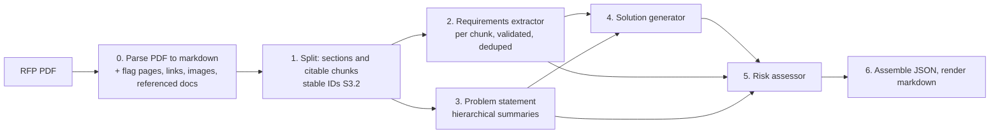
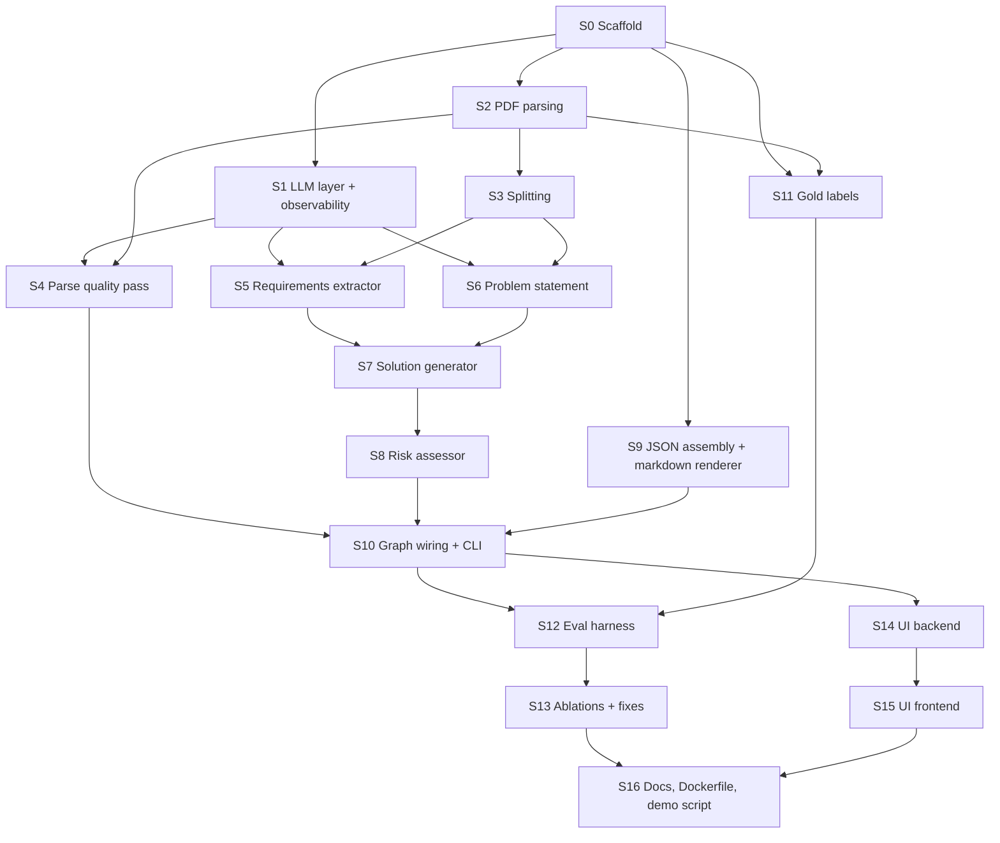

# ROADMAP.md

**This file is the only memory between sessions.** Read it first. Each step is one PR.
Follow the per-step loop in `CLAUDE.md`. Fill in "Detailed plan" when a step starts;
fill in "What was done", "Deviations from plan", "Open issues" when it ends.

Status values: `todo` · `in progress` · `done` · `dropped`.

---

## 0. Project summary (for sessions with cleared context)

36-hour take-home for an AI Engineer (LLM Apps and MLOps) role. Build an LLM/agent
app that ingests the RFP brief in `inputs/` and produces a structured solution summary
(requirements, approach, risks), as a real agentic workflow with an evaluation harness
and observability (tokens, latency, cost). Deliverables: working app plus README,
prompt assets with notes, eval harness with sample results, observability, DECISIONS.md,
3 to 5 minute demo. Also ASSUMPTIONS.md and a rough time log per part. Grading: agentic
depth 30%, eval and observability 20%, LLMOps fluency 15%, craft 15%, communication
10%, novelty 10%. The author defends every decision in a live 60-minute follow-up with a
small live change. **Doing less, cleanly, beats a sprawling half-build.**

Inputs: no brief was provided, so public RFPs stand in (see `docs/ASSUMPTIONS.md`).
Primary brief `data/rfps/missouri.pdf` (copied to `inputs/rfp_brief.pdf`); eval set
adds `NYESD.pdf`, `colfax.pdf`, `federal_way.pdf`. All four are text-native, 4k to 10k
words, fit one context window, have tables that pymupdf4llm renders correctly. Two have
PDF outlines, two do not. Missouri pages 19 to 20 are blank scanned forms; Federal Way
page 5 holds a requirements table as an image.

### Architecture (decided)



Framework LangGraph. Generator DeepSeek, judge Claude, provider and model one config
setting. Keys only in `.env`.

**Traceability rule (steps 2 to 5).** Factual assertions about the client or project
cite the chunk ID that supports them, or are labelled as inferences with the chunk IDs
they come from, or are dropped. Judgments (design choices, severities, mitigations)
need no support but cite the requirement or chunk IDs they respond to. Citations are
IDs, not quotes, except requirements, which keep a verbatim quote verified by string
match. Code checks that every cited ID exists.

**Agentic decision points (minimum).** Validate-and-retry with error feedback on every
structured output; quality-flag escalation in parsing (code flags, LLM confirms, VLM
hook); dedupe grouping with assertion. Critic, revision loop, ReAct are stretch and
only added if evals show a weakness they would fix.

### Repo layout (target)

```
CLAUDE.md  README.md  requirements.txt  .env.example  Dockerfile  pyproject.toml
inputs/rfp_brief.pdf          default input (copy of data/rfps/missouri.pdf)
data/rfps/*.pdf               the four public RFPs (committed)
src/rfp_agent/
  config.py  schemas.py  llm.py  observability.py  graph.py  cli.py
  parsing/   splitting/  agents/{requirements,problem,solution,risk}.py  render/
prompts/<agent>.md            one prompt file per agent
evals/  gold/  results/  harness code
ui/backend (FastAPI)  ui/frontend (Vite + React + Tailwind)
runs/                         local JSON run logs (gitignored except samples/)
tests/
docs/ROADMAP.md DECISIONS.md ASSUMPTIONS.md TIMELOG.md PROMPTS.md
```

---

## 1. Dependency graph



| Step | Depends on | Can run in parallel with | Main files touched |
|---|---|---|---|
| S0 Scaffold | — | — (must land first) | everything top-level, `schemas.py`, `config.py` |
| S1 LLM layer + observability | S0 | S2, S9, S11 | `llm.py`, `observability.py`, `config.py` (pricing) |
| S2 PDF parsing | S0 | S1, S9, S11 | `parsing/` |
| S3 Splitting | S2 | S1, S4, S9, S11 | `splitting/` |
| S4 Parse quality pass | S1, S2 | S3, S5, S6, S9, S11 | `parsing/quality.py`, `prompts/parse_quality.md` |
| S5 Requirements extractor | S1, S3 | S4, S6, S9, S11 | `agents/requirements.py`, `prompts/requirements*.md` |
| S6 Problem statement | S1, S3 | S4, S5, S9, S11 | `agents/problem.py`, `prompts/problem*.md` |
| S7 Solution generator | S5, S6 | S4, S9, S11 | `agents/solution.py`, `prompts/solution.md` |
| S8 Risk assessor | S7 | S4, S9, S11 | `agents/risk.py`, `prompts/risk.md` |
| S9 JSON assembly + markdown renderer | S0 | S1 to S8, S11 | `render/` |
| S10 Graph wiring + CLI | S4, S8, S9 | S11 | `graph.py`, `cli.py` |
| S11 Gold labels | S2 | S1, S3 to S10 | `evals/gold/` |
| S12 Eval harness | S10, S11 | S14 | `evals/` |
| S13 Ablations + fixes | S12 | S14, S15 | prompts, agents, `evals/results/` |
| S14 UI backend | S10 | S12, S13 | `ui/backend/` |
| S15 UI frontend | S14 | S12, S13 | `ui/frontend/` |
| S16 Docs, Dockerfile, demo script | S13, S15 | — | `README.md`, `Dockerfile`, `docs/` |

Parallel work rule: two agents may run concurrently only on steps listed as parallel
with each other, and must not edit each other's "main files". Shared files
(`schemas.py`, `config.py`, `requirements.txt`, `README.md`) are edited only with a
one-line note in the step's "What was done" so merges are easy to resolve.

---

## 2. Core steps

### S0. Scaffold
- **Status:** todo
- **Goal:** the common foundation every other step builds on: repo layout, conda env and
  pinned `requirements.txt`, `config.py` (provider/model single setting, paths, pricing
  table stub), Pydantic v2 `schemas.py` for every pipeline artefact (ParsedDocument with
  pages, tables, images, referenced_documents, flags; Section; Chunk with stable ID,
  section path, page; Requirement with ID, text, type, strictness, quote, chunk IDs;
  Ambiguity; ProblemStatement with cited claims; Solution with requirement coverage;
  Risk with severity, likelihood, justification, IDs; RunLog with per-node tokens,
  latency, cost), `.env.example`, GitHub Actions CI (ruff + pytest), `prompts/`
  directory with a README, `inputs/rfp_brief.pdf` copied from `data/rfps/missouri.pdf`
  (the four RFPs are already committed under `data/rfps/`), README skeleton with the
  pipeline diagram, `tests/` with a schema round-trip test. The agent creates the
  `rfp-solution-gen` conda env itself. Create the `core` branch.
- **Depends on:** —
- **Parallel with:** — (lands first)
- **Detailed plan:** _(fill in when the step starts)_
- **What was done:**
- **Deviations from plan:**
- **Open issues:**

### S1. LLM layer and observability core
- **Status:** todo
- **Goal:** `llm.py`: chat-model factory from config (DeepSeek default, Claude and any
  LangChain model swappable), a `structured_call()` helper that enforces a Pydantic
  schema with bounded retry feeding the validation error back, and records the retry
  count. `observability.py`: per-run JSON log under `runs/` with per-node input/output
  tokens, latency, cost from the pricing table (cache tokens if the provider reports
  them), model ID, temperature, prompt file hashes; Langfuse callback handler wired
  through LangChain and a no-op when keys are absent. Unit tests with a fake model.
- **Depends on:** S0
- **Parallel with:** S2, S9, S11
- **Detailed plan:** _(fill in when the step starts)_
- **What was done:**
- **Deviations from plan:**
- **Open issues:**

### S2. PDF parsing (library path)
- **Status:** todo
- **Goal:** `parsing/`: pymupdf4llm to markdown per page with tables kept as markdown
  tables; use the PDF outline when present. Code heuristics flag suspicious pages (low
  word count, large image blocks, broken table rows, fragmented lines) into a
  `flags` list with the reason. Extract every hyperlink (annotation and plain-text URL)
  and every reference to an attachment, appendix, exhibit, schedule or addendum, with
  the section it appears in, into `referenced_documents`. Record image blocks per page
  (page, size, nearby caption). Unicode normalisation (curly quotes, split URLs inside
  table cells). Output a `ParsedDocument`. Tests on all four RFPs with assertions on
  page count, table count, known flags (Missouri p19 to 20, Federal Way p5) and known
  references (Colfax Attachments A to G). Leave a `escalate(page)` hook stub for S4.
- **Depends on:** S0
- **Parallel with:** S1, S9, S11
- **Detailed plan:** _(fill in when the step starts)_
- **What was done:**
- **Deviations from plan:**
- **Open issues:**

### S3. Section and chunk splitting
- **Status:** todo
- **Goal:** `splitting/`: split on the RFP's own headings (outline first, heading
  detection fallback for documents without an outline), keep the title attached; split
  each section into citable chunks by subsection where present, otherwise by a size cap
  of a few hundred tokens with small overlap. Deterministic stable IDs (`S3.2`), section
  path and page on every chunk. Tag sections narrative vs requirement-bearing by cheap
  heuristics (modal verbs, "shall", numbered lists). Tests: determinism across runs,
  every character of the document lands in exactly one section, chunk size bounds,
  fixtures for both an outlined and a non-outlined RFP.
- **Depends on:** S2
- **Parallel with:** S1, S4, S9, S11
- **Detailed plan:** _(fill in when the step starts)_
- **What was done:**
- **Deviations from plan:**
- **Open issues:**

### S4. Parse quality pass (LLM judge of flagged pages, VLM hook)
- **Status:** todo
- **Goal:** for pages flagged by S2 heuristics, one LLM call judges whether the page's
  extracted text is usable; pages confirmed bad are passed to a VLM hook that in core
  only records "would escalate" (transcription is stretch). Log for every escalation
  whether code or the model triggered it. Prompt `prompts/parse_quality.md`. Tests with
  a fake model.
- **Depends on:** S1, S2
- **Parallel with:** S3, S5, S6, S9, S11
- **Detailed plan:** _(fill in when the step starts)_
- **What was done:**
- **Deviations from plan:**
- **Open issues:**

### S5. Requirements extractor
- **Status:** todo
- **Goal:** `agents/requirements.py`: per-chunk structured extraction (ID, text, type,
  strictness as a separate field, verbatim quote, chunk ID) plus an ambiguities list.
  Around the LLM, code does: schema validation with bounded retry, quote verification
  by string match against the cited chunk (reject or mark unverified), merge, exact
  dedupe, then one LLM grouping pass for fuzzy dedupe; code merges groups, keeps all
  quotes and chunk IDs, keeps the stricter strictness, asserts every original ID lands in
  exactly one group, and flags conflicts rather than merging them. Gaps list optional
  and separate. Prompts `prompts/requirements_extract.md`, `prompts/requirements_dedupe.md`
  with design notes in `docs/PROMPTS.md`. Tests with a fake model for the code paths.
- **Depends on:** S1, S3
- **Parallel with:** S4, S6, S9, S11
- **Detailed plan:** _(fill in when the step starts)_
- **What was done:**
- **Deviations from plan:**
- **Open issues:**

### S6. Problem statement (hierarchical)
- **Status:** todo
- **Goal:** `agents/problem.py`: stage one summarises each chunk ("what is being built,
  for whom, why, under what constraints") tagged with its chunk ID, near-empty for
  irrelevant chunks; stage two synthesises client situation, goal, success criteria,
  main constraints, every factual claim citing chunk IDs, inferences labelled. Also a
  full-text baseline path behind a config flag for the S12 comparison. Code validates
  that cited IDs exist. Prompts `prompts/problem_chunk.md`, `prompts/problem_synthesis.md`.
- **Depends on:** S1, S3
- **Parallel with:** S4, S5, S9, S11
- **Detailed plan:** _(fill in when the step starts)_
- **What was done:**
- **Deviations from plan:**
- **Open issues:**

### S7. Solution generator
- **Status:** todo
- **Goal:** `agents/solution.py`: inputs problem statement, requirements with quotes
  and chunk IDs, ambiguities. Output a structured approach whose components cite the
  requirement IDs they address so mandatory coverage is computable by code; factual
  claims cite chunk or requirement IDs. Code computes coverage of mandatory
  requirements and lists uncovered ones. Prompt `prompts/solution.md`.
- **Depends on:** S5, S6
- **Parallel with:** S4, S9, S11
- **Detailed plan:** _(fill in when the step starts)_
- **What was done:**
- **Deviations from plan:**
- **Open issues:**

### S8. Risk assessor
- **Status:** todo
- **Goal:** `agents/risk.py`: reads the solution and everything before it; covers
  risks inherent in the RFP (timelines, vague or conflicting requirements, missing
  budget, referenced-but-absent documents, flagged pages) and risks created by the
  solution. Structured output: risk, severity, likelihood (scales defined in this
  step's plan), justification, requirement and chunk IDs. Code validates IDs. Prompt
  `prompts/risk.md`.
- **Depends on:** S7
- **Parallel with:** S4, S9, S11
- **Detailed plan:** _(fill in when the step starts)_
- **What was done:**
- **Deviations from plan:**
- **Open issues:**

### S9. JSON assembly and markdown renderer
- **Status:** todo
- **Goal:** `render/`: assemble the final `SolutionSummary` JSON (source of truth) and
  render markdown from it in code with citations shown as "section title, page" and
  requirement quotes inline. Golden-file tests from fixture JSON. No LLM.
- **Depends on:** S0
- **Parallel with:** S1 to S8, S11
- **Detailed plan:** _(fill in when the step starts)_
- **What was done:**
- **Deviations from plan:**
- **Open issues:**

### S10. LangGraph wiring and CLI
- **Status:** todo
- **Goal:** `graph.py`: the pipeline as a LangGraph graph with the parallel fan-out
  (S5 and S6), per-node observability from S1, event streaming usable by the UI.
  `cli.py`: `python -m rfp_agent run inputs/rfp_brief.pdf` writes JSON, markdown and the
  run log; `--full-text-problem` and `--single-call-extraction` flags for ablations.
  First end-to-end run on the primary brief; commit the sample outputs and run log
  under `runs/samples/`; start the failure-modes list in `docs/DECISIONS.md`.
- **Depends on:** S4, S8, S9
- **Parallel with:** S11
- **Detailed plan:** _(fill in when the step starts)_
- **What was done:**
- **Deviations from plan:**
- **Open issues:**

### S11. Gold labels
- **Status:** todo
- **Goal:** `evals/gold/`: for each of the four RFPs, gold requirements (text, type,
  strictness, quote) and a problem-statement checklist of 8 to 12 must-mention facts,
  drafted by Claude from the parsed text and hand-corrected; record the fraction of
  labels corrected per RFP. Federal Way's image-only ERP table is labelled by hand so
  the known parsing miss is visible. A labelling script and a README on the format.
- **Depends on:** S2
- **Parallel with:** S1, S3 to S10
- **Detailed plan:** _(fill in when the step starts)_
- **What was done:**
- **Deviations from plan:**
- **Open issues:**

### S12. Evaluation harness
- **Status:** todo
- **Goal:** `evals/`: run the pipeline over the four RFPs and score. Requirements:
  match extracted to gold, precision and recall, type and strictness accuracy on matched
  pairs. Grounding on every cited output: code checks (cited IDs exist; numbers, dates,
  amounts, proper nouns appear in the source) and a Claude judge that sees only the
  claim and the cited chunk; unsupported-claim count per output. Problem statement:
  checklist coverage by judge plus grounding. Solution: mandatory coverage by code and
  judge, rubric judge (specificity, feasibility, consistency with constraints),
  grounding, consistency across repeated runs, pairwise judge with order swapped for
  ablations. Reads the local run logs for cost and latency. Commit results under
  `evals/results/` with a short README; hand-score a sample for judge agreement.
- **Depends on:** S10, S11
- **Parallel with:** S14
- **Detailed plan:** _(fill in when the step starts)_
- **What was done:**
- **Deviations from plan:**
- **Open issues:**

### S13. Ablations and fixes driven by evals
- **Status:** todo
- **Goal:** run and commit: hierarchical vs full-text problem statement (several runs
  each, variance), per-chunk vs single-call extraction. Fix the failure modes the evals
  expose (prompt edits logged in `docs/PROMPTS.md`, code fixes), each with a
  before/after number in `docs/DECISIONS.md`. Decide with evidence whether any
  back-burner agentic feature (critic, revision loop) is justified; if not, say why.
- **Depends on:** S12
- **Parallel with:** S14, S15
- **Detailed plan:** _(fill in when the step starts)_
- **What was done:**
- **Deviations from plan:**
- **Open issues:**

### S14. UI backend (FastAPI)
- **Status:** todo
- **Goal:** `ui/backend/`: upload a PDF, start a run, stream LangGraph node events over
  SSE with per-node latency, tokens and cost, serve every intermediate output (parsed
  markdown, chunks, requirements, ambiguities and gaps, problem statement, solution,
  risks), the rendered markdown, the run summary with Langfuse trace link, JSON and
  markdown downloads, and a chunk lookup endpoint for source reveal. Define the API
  contract up front so S15 can start against it.
- **Depends on:** S10
- **Parallel with:** S12, S13
- **Detailed plan:** _(fill in when the step starts)_
- **What was done:**
- **Deviations from plan:**
- **Open issues:**

### S15. UI frontend (Vite, React, Tailwind)
- **Status:** todo
- **Goal:** `ui/frontend/`: upload and view the source PDF alongside; live per-node
  progress with metrics (doubles as the metrics dashboard); main view of the rendered
  solution; views for every intermediate output, requirements table filterable by type
  and strictness, risks sorted by severity; click any requirement, risk or cited claim
  to reveal its source (quote or chunk with section and page); run summary with totals
  and Langfuse link; download buttons. Visual language based on Emigre-era design
  (expressive display type, asymmetric grid, rules and whitespace, one accent, open-licence
  fonts; no copied layouts, no licensed Emigre faces), single aesthetic, no theme toggle.
  Functional first; screenshot-critique-adjust with Playwright MCP within budget, deeper
  polish is stretch ST1.
- **Depends on:** S14
- **Parallel with:** S12, S13
- **Detailed plan:** _(fill in when the step starts)_
- **What was done:**
- **Deviations from plan:**
- **Open issues:**

### S16. Documentation, Dockerfile, demo script
- **Status:** todo
- **Goal:** README complete (how to run CLI and UI, where the key goes, how to run
  evals, pipeline diagram, demo script listing what to click in what order, a short
  "live change rehearsal" list: swap model, edit a prompt, add a requirement type);
  Dockerfile for local run; `docs/PROMPTS.md` design notes complete; `docs/TIMELOG.md`
  totals per deliverable; `docs/DECISIONS.md` evidence fields updated; sample run logs
  and eval results committed. Then merge `core` into `main`, delete `core`, sync.
- **Depends on:** S13, S15
- **Parallel with:** —
- **Detailed plan:** _(fill in when the step starts)_
- **What was done:**
- **Deviations from plan:**
- **Open issues:**

---

## 3. Stretch goals (own branches off `main`, only after core is merged)

Priority order. Each gets the same entry structure when started.

| ID | Stretch goal | Depends on | Notes |
|---|---|---|---|
| ST1 | UI visual polish: Emigre-direction iteration with Playwright screenshots | S15 | First stretch item |
| ST2 | VLM transcription of flagged pages and images, compared against the library parser | S4, S12 | Measurable on Federal Way p5 |
| ST3 | Fetch and ingest hyperlinked or referenced external documents | S2, S5 | Colfax Attachments F and G as test |
| ST4 | Critic/reviewer agent | S13 | Only if S13 evidence shows a weakness it fixes |
| ST5 | Revision loop with hard iteration cap | ST4 | |
| ST6 | Per-theme drafting and sub-problem decomposition in the solution step | S13 | Needs baseline comparison |
| ST7 | Model-family benchmark: Claude vs DeepSeek on cost, latency, quality with identical prompts; third family for label drafting | S12 | Commit results |
| ST8 | Retrieval-based grounding beyond chunk citations | S12 | |
| ST9 | Observability dashboard in the UI beyond live progress | S15 | |
| ST10 | Cloud deployment | S16 | Only with all core and evals done |
| ST11 | Observability extras: retry and validation-failure counts per node, escalation events, cache tokens, prompt/config hash, code-computed quality signals per run | S1 | Lowest priority; not planned for implementation |

---

## 4. Known facts for planning (from the 2026-10-30 inspection)

- Missouri: budget not to exceed $175,000; contract Nov 2024 to Feb 2026 with a dated
  milestone table; Tasks 1 to 6; Section 5 has 24 lettered legal clauses; pages 13 to
  18 are IT standards with hard constraints (Python needs IS review-team approval, no
  PII in database tables, WCAG 2.1 AA). Good test for the risk assessor.
- NYESD: no PDF outline, 63 hyperlinks, references Appendix A/B and Schedule A.
- Colfax: has an outline, Attachments A to G provided separately; F and G hold the
  software requirements, so the "referenced but absent" gap case is real.
- Federal Way: no outline, 10 tables, page 5 ERP environment table is an image; the
  functional requirements live in a separate document not provided.
- pymupdf4llm artefacts seen: bold URLs split across lines inside table cells, curly
  apostrophes, a merged header cell in the cost-estimate table.
- Every document fits one context window, so single-call extraction is a fair baseline.
