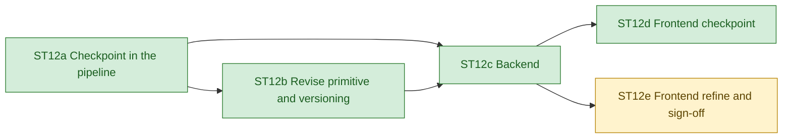

# ST12. Human in the loop: checkpoint and refine

Feature index for stretch goal ST12 on the long-lived branch `hitl`. Read this first,
then the step file of the step being worked on. Core steps S0 to S16 and the other
stretch goals stay in [../ROADMAP.md](../ROADMAP.md); decisions are in
[../DECISIONS.md](../DECISIONS.md).

**Brief.** A pursuit lead must be able to confirm what the machine read before anything
is drafted, steer the draft with what the RFP does not contain, iterate on the draft in
prose, and sign off a named version. One mode, two human touchpoints, one loop:

1. **Read** (machine): parse, quality pass, split, requirements and problem statement.
2. **Checkpoint** (human): confirm the requirements (accept, reject, change strictness
   or type; anything that produces new text goes through the model with the extractor's
   validators) and write the **pursuit brief** (win themes, capabilities, constraints,
   client context not in the RFP, things to avoid).
3. **Draft** (machine): solution, risks, summary, with the brief as citable evidence
   (`H1`, `H2`...) so claims that rest on human input are traceable and visibly
   distinct from claims that rest on the RFP.
4. **Refine** (human and machine): instruction-driven revisions of any artefact,
   applied by the model, re-validated by code, shown as a diff; downstream artefacts
   marked stale and regenerated on request, never automatically.
5. **Sign-off** (human): freeze the version, render the review history.

Guards, in priority order: non-compliance (a missed or wrong mandatory requirement
propagating into the draft), ungrounded or over-promising claims, generic solutions,
silent regressions from edits, no audit trail, cost blindness. The full reasoning is in
`docs/DECISIONS.md` D42.

Pause and resume go through the run directory: every stage already writes its JSON, so a
paused run is reloaded from those files and the graph is invoked from `solution`. No
checkpointer (D1 extended), the paused run survives a backend restart and frees the
single worker. Unattended runs (`--unattended`, the eval harness, CI) auto-confirm the
checkpoint with no brief and produce the same output as before ST12.

Branching: long-lived feature branch `hitl` off `main`; one short-lived branch per
sub-step (`st12a-checkpoint`...) as a PR into `hitl`, merged by the agent. The final PR
`hitl` → `main` is the author's call.

**Progress (2026-11-02):** ST12a to ST12d done (the UI takes the checkpoint; the API
drives revisions, regenerations and sign-off). ST12e is ready: after the draft, the UI
has no refine or sign-off screens yet; ST12d's hooks already refetch revised artefacts
by version, and `RunPage.tsx` now has the Checkpoint tab and the lifecycle banner.

| Step | Depends on | Can run in parallel with | Main files touched |
| --- | --- | --- | --- |
| ST12a | S10 | — | `src/rfp_agent/{schemas,graph,cli,brief,checkpoint}.py`, `agents/{solution,risk}.py`, `render/*`, `prompts/{solution,risk}.md`, tests |
| ST12b | ST12a | ST12c | `src/rfp_agent/{versions,refine}.py`, `agents/revise.py`, `prompts/revise_*.md`, `cli.py`, `graph.py` (end stage, confirmed load), `schemas.py` (revision contracts), `render/markdown.py`, tests |
| ST12c | ST12a, ST12b | — | `ui/backend/*`, `tests/test_ui_backend.py` |
| ST12d | ST12c | ST12e | `ui/frontend/src/views/Checkpoint*.tsx`, `hooks/*`, `api/*`, `lib/{brief,checkpoint,lifecycle,revisions,storage,stages}.ts`, `components/{Lifecycle,StageTimeline,UploadForm,ui}.tsx`, `RunPage.tsx` (shared) |
| ST12e | ST12c | ST12d | `ui/frontend/src/views/*View.tsx`, `components/Revise*.tsx`, `SignOff*.tsx` |

## Steps

| Step | Status | File | Summary |
| --- | --- | --- | --- |
| ST12a Checkpoint in the pipeline | done | [ST12a-checkpoint.md](ST12a-checkpoint.md) | The pipeline pauses after requirements and problem extraction, takes a named reviewer's decisions and a pursuit brief that becomes citable evidence (H1, H2...), and resumes drafting from the run directory; unattended runs are unchanged. |
| ST12b Revise primitive and versioning | done | [ST12b-revise.md](ST12b-revise.md) | A reviewer's instruction revises any artefact under its stage's own checks (requirements as a quote-verified patch, the rest whole with stable IDs and no coverage loss), every change is versioned with a code-computed diff and cost, dependants go stale until regenerated, and sign-off freezes the run; live loop on Missouri cost $0.11. |
| ST12c Backend | done | [ST12c-backend.md](ST12c-backend.md) | The backend drives the whole human loop over HTTP: uploads pause at the checkpoint, the checkpoint, revisions, regenerations and sign-off are endpoints queued on the one worker, the run's state and allowed actions are derived from its files so paused and signed-off runs survive a restart, and SSE reports every state change; live Missouri loop through the API with a restart cost $0.12. |
| ST12d Frontend checkpoint | done | [ST12d-frontend-checkpoint.md](ST12d-frontend-checkpoint.md) | The UI takes the checkpoint: a Checkpoint tab with per-row reject, strictness and type held as a browser-side draft, model instructions on the requirements or problem with each revision summarised, a pursuit brief with a live preview of its H1..Hn paragraphs, and confirm under a reviewer name, below a lifecycle banner that follows every run state live; live Missouri checkpoint through the UI with a restart cost $0.085. |
| ST12e Frontend refine and sign-off | in progress | [ST12e-frontend-refine.md](ST12e-frontend-refine.md) | (todo) Suggest-edits panel, diff view, versions, stale banners with regenerate, sign-off and review history in the UI. |
