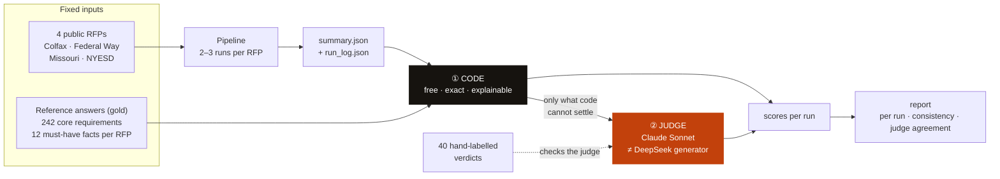
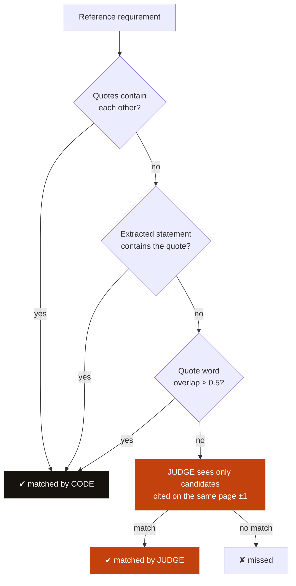
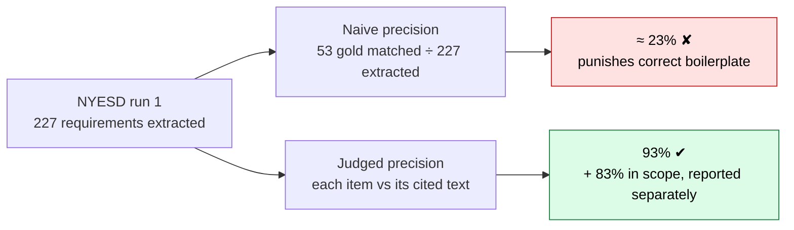
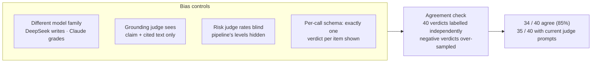
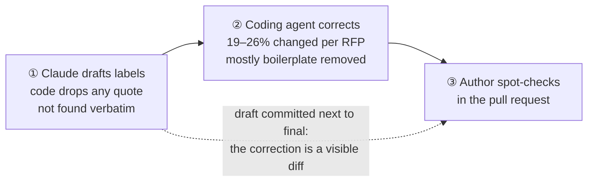
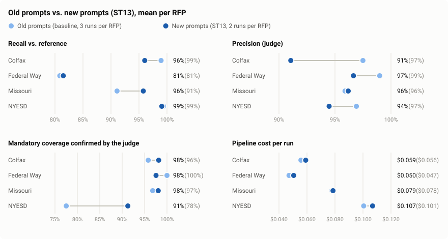
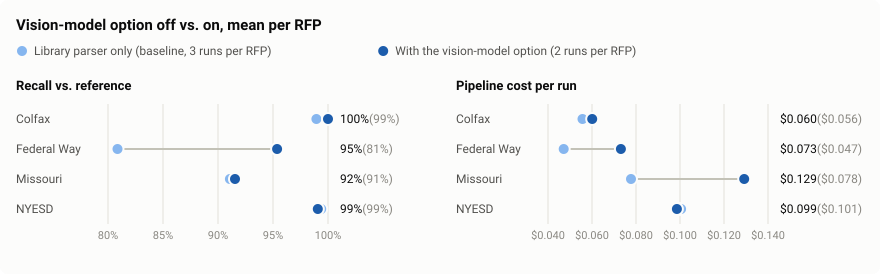

# Evaluation harness

> [!IMPORTANT]
> **Every prompt or model change is judged by numbers, not by reading a few outputs.**
> Fixed inputs (4 public RFPs), fixed reference answers, code scores what code can,
> a judge from a *different model family* scores the rest, and the judge is itself checked.

## The numbers

Current prompts, 2 runs on each of 4 RFPs (`evals/results/prompt_structure/`).

|                             | Result                              | What it means                                                                                                                                                                        |
| --------------------------- | ----------------------------------- | ------------------------------------------------------------------------------------------------------------------------------------------------------------------------------------ |
| **Requirement recall**      | **95–100%** (Federal Way 81%)       | Share of all 242 core reference requirements the pipeline found, whatever their strictness. Federal Way's 8 missing items sit on an image-only page; 96% of what the parser can read |
| **Precision**               | **91–97%**                          | Extracted items the judge confirms are real obligations, supported by the cited text                                                                                                 |
| **Mandatory coverage**      | **100%** cited · **91–100%** judged | Every must-do requirement is answered by a solution component, and the judge agrees the text really meets it                                                                         |
| **Problem-statement facts** | **8–10 of 12** (+2–4 partial)       | Key facts any correct summary must contain (issuer, budget, dates…)                                                                                                                  |
| **Dangling citations**      | **0** on every scored run           | No claim points at an ID that does not exist                                                                                                                                         |
| **Judge vs hand labels**    | **34 / 40** (85%)                   | How often the judge agrees with an independent labelling                                                                                                                             |
| **Cost per RFP**            | **$0.05–0.11**, 67–113 s            | Judging costs ~**6×** that ($0.35–0.70 per run)                                                                                                                                      |

**Recall by strictness**: same runs, range over the 2 runs per RFP.

| Strictness (reference items) | Colfax     | Federal Way  | Missouri    | NYESD       |
| ---------------------------- | ---------- | ------------ | ----------- | ----------- |
| **Mandatory: "must"** (186)  | **94–96%** | **81–84%**   | **95–96%**  | **98–100%** |
| Desired: "should" (52)       | 100%       | 100%         | 93–100%     | 100%        |
| Optional: "may" (4)          | –          | 0–33% (of 3) | 100% (of 1) | –           |

The reference set is **core**, not mandatory-only: 77% of it is mandatory. Federal Way's gap is mostly in **mandatory** items: 6 of the 8 items on the image-only page are mandatory (the existing systems the new software must replace or connect to). With the vision model on, Federal Way mandatory recall is **95%**.

---

## 1 · How it works



**Talking points**
- Same four RFPs, same reference answers every time, so two runs are comparable.
- Code goes first: a requirement quote is a verbatim span of the parsed text, so matching by quote is exact and costs nothing.
- The judge only gets the leftovers: paraphrases, "does this text really meet that requirement?", "does the cited text say this?".

<details>
<summary>Glossary for this page</summary>

- **RFP** (request for proposal): the document a buyer publishes asking companies to bid for a job.
- **Requirement**: something the bidder must or should do or provide ("shall submit by 4 p.m.").
- **Strictness**: how binding a requirement is. **Mandatory** = "must" or "shall", **desired** = "should" (scores points if met), **optional** = "may".
- **Mandatory requirement**: a "must", not a "should". In *coverage*, submission logistics (deadline, file format, where to send the bid) are left out; in *recall* they count.
- **Boilerplate**: standard legal clauses that appear in every contract (insurance, non-discrimination). They rarely change how you design a bid.
- **Gold labels / reference answers**: the answers the pipeline's output is compared against.
- **Recall**: of the reference requirements, how many the pipeline found. **Precision**: of what the pipeline found, how much is correct.
- **Judge**: a second language model asked to grade the output.
</details>

---

## 2 · What gets scored

| Output | Question | Scored by |
|---|---|---|
| **Requirements** | Found the ones that matter? Are they real? Type and strictness right? | Code match → judge for leftovers; judge rates every item |
| **Problem statement** | Does it state the 12 must-have facts? | Judge, fact by fact |
| **Grounding** | Does the cited text actually say what the claim says? | Code (IDs, numbers, names) + judge that sees **only the cited text** |
| **Solution** | Every mandatory requirement covered, by citation *and* in substance? Specific, feasible, consistent? | Code counts citations; judge confirms + 1–5 rubric |
| **Risks** | Severity and likelihood sensible? Every detected issue gets a risk? | Judge re-rates **blind**; code + judge check issues are addressed |
| **Cost & latency** | Cost, time, retries and why | Code, from the run log |
| *Across runs* | Same answer twice? | Mean ± spread, overlap of what was found |

---

## 3 · Code first, judge second

How one reference requirement gets matched:



- **Code alone finds 69–94% of the reference requirements** before any paid call.
- Both figures are reported: **code-only recall is a hard lower bound**, judged recall the upper. The truth lies between.
- The judge gets a short candidate list, not the whole document: cheaper and harder to get wrong.

---

## 4 · Why precision is judged item by item

The reference set is deliberately **core-only**: it leaves out boilerplate. So "extracted but not in the reference" is **not** an error.



- **Recall** against the reference: did it find what matters?
- **Precision** by the judge, per item: is each extracted item a real obligation, supported by the text it cites?
- **In-scope share** shown on its own: how much surplus the extractor adds (81–96%).

---

## 5 · Who checks the judge



| Verdict kind | Agree |
|---|---|
| Precision | 11 / 12 |
| Grounding | 10 / 12 |
| Checklist facts | 7 / 8 |
| Coverage | 6 / 8 |

**Hiding the pipeline's own risk levels mattered.** When the judge could see them, it agreed 100% of the time. Hidden, agreement dropped to 92% on severity and 58% on likelihood. The setup had been producing the agreement.

---

## 6 · Where the reference answers come from



> [!CAUTION]
> **Known limitation: the reference answers are AI-made.** In a real project, one or two bid specialists would label them by hand, and a person would label the judge-agreement sample.
> With 36 hours, hand-labelling ~250 requirements was out of reach. So the scores measure agreement with a careful *model* reading, and a blind spot shared by all the models would not show up.
> Swapping in expert labels needs **no code change**: same file format, and `label check` verifies every quote.

---

## 7 · What the harness let me decide

| Experiment | Result | Decision |
|---|---|---|
| **Vision model for image-only pages** | Federal Way recall **81% → 95%** (mandatory 81% → 95%), all 8 page-5 items found; +$0.02 per run | Kept as an option, off by default (D42) |
| **One call for all requirements** (instead of one per chunk) | Recall within 2 pts, 30–45% cheaper… but **truncates on long RFPs** and drops whole obligations | Rejected (D39) |
| **Problem statement from full text** | Within run-to-run noise, 10–25% cheaper | Rejected: the UI and the per-claim citations rely on the per-chunk path (D39) |
| **Prompt rewrite** to one shared structure | Neutral to slightly positive | Adopted (D51) |
| **Judge too lenient** on matches missing a date | Missouri recall 99/100/94% → **93/93/87%** after the fix | Judge prompt fixed (F14) |

Old prompts vs. current prompts:



Vision model off vs. on:



- **Changing the judge and the generator together makes the result unreadable**, so `baseline_rejudged` rescored the *old* outputs with the *new* judge prompts.
- Differences under ~3 points are inside the run-to-run spread.

---

## 8 · Honest weak spots

- **Risk severity agreement is low on NYESD (33–50%)**. Elsewhere it is 67–83%. Risk levels are judgment calls, and the scale has no ground truth.
- **"Partially supported" claims are common**, especially risks (5–11 of 12), because risks look forward and rest on more than one fact.
- **Two runs per arm** shows whether a difference is inside the noise. It is not enough to rank close alternatives.
- **Open:** the grounding judge occasionally runs away inside a reason string (F17).

---

<details>
<summary><b>Detail:</b> commands (run, score, report, check the judge)</summary>

```bash
python -m evals.harness run --label baseline --all --runs 2 --reuse-samples
python -m evals.harness score --label baseline
python -m evals.harness score --label baseline --no-judge
python -m evals.harness report --label baseline
python -m evals.harness sample --label baseline
python -m evals.harness agree --label baseline
python -m evals.harness diff baseline ablation_vlm --what requirements
python -m evals.harness chart baseline prompt_structure -o docs/images/x.svg
```

- `run` is paid (~$0.60 for 8 runs). `score` with the judge is paid (~$4–5). `--no-judge`, `report`, `diff` and `chart` are free.
- `score --only match` re-runs one judge and merges into the existing scores (~$0.40 instead of $5).
- `score` skips runs already scored, so an interrupted scoring run resumes.
</details>

<details>
<summary><b>Detail:</b> where things live</summary>

| Path | What |
|---|---|
| `evals/harness/` | Harness code: `match.py` (code tier), `judge.py`, `grounding.py`, `agreement.py`, `consistency.py`, `pairwise.py`, `report.py`, `chart.py` |
| `evals/gold/<rfp>.json` | Reference answers; `<rfp>.draft.json` is the untouched model draft |
| `evals/results/<label>/summary.md` | The report: start here |
| `evals/results/<label>/scores/` | Every verdict with the item's text and the judge's reason |
| `evals/results/<label>/judge_logs/` | The judge's own cost log, same format as the pipeline's |
| `prompts/judge_*.md` | One prompt per judge |
| `evals/results/README.md` | How to read every column |
</details>

<details>
<summary><b>Detail:</b> judge configuration</summary>

- Model `anthropic:claude-sonnet-5-5`, effort `medium` (hundreds of classification-like calls; keeps thinking tokens down).
- 32,000-token output cap: an earlier cap truncated judge replies (F13).
- Calls go through the same `structured_call` as the pipeline, so retries, cost and latency are logged the same way.
- Per-call schema demands exactly one verdict per ID shown. A dropped or invented ID goes back as a validation error (the F4 fix: the judge once returned 3 checklist facts instead of 12).
- Grounding is judged in batches of 10. Assumptions are judged as *positions*: only the facts they state about the RFP must be supported.
- An A/B pairwise judge (`compare`) runs both orders to expose position bias.
</details>

<details>
<summary><b>Detail:</b> per-RFP results, current prompts</summary>

| RFP | Recall | Code-only | Precision | Judged coverage | Checklist | Cost | Time |
|---|---|---|---|---|---|---|---|
| Colfax | 95–97% | 89% | 91% | 98% | 9–10 (+2–3) | $0.06 | 80 s |
| Federal Way | 81% (96% readable) | 69–74% | 96–97% | 95–100% | 9 (+2–3) | $0.05 | 73 s |
| Missouri | 96% | 92–94% | 96% | 97–99% | 8–10 (+2–4) | $0.08 | 90 s |
| NYESD | 98–100% | 83–87% | 93–96% | 91% | 9 (+3) | $0.11 | 108 s |

Run-to-run overlap of matched requirements (Jaccard): 0.94–0.98.
</details>

<details>
<summary><b>Detail:</b> decisions behind this harness</summary>

- [D36](../archive/DECISIONS-full.md#d36-evals-code-first-judge-second-recall-against-gold-precision-judged-per-item): code first, judge second; recall against gold, precision per item
- [D37](../archive/DECISIONS-full.md#d37-grounding-code-heuristics-plus-a-judge-that-sees-only-what-is-cited): grounding judge sees only the cited text
- [D23](../archive/DECISIONS-full.md#d23-gold-labels-core-only-scope-claude-drafts-agent-corrects-diff-is-the-record): gold labels, core-only, draft kept as the record
- [D3](../archive/DECISIONS-full.md#d3-deepseek-generates-claude-judges-single-family-per-role): DeepSeek generates, Claude judges
- [D39](../archive/DECISIONS-full.md#d39-ablations-hierarchy-and-chunking-are-kept-for-scale-and-traceability-not-for-quality-the-evals-can-see): ablations
- Failure modes hit: F4 (judge fact count), F13 (judge truncated), F14 (lenient matches), F17 (open)
</details>
