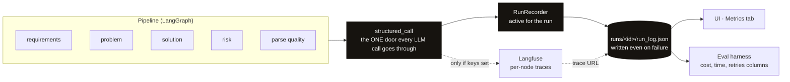
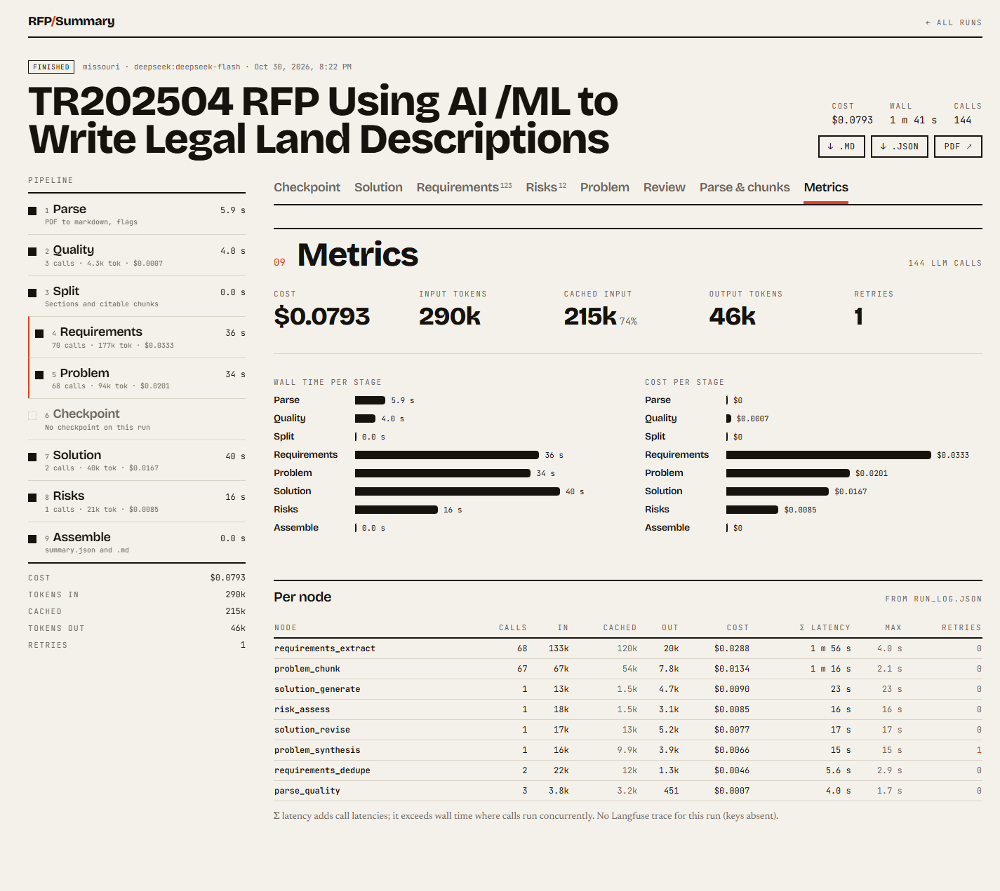
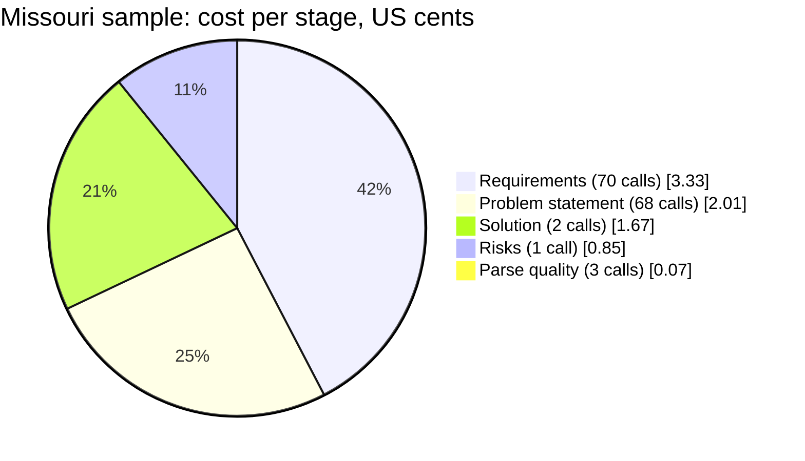
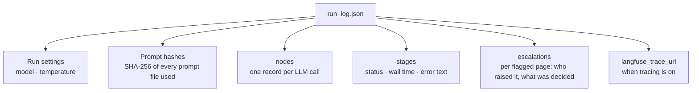

# Observability harness

> [!IMPORTANT]
> **Every LLM call leaves a record: tokens, cost, latency, retries and *why* it retried.** It goes into one JSON file per run, written even when the run fails.
> The UI, the eval harness and the judge all read that same file. Langfuse tracing rides alongside and switches itself off without keys.

## The numbers (one real run: Missouri sample)

| Calls | Cost | Wall time | Input tokens | Served from cache | Output tokens | Retries |
|---|---|---|---|---|---|---|
| **144** | **\$0.079** | **1 m 41 s** | 290k | **215k (74%)** | 46k | **1**, with its cause logged |

Across the eval runs: **\$0.05–0.11 and 67–113 s per RFP**. The eval's own judge is logged the same way: ~**6×** the pipeline's cost.

---

## 1 · How it is wired



**Talking points**
- **One choke point.** Every model call, pipeline or judge, goes through `structured_call`. Nothing can call a model without being recorded.
- **Local first.** The JSON log needs no hosted service, so the demo and the evals never depend on Langfuse being up.
- **Langfuse is optional.** It is a LangChain callback added only when both keys are set. Without keys it is never even imported.

---

## 2 · What the UI shows



Left: each stage with its time, calls, tokens and cost, live while the run is going. Right: totals, time and cost per stage, and the per-node table read from `run_log.json`.

---

## 3 · Where time goes

Requirements and problem statement run **in parallel**. Times from the Missouri run log:

```mermaid
gantt
    title Missouri sample run, seconds from start
    dateFormat HH:mm:ss
    axisFormat %M:%S
    section Code
    Parse PDF            :c1, 00:00:00, 00:00:06
    Split into chunks    :c2, 00:00:10, 00:00:11
    Assemble and render  :c3, 00:01:41, 00:01:42
    section LLM
    Parse quality check  :l1, 00:00:06, 00:00:10
    Requirements · 70 calls :l2, 00:00:10, 00:00:46
    Problem statement · 68 calls :l3, 00:00:10, 00:00:44
    Solution · 2 rounds   :l4, 00:00:46, 00:01:25
    Risks · 1 call        :l5, 00:01:25, 00:01:41
```



## 4 · Where money goes



- **The two per-chunk stages make 138 of the 144 calls** (135 of them one per chunk) and two thirds of the cost.
- **74% of input tokens are served from the provider's cache**: the per-chunk calls repeat the same long prompt, and DeepSeek bills cached input at 2% of the normal rate.

---

## 5 · One record per call

A real entry from the log:

```json
{
  "node": "problem_synthesis",
  "model": "deepseek:deepseek-flash",
  "input_tokens": 15999,
  "output_tokens": 3948,
  "cached_input_tokens": 9856,
  "cost_usd": 0.00664,
  "latency_s": 14.78,
  "retries": 1,
  "last_error": "1 validation error for ProblemStatement: constraints is empty; every list needs at least one claim"
}
```

- **`retries` + `last_error`**: not just *that* a call retried but *why*. This field was added after a retry showed up with no recorded cause (F7).
- **Retries are summed into one record per logical call**, so a failed validation stays attached to the call that caused it.
- **Recorded on failure too**: a call that exhausts its retries still lands in the log.

---

## 6 · What else the run log holds



| Field | Why it matters |
|---|---|
| **Prompt hashes** | Ties every result to the exact prompt version. An eval comparison across a prompt change can prove which prompts produced which numbers |
| **Stages** | Which stage failed and with what error, even if it made no LLM call |
| **Escalations** | Parse-quality decisions per page. Example: *"p19, raised by code, confirmed bad: the affidavit form is an image, its wording is absent from the text"* |

---

## 7 · Why built this way

| Choice | Alternative | Why |
|---|---|---|
| **Local JSON log + optional Langfuse** | Langfuse only | Nothing depends on a hosted UI being reachable during a demo or a review (D11) |
| **Explicit recorder** that `structured_call` writes to | LangChain callback aggregating by node | Testable without a graph. Retries and validation errors stay attached to their call. No dependence on callback propagation (D18) |
| **Cost from a pricing table in config** | Provider billing API | Per-call, immediate and offline. A model with no price logs a warning instead of guessing |
| **The judge logs like the pipeline** | Separate eval accounting | The cost of *measuring* is on record too: \$3.80 judge vs \$0.59 pipeline for the 8 current runs |

---

## 8 · What it caught

- **F7.** A retry with no recorded cause, so `last_error` was added.
- **F13.** The judge's output was cut off by the token cap. The log showed the truncation; the cap was raised to 32k.
- **F16.** Single-call extraction was cut off at the provider's default cap. `structured_call` does **not** retry a truncated reply (retrying would hit the same cap), and logs it instead.
- **Ablation costs.** Every cost figure in the eval reports (for example "single call is 30–45% cheaper") comes from these logs, not from estimates.

---

> [!note]- Detail: cost is an upper bound
>
> - DeepSeek is priced at peak rates.
> - Cache reads are priced at the cached rate. Cache writes are priced at the normal input rate, but Anthropic bills them at 1.25×, so Claude cost is slightly **under**-counted on calls that write the cache.
>
> | Model | Input \$/M tok | Cached \$/M tok | Output \$/M tok |
> |---|---|---|---|
> | deepseek-flash (generator) | 0.30 | 0.006 | 1.20 |
> | claude-sonnet-5-5 (judge, VLM) | 2.00 | 0.20 | 10.00 |
>
> Source: the pricing table in `src/rfp_agent/config.py`.

> [!note]- Detail: where it lives in code
>
> | What | Where |
> |---|---|
> | `structured_call`: retry loop, truncation check, recording | `src/rfp_agent/llm.py` |
> | `RunRecorder`, cost estimate, Langfuse handler | `src/rfp_agent/observability.py` |
> | `RunLog`, `NodeMetrics`, `StageRecord` schemas | `src/rfp_agent/schemas.py` |
> | Pricing table | `src/rfp_agent/config.py` |
> | Metrics tab | `ui/frontend/src/views/MetricsView.tsx` |
> | Judge logs | `evals/results/<label>/judge_logs/` |

> [!note]- Detail: how a stage maps to its calls
>
> A stage's calls are the nodes whose name starts with its prefix:
>
> | Stage | Nodes |
> |---|---|
> | Parse quality | `parse_quality`, `parse_quality_vlm` |
> | Requirements | `requirements_extract` (one per chunk), `requirements_dedupe` |
> | Problem | `problem_chunk` (one per chunk), `problem_synthesis` |
> | Solution | `solution_generate`, `solution_revise` |
> | Risks | `risk_assess` |
>
> Σ latency adds call latencies, so it exceeds wall time where calls run concurrently (`RFP_LLM_CONCURRENCY`, default 4).

> [!note]- Detail: settings that affect what is logged
>
> | Variable | Default | Effect |
> |---|---|---|
> | `RFP_MAX_STRUCTURED_RETRIES` | 2 | Validation retries per call, counted in `retries` |
> | `RFP_LLM_TRANSPORT_RETRIES` | 2 | SDK retries on 429, 5xx and connection errors (not counted as validation retries) |
> | `RFP_REQUEST_TIMEOUT_S` | 120 | Per-request timeout |
> | `RFP_LLM_CONCURRENCY` | 4 | Parallel calls in per-chunk stages |
> | `LANGFUSE_PUBLIC_KEY`, `LANGFUSE_SECRET_KEY`, `LANGFUSE_HOST` | unset | Turn tracing on; the trace URL is saved in the run log and linked from the UI |
>
> The committed sample runs were made without Langfuse keys, so their Metrics tab says "No Langfuse trace for this run".

> [!note]- Detail: decisions behind this harness
>
> - [D11](../archive/DECISIONS-full.md#d11-observability-langfuse-cloud-plus-a-local-json-run-log): Langfuse plus a local JSON run log
> - [D18](../archive/DECISIONS-full.md#d18-observability-recording-explicit-recorder-in-a-context-variable): explicit recorder in a context variable
> - [D17](../archive/DECISIONS-full.md#d17-structured-output-provider-native-mode-inside-a-code-owned-retry-loop): retry loop owned by code
> - [D13](../archive/DECISIONS-full.md#d13-model-ids-and-pricing-source): model IDs and pricing source
