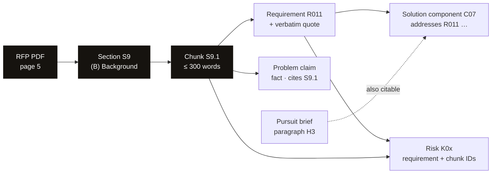
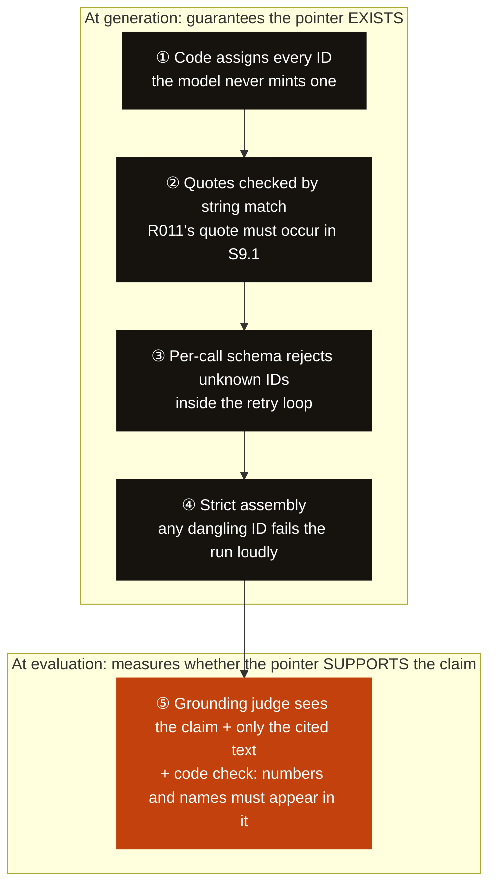
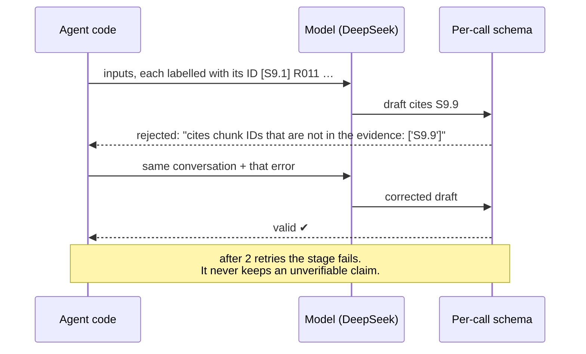
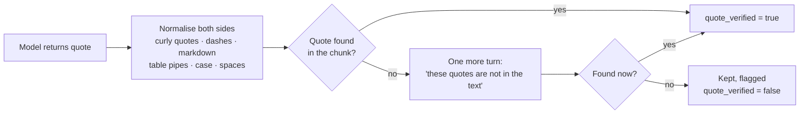
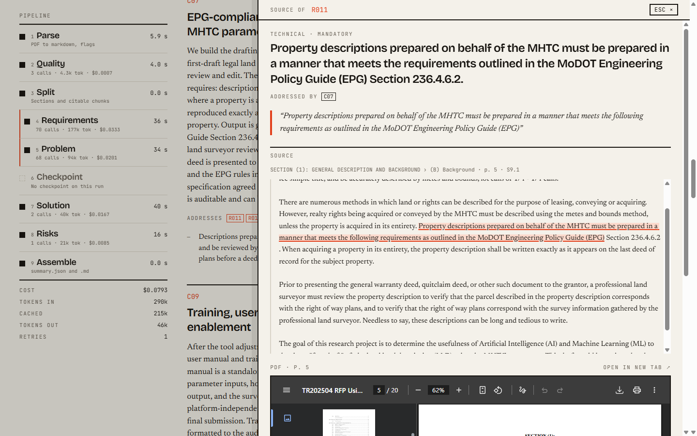

# Traceability harness

> [!IMPORTANT]
> **Every claim points at a numbered paragraph of the RFP, and code, not the prompt, guarantees the pointer exists.**
> Code assigns every ID, checks every quote, rejects unknown IDs inside the retry loop and refuses to assemble a summary with a broken citation.
> Whether the paragraph *supports* the claim is then measured by the evals.

## The numbers

| | Result |
|---|---|
| **Dangling citations** (cited ID that does not exist) | **0** on every scored run (baseline, ablations, current prompts) |
| **Requirements with a verbatim quote** | Every one; quote checked by string match against its chunk |
| **Claims judged unsupported or partial** against *only* their cited text | Problem 3–8 of ~30 · Solution 4–12 of 15–34 · Risks 5–11 of 12 |
| **Who can mint an ID** | Code only. The model copies IDs it was shown |

---

## 1 · The chain: from a PDF page to a risk

| ID | Example | What it is | Assigned by |
|---|---|---|---|
| `S` | `S9` | Section, in document order | Splitter (code) |
| `S.n` | `S9.1` | Citable chunk: ≤ 300 words, cut at paragraphs, never inside a table | Splitter (code) |
| `R` | `R011` | Requirement | Extractor (code, after merging duplicates) |
| `A` / `G` | `A01` / `G01` | Ambiguity / gap: a document the RFP refers to but does not contain | Extractor (code) |
| `C` | `C07` | Solution component | Solution stage (code) |
| `K` | `K01` | Risk; K01 is the top risk after sorting | Risk stage (code) |
| `H` | `H3` | Paragraph of the reviewer's pursuit brief | Code |

**IDs are deterministic.** The same PDF always gives the same `S9.1`, so a citation stays valid across runs.

---

## 2 · Three kinds of statement, three rules

| Kind | Example | Rule |
|---|---|---|
| **Fact** about the client or project | "Descriptions must meet EPG Section 236.4.6.2" | Cites the chunk ID(s) that say it |
| **Inference** | "The $175,000 cap is all-inclusive" | Labelled `inference` + the chunk IDs it is drawn from |
| **Judgment**: a design choice, severity or mitigation | Component C07, risk K03 | Cites the requirement or chunk IDs it responds to |
| **Requirement** | R011 | Keeps a **verbatim quote**, checked by string match |

Anything that cannot meet its rule is **dropped**.

---

## 3 · Five layers of defence

> [!NOTE]
> **Existence is guaranteed by code. Support is measured by the eval.** An ID that exists can still point at the wrong paragraph. Layer ⑤ catches that.

---

## 4 · Layer ③ in motion: the model is told exactly what to fix

- The schema is built **per call**, with the exact set of IDs that call was shown.
- The same validators also enforce the rules beyond IDs. For example, the risk stage **must cite every mandatory requirement the solution left uncovered**.
- Real example from the Missouri run log: `problem_synthesis` was rejected once with *"constraints is empty; every list needs at least one claim"* and passed on the retry.

---

## 5 · Layer ②: quotes are checked, not trusted

**Why keep an unverified item?** A sloppy quote does not make the obligation go away. Dropping it would lose a real requirement. Instead it is flagged and shows up in the report.

---

## 6 · What a reader sees

In the rendered markdown, every citation reads like this:

> MoDOT's Right of Way function must describe every realty right it acquires… by metes and bounds…
> **((B) Background, p. 5 [S9.1])**

The section and page are for a person. The bracketed ID is the key into the JSON.

In the UI, clicking any ID opens the source: the item, its quote **highlighted inside the cited chunk**, and the PDF opened at that page.

---

## 7 · Why chunk IDs and not RAG

| | Retrieval (RAG) | **Chunk-ID citations (chosen)** |
|---|---|---|
| Fits the problem? | Built for corpora too large for one prompt | Each RFP fits in one context window |
| Unsupported claim | Hard to count | **A countable eval metric** |
| Show the source in the UI | Needs a retrieval trace | One ID lookup |
| Cost to build | Vector store, embeddings, a lookup tool | An ID field in a few schemas + code validators |

**Downstream stages never see the RFP text.** The solution and risk stages see only the problem statement and requirements, each labelled with IDs. So they can only cite what they were shown.

---

## 8 · Limits

- **An ID that exists may still be the wrong one.** Layer ⑤ measures it, and the grounding judge rates claims as supported, partially supported or unsupported.
- **Risks are often "partially" supported** (5–11 of 12). A risk looks forward and combines several facts, so no single paragraph states it in full.
- **The entity check over-flags.** It looks for numbers and capitalised names missing from the cited text (7–23 per run). It finds real misses, for example Missouri's commission cited to chunks that do not name it, but also style capitals. So it is a pointer, not a score.

---

<b>Detail:</b> where it lives in code

| What | Where |
|---|---|
| ID formats (regex) and `validate_ids_exist` | `src/rfp_agent/schemas.py` |
| Chunk and section IDs | `src/rfp_agent/splitting/` |
| Quote normalisation and matching | `src/rfp_agent/textmatch.py` |
| Quote check + one fix turn | `src/rfp_agent/agents/requirements.py` |
| Per-call citation schemas | `problem_schema` in `agents/problem.py`, `risk_schema` in `agents/risk.py`, the solution equivalent in `agents/solution.py` |
| Strict assembly, `CitationError` | `src/rfp_agent/render/assemble.py` |
| Citation rendering `(Section, p. 4 [S3.2])` | `src/rfp_agent/render/markdown.py` |
| Grounding eval (code + judge) | `evals/harness/grounding.py`, `prompts/judge_grounding.md` |
| UI source reveal | `ui/frontend/src/components/SourcePanel.tsx` |

<b>Detail:</b> the guards in each stage

| Stage | Sees | Guard |
|---|---|---|
| Requirements | One chunk at a time | Code attaches the chunk ID and assigns `R…`. Quote checked. Duplicate grouping checked: every ID exists, none in two groups |
| Problem statement | Per-chunk summaries labelled with their chunk IDs | Schema rejects an empty list or an ID not in the evidence |
| Solution | Problem statement + requirements (IDs), never the RFP text | Schema rejects unknown requirement or chunk IDs. Coverage computed by code |
| Risks | Solution + problem + requirements, never the RFP text | Schema rejects unknown IDs and a count outside 3–15, and requires every uncovered mandatory requirement to be cited |
| Assembly | Everything | Every cited ID checked against the split document and the requirement list |
| Human revision | Reviewer instruction | Re-runs the producing stage's own validators; refuses a revision that loses coverage |

<b>Detail:</b> strict vs non-strict assembly

- `assemble()` raises `CitationError`, listing every dangling ID and where it sits, unless `strict=False`.
- The non-strict path exists so the eval harness can still **score** a run with a bad citation and count it.
- The renderer never raises: an unknown ID prints as a bare `[S9.9]`.
- One golden-file test covers every render branch, so any change in output shows up as a diff.

<b>Detail:</b> failure modes this caught

- **F6:** synthesis claims spoke of "the evidence" instead of the RFP. Prompt rule added.
- **F8:** the extractor reported other sections of the same RFP as gaps. Fixed in the prompt.
- **F10:** solution assumptions cited ambiguity and gap IDs (`A02`, `G06`) as chunk IDs. **The schema rejected them and the retry fixed it**, so the output was already safe. The prompt was then clarified to save the retry.
- **F12:** 13 risks on every RFP against "six to twelve". That was still inside the schema's 3–15 band, so no retry. A prompt rule brought two RFPs to 12. The schema band is the contract; the range in the prompt is advice.

<b>Detail:</b> decisions behind this harness

- [D4](../archive/DECISIONS-full.md#d4-chunk-id-citations-instead-of-retrieval-based-grounding): chunk-ID citations instead of RAG
- [D16](../archive/DECISIONS-full.md#d16-markdown-layout-citation-format-strict-assembly): citation format, strict assembly
- [D17](../archive/DECISIONS-full.md#d17-structured-output-provider-native-mode-inside-a-code-owned-retry-loop): retries owned by code
- [D29](../archive/DECISIONS-full.md#d29-quote-verification-one-feedback-turn-then-keep-the-item-as-unverified): quote verification
- [D37](../archive/DECISIONS-full.md#d37-grounding-code-heuristics-plus-a-judge-that-sees-only-what-is-cited): grounding judge sees only the cited text
- [D45](../archive/DECISIONS-full.md#d45-the-pursuit-brief-is-citable-evidence-row-actions-are-deterministic-the-reviewer-is-a-name): the pursuit brief is citable evidence

